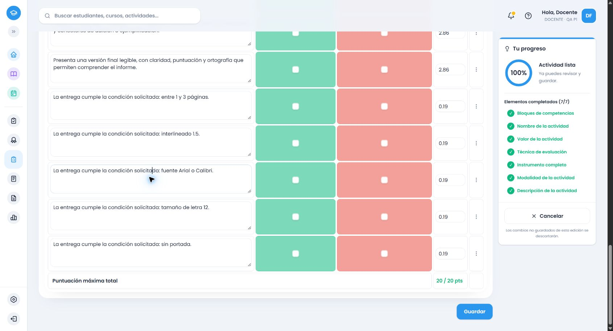

# Cierre: consignas naturales y adición de criterios

15/10/2026. Encargo del adjunto `50f00616-6622-4f7d-93f7-dbf4e5c7fea8`. Rama `amplia-instrumentos-secundaria`, repositorio `thebuuba/Proyecto-educativo-v3`. Corrección compartida; sin ampliación curricular, subagentes, IA de aplicación, dependencias, cambios de permisos, migraciones, reset, main ni despliegue.

## Causas confirmadas

1. **Filtro gramatical demasiado restrictivo.** Las formas ambiguas requerían un verbo seguido casi inmediatamente del nombre. «Utilizando las estructuras gramaticales will y going to» perdía ambas; «con» tampoco era una solicitud reconocida. Se amplía el vocabulario intermedio admitido y se conserva la coordinación: `y` solicita ambas; `o, a elección` una alternativa. Se mantienen fronteras de palabra y exclusión de recursos/negaciones. En primero se conserva el verbo de reconocimiento al volver a resolver el segmento extraído; sin ello la nueva guarda perdía requisitos ya reconocidos. Las listas largas siguen completas y el límite se aplica después de adaptar el formato.
2. **Modalidad única usada como evidencia única.** El proveedor elegía presentación oral y no añadía la evidencia escrita de la misma frase. El resolvedor común incorpora las dos dimensiones explícitas usando los descriptores del grado, sin duplicar las funciones ni imponer dos productos cuando la consigna ofrece una alternativa. El tipo principal continúa siendo Presentación oral, técnica Presentación y recomendación Rúbrica: son adecuados para esta consigna mixta.
3. **Agregar agotaba un conjunto ya incompleto.** La respuesta inicial y el pool .66 contenían los mismos tres objetivos. El editor no estaba descartando candidatos válidos ni sustituyendo una respuesta contextual correcta. El aviso existía, pero estaba arriba y caducaba a los ocho segundos. Ahora el estado permanece junto al instrumento y la opción manual, con cierre explícito. Se conservan el bloqueo de duplicados, el estado del botón, el control de respuestas obsoletas y la confirmación de redistribución manual. Los errores de la petición aparecen allí y permiten reintentar. Con un candidato disponible se añade una fila completa; agotado el pool no se fabrica otra.
4. **Condiciones de entrega desconectadas.** No había una representación compartida de páginas, interlineado, fuente, tamaño, portada, apartados o cantidades expresas. El lector compartido genera evidencia solo para las condiciones reconocidas y valida contradicciones en servicio, alternativa y formulario. Distingue cantidad exacta, mínimo, máximo, intervalo, alternativas y exclusión. No traslada el límite de ejemplos a páginas. Se probaron dos cantidades incompatibles en una misma frase.
5. **Alternativa local con contexto insuficiente.** Algunas rutas dedicadas usaban el indicador de grado opcional sin derivarlo del contexto autorizado de Lengua Española. Esto podía producir una plantilla distinta de la del servicio. Se resuelve el grado antes de recorrer esas rutas. Se reconocen «hacen un informe» y errores de escritura acotados compartidos, sin una plantilla por título.
6. **Informe de lectura convertido en investigación.** La inspección de instrumentos completos encontró un título que suponía texto literario en primero y un reemplazo por investigación en informes breves fuera del proveedor temático de tercero a sexto. Se conserva el referente noticia y se usa síntesis/interpretación del material leído. Esos últimos casos son `ACTION_ONLY`, sin atribuirles cobertura curricular nueva.
7. **Verbo irregular en ejercicios.** «Resuelven ejercicios de suma y resta» quedaba en Otra actividad, perdía resta y exigía unidades no solicitadas. Se reconoce la acción y se ofrecen dos evidencias básicas de procedimiento/resultados para las operaciones indicadas. Esto no implementa ni cierra Matemática de ningún grado.

## Recorrido comprobado y catálogo

Inicio: HEAD `dc50778c113161762b97ca4f4be56d2b1044929f`, limpio y publicado. El proceso que atendió la reproducción registraba `75ed6e9dd5d217afccdab30c59df874fdea9b49a`, `dirty: true`, inicio `2026-10-15T09:42:26.527Z`, catálogo `.66`. No se atribuye retroactivamente al proceso un commit posterior.

Entorno final: Chrome habitual autenticado con cuenta ficticia, frontend Vite `localhost:5173`, API backend `3000`, Supabase local `127.0.0.1:54321`. No es el entorno `8787` ni la base remota. El proceso final registra base `dc50778…`, `dirty: true`, inicio `2026-10-15T10:32:24.253Z`, catálogo **`evaluation-2026.69`**. Los cambios probados se publican en el commit de este cierre; su hash y push se confirman en la entrega/Git.

El instalador rechazó correctamente cambiar un release existente. Se congelaron `.66`, `.67` y `.68`; `.69` alinea el módulo declarativo de informe con el proveedor corregido. La conciliación compara íntegramente el catálogo del código con los cuatro payloads instalados `.66`–`.69`: coinciden. Los dos primeros CRUD permanecen en `.67`; el informe se guarda en `.69`. No se reescriben snapshots anteriores.

Traza del caso exacto: descripción del editor → asignación autorizada de cuarto/ING → proveedor común de cuarto → función planes → solicitudes `going-to` y `will` → género presentación → evidencia oral y escrita → propuesta → conversión al editor → snapshot guardado/reabierto. El total pendiente deja vacíos los puntos; no suprime las evidencias. Las cinco progresiones declaradas se adaptan a los niveles configurados del editor.

Antes: `ing-4-plans`, `ing-4-genre-presentation`, `ing-4-intelligibility`. Después: esos tres más `ing-4-feature-going-to`, `ing-4-feature-will`, `ing-4-written`. Inicial y pool contienen los seis; no se reservan requisitos para Agregar. «Will» en planes evalúa comunicar una intención/decisión futura; no exige una predicción distinta del encargo ni valora la calidad de las aspiraciones personales. Los referentes ficticios siguen admitidos.

## Requisitos por caso

| Consigna | Se representa | No se añade |
|---|---|---|
| My Future Plans exacta | Plan comunicado, ambas formas, ideas relacionadas, comunicación oral y escrita | Juicios sobre las metas, biografía, cantidad de oraciones, fuentes o materiales |
| Presentan sus planes en inglés con will y going to | Plan, ambas formas y discurso oral: cuatro objetivos | Escritura, investigación o formato |
| Usando will o going to, a elección | Un objetivo gramatical con alternativa explícita | Exigir ambas estructuras |
| Informe breve de una noticia | Síntesis e interpretación; proveedor del grado cuando corresponde | Convertirlo en cuento o investigación, exposición o bibliografía |
| Informe con condiciones | Entre 1 y 3 páginas, interlineado 1.5, Arial o Calibri, tamaño 12, sin portada | Otra fuente, tolerancias, ni decidir si la portada cuenta en el límite |
| Comparan dos noticias | Contraste sustentado; fuera del proveedor del grado, evidencia de acción limitada | Escribir otra noticia, investigación o conclusión independiente no pedida |
| Suma y resta | Procedimiento y resultados de ambas operaciones | Unidades, exposición, materiales o cobertura temática de Matemática |
| George Washington | El nombre permanece en la descripción enviada | Fechas, cargo, acontecimientos o supuesta comprobación histórica |

Formato tiene peso relativo agregado 1, repartido entre sus partes en cotejo. Se conserva la política existente de distribución por centésimas y los pesos manuales; el formato no domina automáticamente. Estructura del informe y condiciones tipográficas siguen siendo dimensiones diferentes. No se inspeccionan archivos entregados.

## Verificación automática

- RED del caso real, formas con palabras intermedias, modalidades, ausencia de condiciones, contradicciones y feedback junto al control. Se observaron los fallos antes de corregirlos; después se amplió la regresión con negativos, errores leves y límites de unidades.
- Backend final: **36.796 pruebas / 93 archivos**, aprobadas (`consignas-backend-catalog-final.log`, log local excluido).
- Frontend completo final: **37.457 / 119**, aprobado (`consignas-frontend-definitivo.log`). Contratos dirigidos: **278 / 2** después de las últimas correcciones de formato/interacción. Los cruces incluyen Lengua Española e Inglés común 1.º–6.º, cuatro formatos, 20/17.35, puntaje pendiente, servicio/alternativa, candidato agotado, completar vacío/parcial, identidad y puntos.
- Se incluyen respuestas tardías después de editar, eliminar o cambiar contexto; no sobrescriben el borrador. Se prueba bloqueo de doble clic, error 400/403 sin alternativa y servicio 503 con procedencia local visible.
- Inventario/conciliación: **11 pruebas**, aprobadas. Auditoría estructural de la matriz: solo `pending`/`serviceVerification` de 12 ámbitos comunes y 133 registros temáticos recibieron seguimiento; los cierres originales, otros ámbitos y optativas permanecen iguales.
- Compilaciones backend y frontend aprobadas; `pnpm cloudflare:build` termina en **`--dry-run: exiting now`**. Sin despliegue. Permanecen avisos conocidos de tamaño de bundle y `scrollTo` de jsdom; las suites pasan.

## HTTP real, separado de navegador

[Servicio final .69](evidencias/consignas-servicio-69.json): **264 respuestas**, cuatro interpretaciones naturales y cuatro rechazos 400 por contradicción. Cuatro formatos y totales 20/17.35. Incluye caso exacto, títulos neutrales, variantes breves, ambos idiomas en patrones definidos, negativos, referente nominal, comparación e informes de los seis grados. Se comprueba pertinencia de requisitos y exclusiones además de filas/puntuación.

[Seguimiento de unidades .69](evidencias/consignas-unidades-69.json): ocho respuestas/rechazos, límite de páginas separado del de ejemplos y cantidades exactas incompatibles. El backend requiere total positivo: pendiente se verifica en contratos del editor y navegador, sin simular un guardado HTTP con cero.

Se conservan [reproducción .66](evidencias/consignas-antes-66.json), [estado visible anterior](evidencias/consignas-navegador-antes-66.txt) y [ejercicios antes](evidencias/consignas-ejercicios-antes-67.json). La primera pasada .67 permitió encontrar el error semántico de informes; la verificación completa se repitió en `.69` después de corregirlo. No se presenta esa pasada intermedia como cierre.

## Navegador y persistencia real

[Campos capturados en Chrome](evidencias/consignas-flujos-navegador.json), [actividades y snapshots](evidencias/consignas-persistencia.json). Guardar → confirmación → Actividad creada → volver a listado → navegación nueva al enlace Editar → comparación de campos y puntos → contraste HTTP con snapshot.

| Caso | Actividad local | Formato / total / catálogo | Evidencia |
|---|---|---|---|
| My Future Plans exacta | `d8ba8d93-e9e7-4449-ab4e-b6e5f3ff46d0` | Rúbrica / 20 / .67 | Seis objetivos desde el inicio; pendiente; agotamiento visible; fila totalmente vacía completada; descriptor parcial completado; título y puntos manuales 4.5/2.5/3/4/3/3 conservados |
| Consigna breve | `584fde4e-fb8a-4e8f-b469-ae8a6648c747` | Ponderada / 17.35 / .67 | Elección manual anterior a describir respetada; cuatro objetivos; pesos y campos iguales al reabrir |
| Informe y formato | `0d0640ae-f839-4074-a3e7-6b67f9d3b5d0` | Cotejo / 20 / .69 | Diez filas, cinco de contenido y cinco de entrega; contradicción visible bloquea Guardar y conserva campos; diez puntos pendientes vacíos; posterior guardado válido y reapertura idéntica |

Además, [Agregar con candidato disponible](evidencias/consignas-agregar-candidato-69.json) se recorrió realmente en otro borrador ficticio: se retiró la evidencia escrita del borrador, Agregar restituyó la fila completa y conservó el texto manual de otra fila. **No se guardó en la base**; no se cuenta como cuarto CRUD ni persistencia. El borrador de prueba puede permanecer en el dispositivo.

[Conciliación final](evidencias/consignas-conciliacion-despues-69.json): **138 = 108 + 28 + 2**, sin solapamientos. Antes: **135 = 105 + 28 + 2**. Los 135 hashes completos de snapshots previos permanecen idénticos. Hay 138 actividades, 138 instrumentos y 138 snapshots en este conjunto local, cero predecesores; no es una garantía general de relación uno a uno del modelo.

## Soporte lingüístico real y pendientes

El motor es determinista y reconoce patrones definidos; no comprende cualquier consigna. Se verifican redacciones españolas sin tildes, formas futuras y títulos en inglés, variaciones de orden y cinco correcciones de palabra acotadas: `precentan`, `escriven`, `comapran`, `letura`, `utilisando`. No se implementa corrección ortográfica general ni una plantilla por frase.

En instrucciones inglesas se verifica en cuarto `Write a message using will and/or going to`; los proveedores existentes conservan sus patrones específicos de lectura/escritura. Esto **no acredita comprensión general de inglés**, todas las órdenes inglesas en todos los grados, ni negación inglesa libre. Redacciones ambiguas y patrones no reconocidos requieren selección/edición docente.

El lector de entrega admite números arábigos y palabras de uno a veinte, condiciones expresas probadas, y fuentes Arial/Calibri/Times New Roman en las construcciones definidas. Otras familias tipográficas, cantidades con referentes semánticos complejos y restricciones no enumeradas quedan pendientes de nuevos ejemplos y reglas. No se promete interpretar requisitos arbitrarios ni verificar documentos automáticamente.

Lengua Española e Inglés conservan el cierre previo **de sus familias definidas** con este seguimiento. No se convierte una consigna de noticia de otro grado en un género curricular implementado. La matriz señala el límite `ACTION_ONLY` y no declara cerradas Matemática, Francés, optativas ni otras áreas. Sin pendientes conocidos en los casos y patrones exigidos aquí; los límites anteriores quedan documentados, no marcados como completados.

## Archivos y entrega Git

Motor compartido: `english-feature-request.ts`, `secondary-english*.ts`, `evaluation-task-contract.ts`, `evaluation-task-text.ts`, `task-delivery-requirements.ts`, `action-content-criteria.ts`, `secondary-topic-recommendation.ts`, detección de Lengua y fuente del informe de primero. Backend: catálogo actual y congelados `.66`–`.68`, motor, servicio y `natural-task.spec.ts`. Frontend: preparación local, validación del borrador, `ActivityCreationView`, `InstrumentPreview` y contratos/pruebas de interacción. Scripts: reproducción, HTTP, unidades, persistencia, conciliación y ejemplos. Documentación: este informe, instrumentos completos, plan, matriz, avance y continuación. Credenciales, cuentas locales, `.env`, logs y archivos de trabajo temporales quedan excluidos.

Los [ocho instrumentos completos](consignas-ejemplos-completos.md) incluyen el anterior, las cuatro salidas del servicio para My Future Plans y los tres instrumentos realmente guardados. Los JSON conservan el resto de formatos/totales sin resumirlos a sumas o conteos.

Commit español y push normal a `origin/amplia-instrumentos-secundaria`; sin force, mezcla ni despliegue. El hash final, resultado del push y estado del árbol se verifican y confirman al entregar, sin inventar un hash autorreferencial en este documento.
