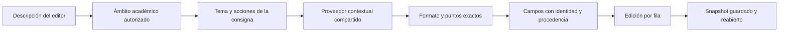

# Corte verificado: composición y ampliación curricular .14–.17

Se corrigió el flujo compartido y se cerraron tres reauditorías posteriores, afiche, cuento policíaco y caligrama de 1.º. **La cobertura de toda secundaria no está terminada.** Los bloques son parciales y sus requisitos pendientes permanecen registrados. Este informe consolida el corte entregado; no equivale a finalizar los 72 ámbitos ni los 385 candidatos a tema del inventario.

## Causas confirmadas

1. Matrices se atendía mediante dimensiones generales, con el título completo concatenado en indicadores. Había contenido inventariado, pero no un proveedor temático conectado.
2. Título y descripción se mezclaban al detectar temas; un título antiguo podía contaminar criterios y referentes aunque cambiara la consigna.
3. Candidatos adicionales se rellenaban con dimensiones generales; las ediciones ocultaban identidades y permitían duplicados. Faltaba completar una sola fila conservando sus otros campos.
4. La conversión y configuración podían perder descriptores, repetir niveles y redistribuir puntos al modificar únicamente niveles.
5. Interpretación y recomendación resolvían de forma distinta el DRAFT local. Dos guardados perdieron ámbito; la evidencia se conserva y el flujo de desarrollo ahora resuelve igual.
6. En los tres núcleos reauditados de Lengua, niveles inferiores generales y proveedores locales distintos añadían objetivos ausentes: preguntas, gráficos, conclusión, dramatización o desempeño individual redundante.

La investigación científica anterior confirmó también un 503 del catálogo remoto desactualizado, contenido curricular sin conexión al motor y alternativa que clasificaba un dibujo científico como producción artística. No era ausencia de contenido curricular. [Auditoría completa de células/Ohm](ciencias-celulas-ohm.md).

## Flujo corregido

El título se conserva en el encabezado y puede ayudar a detectar tema; no se concatena para simular criterios específicos. Una descripción incompatible prevalece. Servicio y alternativa usan los proveedores compartidos; una respuesta válida no se sustituye por el formato automático provisional. Fallos de autorización/validación no habilitan una alternativa local que los oculte.

Añadir criterio selecciona candidatos no utilizados, excluidos por identidad aunque cambie su nombre. Mantiene ediciones, peso relativo y total; protege redistribución manual con confirmación. Agotar el conjunto permite una fila manual con aviso. Completar criterio actúa solo en campos vacíos; una intención ambigua no se rellena con texto genérico. Respuestas obsoletas por edición, reordenación, contexto o formato se descartan. Quinto nivel se basa en progresión autorada; sexto no se inventa. [Detalle, límites y archivos del flujo compartido](composicion-y-filas.md).

## Selección automática del instrumento

No se confirmó una rúbrica inicial manual: el formulario nuevo empieza sin instrumento. Los fallos reales eran rechazar formatos distintos al provisional automático, pasar ese provisional como preferencia docente y recomendar rúbrica en la alternativa para ejercicios. Se corrigieron manteniendo prioridad de cualquier elección explícita y protección de borradores antiguos de origen desconocido.

| Consigna comprobada | Recomendación | Motivo |
|---|---|---|
| Informe argumentado, evidencia y conclusiones | Rúbrica | Varias dimensiones y calidad progresiva |
| Presencia/ausencia de características de hojas | Cotejo | Cumplimiento verificable |
| Regularidad de equilibrio y coordinación | Escala | Grado o regularidad del desempeño |
| Cálculos de Ohm con procedimiento y resultado | Ponderada | Componentes con pesos/puntos |

No hay cuotas ni variedad forzada. Rúbrica permanece cuando corresponde; las selecciones manuales de los cuatro formatos se guardaron y reabrieron. El control trigonométrico y matrices mostraron recomendación ponderada automática en navegador. [Causas, reglas y verificaciones](ciencias-celulas-ohm.md#hallazgo-adicional-selección-automática-del-instrumento).

## Instrumentos completos y fidelidad a las consignas

- [Matrices 5.º, cuatro formatos completos](matrices-instrumentos-completos.md): filas/columnas, dimensiones/operaciones pertinentes, cálculo, justificación e interpretación contextual. No se imponen todas las operaciones a cada situación.
- [Células 2.º y Ohm 6.º, ocho instrumentos completos](instrumentos-ciencias-completos.md): estructuras, ambos tipos celulares, funciones, comparación y explicación; datos/incógnitas, aplicación/despeje, cálculo/unidades, interpretación y esquema. Maqueta o dibujo son alternativas; el circuito se esquematiza, no se exige construirlo.
- [Control original de trigonometría](trigonometria-instrumentos-completos.md): se registra que retoma contenido oficial de 5.º, sin inventar respaldo curricular de 6.º.
- [Afiche](afiche-instrumentos-completos.md), [cuento policíaco](cuento-instrumentos-completos.md), [caligrama](caligrama-instrumentos-completos.md): indicadores y progresiones por acción; las evidencias JSON conservan las demás familias y ambos totales.

## Verificación real y límites

Bloque compartido .14: 32 instrumentos matemáticos, un candidato adicional y 23 regresiones; siete actividades guardadas/reabiertas en navegador, incluidos texto manual, quinto nivel, completar celdas, candidatos agotados y peso relativo. Afiche .15: 64 propuestas y siete regresiones. Cuento .16: 80 y ocho. Caligrama .17: 80 y nueve. Cada núcleo posterior tiene cuatro formatos persistidos desde navegador, con edición manual y celdas completadas. Login real de cuenta ficticia, contexto académico real y proxy habitual; no simulación de persistencia ni interrupción deliberada del servicio principal.

Últimos checks: **backend 1.214; frontend 809; inventario siete**. Builds backend/frontend y Cloudflare `--dry-run` aprobados. La comprobación final del proveedor frontend tiene 61 casos. Normalización, otros temas/asignaturas, títulos neutrales/incompatibles, 20/17,35, pendiente y preferencias manuales conservan sus regresiones.

La lectura HTTP comprueba identidad, plantilla, ámbito/versión, indicadores, máximos y textos de desempeño tras reabrir. Caligrama contrasta esos contenidos directamente con las respuestas del servicio. Cotejo/ponderada representan sus opciones nativas como niveles internos de calificación; el editor no incorpora niveles de rúbrica a cotejo.

No todos los negativos de concurrencia/permisos fueron reproducidos visualmente: tienen pruebas automatizadas. No se comprobó subida de archivos. No hay asignatura completa ni instrumentos optativos verificados; los contextos QA de optativas aún no están sembrados. Gramática focalizada, más candidatos y algunas familias/modalidades visuales permanecen pendientes por tema. La matriz corrige estados `IMPLEMENTED` de los seis núcleos de Lengua 2.º a parciales, conservando su conexión y evidencia HTTP aislada. [Cobertura por asignatura y grado](cobertura-por-asignatura-grado.md), [matriz detallada](matriz.csv).

## Rama, catálogo y ejecución

Repositorio `https://github.com/thebuuba/Proyecto-educativo-v3.git`, rama `amplia-instrumentos-secundaria`; sin mezcla con main, producción ni resets.

| Bloque publicado | Commit funcional |
|---|---|
| Composición y filas .14 | `2bcad9b4a42263a2fab1480f7a47abe48f89d0b0` |
| Afiche .15 | `b90a492a1d661227924e80fd30123e92cad955e6` |
| Cuento .16 | `7a75486fba93bd7439516c515b1a81a5432c76c1` |
| Caligrama .17 | `f037918ad4204bbfe37ad779be838be55d4c1407` |

Frontend 5173 → backend 3000 → Supabase local 54321/54332. El arranque final confirma `f037918…`, `dirty=false` y `evaluation-2026.17` en [health capturado](evidencias/entorno-catalogo17-ejecutado.json). El commit posterior `f1a88f232c0d172b40f463fc3cb6b2a0eaef9a26` registra esa evidencia y no cambia código. Cada bloque se publicó mediante push a la misma rama; los releases anteriores conservan sus huellas. No se hicieron cambios de esquema ni dependencias.

Archivos funcionales compartidos y de UI se enumeran en `composicion-y-filas.md`; los temáticos, pruebas y verificadores en cada reauditoría .15/.16/.17. [Lista exacta del corte](archivos-del-corte.txt). Próxima continuación: requisitos lingüísticos focalizados de noticia/guía/informe, reauditoría de Lengua 2.º y los grados 3.º–6.º, después Ciencias, otras comunes y optativas, según `continuacion.md` y `avance.md`. Graphify está desactualizado y sin CLI operativa; el rastreo se basó en código actual. No se usaron subagentes.
