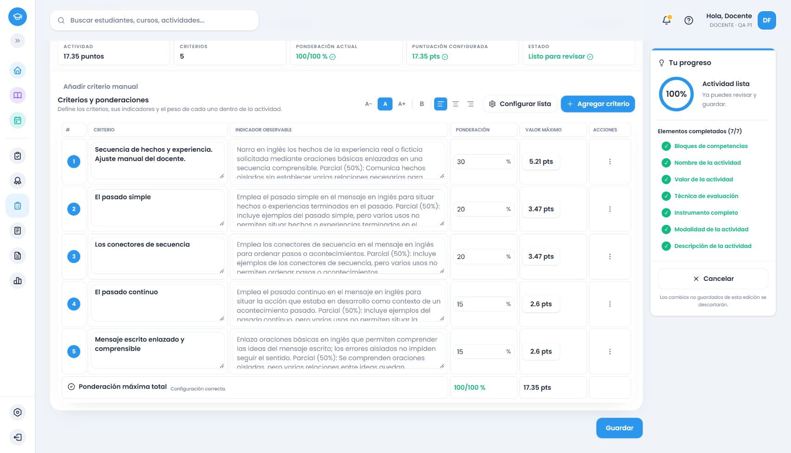

# Inglés común de segundo: cierre de familias definidas

Fecha de trabajo:14/10/2026, República Dominicana. **Este cierre corresponde a2.º; el encargo de2.º–6.º continúa.** Fuente oficial MINERD: PDF140–145, páginas impresas139–144, primer ciclo, Inglés común, ámbito `7e4c1236-8f04-5817-b017-a9ace9edff5e`. No incluye optativas.

## Cobertura y fuente

[Cotejo de los196 registros](ingles-2-cotejo-fuente.json), con ID, página, decisión, proveedores y verificación; [matriz](matriz.csv). Se revisaron visualmente las seis páginas, incluidas las continuaciones gramaticales143/144 con otras columnas vacías. Los conceptos quedan reagrupados en13 ámbitos cotidianos y tres grupos de vocabulario, expresiones y gramática. Se conservan todos los registros originales, sin duplicarlos ni fabricar filas fuente. La primera forma gramatical sirve de ancla del grupo porque el encabezado aparece incrustado en el registro anterior de deseos.

Conectadas nueve funciones comunicativas;41 familias gramaticales con83 formas/sinónimos ensayados en reconocimiento, explicación y uso;27 familias léxicas y13 expresivas;22 estrategias observables; géneros diferenciados por modalidad:28 de recepción,8 de producción oral y11 escrita. Ocho condiciones comunicativas observables, nueve contratos de composición y los marcos/indicadores de logro tienen asociaciones condicionales documentadas. Mencionar un ámbito no añade una fila por su nombre. La producción audiovisual requiere una consigna explícita; no se presenta como un género inventariado en esa lista oficial.

Los cuatro formatos usan la misma resolución: rúbrica con progresiones propias; cotejo con evidencia verificable; escala de grado o frecuencia según el propósito; ponderada con cumplimiento parcial y pesos. Pendiente,20 y17.35 conservan reparto exacto e independiente del orden de introducir el total.

**Limitación de fuente:** PROCEDURE20 dice literalmente «Identificación de que se comprensión oral». Se excluye expresamente su significado indeterminado, sin sustituirlo por la habilidad de primero. Situación e intención sí se conectan por sus registros oficiales explícitos. Una fe de erratas oficial permitiría resolver esa atribución. Motivación, ansiedad, autocontrol, humildad, identidad familiar y flexibilidad interna se excluyen de puntuaciones de personalidad. Las demás actitudes se traducen solo a mensajes o situaciones explícitos y observables; no se califican datos privados, posesiones o hábitos reales.

La cobertura se limita a las familias y patrones definidos y ensayados. No se promete interpretar cualquier redacción imaginable. Un paráfrasis manual sin coincidencia suficientemente específica se conserva y recibe un aviso; el motor no impone por identidad un objetivo distinto.

## Causas corregidas

- La ampliación de funciones no conectaba todavía todas las familias gramaticales, léxicas, procedimentales y discursivas propias de segundo. Ahora el proveedor compartido las compone; servicio y alternativa local coinciden. Los parámetros reutilizables conservan los valores predeterminados de primero.
- Se distinguieron acciones finitas independientes de infinitivos de propósito y recursos de apoyo. Lectura/escritura, reconocimiento/uso, investigación/comparación y presentación posterior conservan sus evidencias, sin convertirlas en una sola modalidad.
- La detección de palabras ambiguas como May, Will o for exigía contexto de requisito gramatical. Las alternativas can/could y correo/carta dejan de convertirse en exigencias simultáneas. Se corrigieron usos propios del pasado continuo, will de pedido y presente continuo de compra.
- Chrome reprodujo la omisión de «revisarán el significado y la corrección del mensaje» y de la respuesta escrita al interlocutor. Prueba roja y corrección .51; la rúbrica real incluye ambas evidencias.
- El cotejo real del menú expuso que `compr\w*` confundía «comprobar» con «comprar». Prueba roja y corrección .52: productos/precios y subrayado, sin compra implícita.
- La revisión de la ponderada expuso que experiencia/narración puntuaban dos veces los mismos acontecimientos. Prueba roja y corrección .53: una evidencia de hechos; los componentes narrativos explícitos siguen incorporándose.

No se añadieron IA, dependencias, rediseño, migraciones ni cambios de instrumentos históricos.

## Verificación

| Nivel | Evidencia y resultado |
|---|---|
| Backend vigente .53 | `pnpm --filter backend test`:10.210 pruebas,71 archivos, aprobados. Incluye negativas, alias, títulos incompatibles, modalidades, alternativas, aislamiento, selección y capacidad. |
| Frontend vigente .53 |3.412 pruebas en el contrato integral de segundo y flujo compartido de filas, aprobadas. Paridad servicio/alternativa, campos, progresiones, totales y puntaje pendiente. |
| Regresión reciente reutilizada | Suite frontend completa14.820/113 en .49 y5.169 verificaciones específicas en .50. Los cambios posteriores se acotan a segundo y tienen contratos específicos ejecutados; no se atribuyen esas cifras al último árbol como una suite completa nueva. |
| Inventario | Nueve pruebas aprobadas tras reagrupar y actualizar la matriz. |
| Compilación | Backend y frontend aprobados; `pnpm cloudflare:build` aprobado en dry-run, sin despliegue. |
| HTTP autenticado .53 |158 casos definidos, un formato por caso rotado, totales alternos20/17.35; ocho recomendaciones de selección (cuatro propósitos × dos totales), cuatro rechazos de exceso y cuatro conjuntos de candidatos mayores que20. [Respuesta íntegra y runtime](evidencias/ingles-2-integral-servicio.json). La matriz de todos los formatos/totales pertenece a pruebas automáticas, no a158×8 solicitudes HTTP. |
| Chrome habitual | Cuatro consignas cotidianas: generar→editar→resumen→guardar→reabrir. Rúbrica20, cotejo17.35, escala20 y ponderada17.35. [Campos observados](evidencias/ingles-2-final-flujo-navegador.json), [snapshots cotejados](evidencias/ingles-2-final-persistencia.json), [instrumentos completos](ingles-2-ejemplos-finales.md). |
| Históricos |108 snapshots de la base de segundo intactos,28 de referencia y86 instrumentos completos verificados;116 snapshots actuales. [Comprobación](evidencias/lengua-historicos-evaluation-2026.53.json). |

En Chrome se observaron las cuatro recomendaciones directamente en el selector: rúbrica para calidad en lectura/respuesta/revisión; cotejo para presencia de datos/subrayado; escala para regularidad en intercambios; ponderada para componentes con pesos. Las elecciones explícitas del docente siguen cubiertas por las pruebas compartidas y solicitudes con formato preferido; esos casos no se presentan como cuatro recorridos visuales manuales adicionales.

Operaciones reales: agotamiento conserva las dos filas del cotejo y ofrece edición manual; completar la fila vacía repone la evidencia disponible. En escala, completar un descriptor conserva los textos del indicador y los otros niveles; una paráfrasis no reconocida se conservó con aviso antes de probar la coincidencia compatible. En ponderada, completar un indicador vacío conserva pesos30/20/20/15/15 y valores5.21/3.47/3.47/2.60/2.60. Identidades, objetivos, textos y puntos se contrastaron con snapshots persistidos; no son callbacks simulados. Los demás escenarios de filas/capacidad/respuestas obsoletas tienen contratos automáticos y HTTP según corresponda.

La rúbrica fue guardada en .51; cotejo y escala en .52; ponderada en .53. Las correcciones posteriores no afectan las consignas anteriores. Las pruebas se ejecutaron sobre `b769b19d587b74030d6cb2dee6d87c77b3273ba8` más cambios pendientes, `dirty:true`; no se atribuye retroactivamente el hash del commit de cierre a esos procesos. Catálogos .48–.52 congelados, .53 instalado y cargado en backend3000, frontend5173, Supabase local54321. Solo cuenta ficticia autorizada.

Los reinicios de Vite vaciaron formularios de prueba no guardados, que se reintrodujeron. No se afirma que esos reinicios recuperaran íntegramente el borrador. Una captura completa excedió el tiempo disponible; se obtuvo la vista visible de la ponderada reabierta. Durante la automatización, dos acciones mediante clic no activaron el destino previsto; se verificó el estado y se usó teclado, sin modificar instrumentos históricos.

## Cambios y continuidad

Archivos principales: `packages/shared/src/secondary-english-grade-two{,-grammar,-lexicon,-strategies,-genres,-context}.ts`; parámetros opcionales en helpers de primero; exports compartidos; catálogo y traza backend; seis contratos de datos adicionales, pruebas backend de cada familia y `englishGradeTwoFullContract.spec.ts`; scripts de HTTP/cotejo/ejemplos y matriz/evidencias/documentos de continuación. No se alteraron las listas curriculares ni el despacho de primero para trasladarles contenido de segundo.

Revisión propia del flujo y diff, sin subagentes por instrucción del usuario. Los hallazgos de contenido detectados se corrigieron con pruebas que fallaron antes de la solución. `git diff --check` aprobado; archivos locales de cuentas, credenciales, .env, logs y temporales excluidos del cierre. Rama `amplia-instrumentos-secundaria`, origen `https://github.com/thebuuba/Proyecto-educativo-v3.git`; el hash y resultado del push se confirman con Git al publicar.

**Siguiente pendiente:** Inglés común3.º, PDF146–151. Leer/cotejar visualmente su fuente y definir requisitos propios antes de implementar. Después4.º–6.º en ese orden. No comenzar Francés ni optativas de Inglés.
