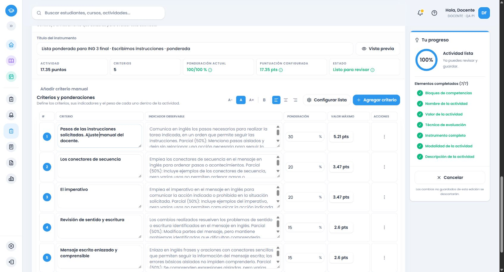

# Inglés común de tercero: cierre de las familias definidas

Fuente oficial: MINERD, adecuación secundaria2023, PDF146–151/impresas145–150, primer ciclo, ámbito `cc482480-0f08-5657-98aa-1afd28ecfa1a`. Las seis páginas se cotejaron visualmente, incluidas las continuaciones gramaticales de149/150 y las otras columnas vacías. Los158 registros conservan identidad, página, decisión y proveedor en el [cotejo](ingles-3-cotejo-fuente.json). La matriz agrupa12 ámbitos cotidianos y vocabulario/expresiones/gramática:15 grupos sin duplicaciones.

## Causa y correcciones

La reproducción HTTP anterior a instalar tercero confirmó que el runtime `.53` devolvía las mismas cinco filas generales para una opinión oral y para lectura→respuesta escrita. No faltaban los datos inventariados: faltaban proveedores evaluativos de tercero conectados al despacho común. [Reproducción conservada](evidencias/ingles-3-reproduccion-53.json).

Se conectaron12 evidencias funcionales,52 familias gramaticales/105 formas,19 familias léxicas/cinco intenciones expresivas,23 estrategias, recepción28/oral8/escrita11 y audiovisual explícito, condiciones comunicativas observables y composición. Los propósitos gramaticales, las expresiones y los cuatro aspectos culturales son propios de tercero. Las mecánicas/evidencias coincidentes con otros grados se reutilizan tras cotejar su fuente; no se trasladan las compras, horarios privados ni los aspectos culturales de segundo. Los ámbitos temáticos no crean criterios por su mera mención.

La revisión y los recorridos corrigieron: duplicación prohibición/aviso; alias «correo»; will o going to como alternativas; «usando» como requisito; exposición oral agregada a un video; comprensión y dudas pedidas conjuntamente; referencia a un texto inexistente en una inferencia oral y costumbres ajenas al caso. Cada comportamiento se reprodujo con una prueba roja antes de corregirlo. Se conservan las acciones independientes, las finalidades, los productos alternativos y las condiciones negativas. No se puntúan motivación, ansiedad, autocontrol ni rasgos privados. Empatía, cortesía, información fiel y cuidado se concretan solo como acciones comunicativas explícitas de personajes o situaciones proporcionadas.

## Verificaciones

| Capa | Evidencia y resultado |
|---|---|
| Backend actual |15.240 pruebas/76 archivos aprobados; funciones, modalidades, gramática por reconocimiento/explicación/uso/comparación/investigación, léxico, estrategias, géneros, contexto y composición; cuatro formatos y20/17.35 |
| Frontend actual específico y componentes |4.008/3 archivos aprobados: servicio/alternativa/adaptador, puntos pendientes, orden de total, exactitud, candidatos agotados, filas vacías/parciales/renombradas/manuales; selector y operaciones compartidas |
| Regresión completa reciente |18.792/114 archivos aprobados en `.54`; después cambiaron únicamente contenido de tercero, su traza y pruebas. La comprobación específica anterior se repitió sobre el estado final; no se atribuye esa suite completa al estado posterior |
| Inventario |9 pruebas aprobadas;158 registros/15 grupos, referencias válidas y ninguna decisión pendiente |
| Compilaciones |Backend, frontend y Cloudflare aprobados; Cloudflare dry-run, sin despliegue |
| Servicio real |156 casos por familias, ocho selecciones por propósito/total, cuatro rechazos de capacidad final superior a20 y cuatro conjuntos de candidatos mayores que20, tanto en `.54` como en `.55` |
| Chrome habitual |Cinco CRUD auténticos; cuatro finales representativos de los cuatro formatos. Generar→editar→resumen→guardar→reabrir, con cuenta ficticia autorizada |
| Persistencia |Textos, IDs, objetivos, puntos y pesos cotejados con snapshots, sin discrepancias.108 de base y todos los instrumentos anteriores conservados;121 snapshots actuales y91 instrumentos completos contrastados |

El HTTP rota un formato y un total por caso; los cuatro formatos y ambos totales por familia se verifican en los contratos automáticos. Las ocho selecciones HTTP cubren los cuatro instrumentos y ambos totales. No se presentan callbacks simulados como persistencia ni una suma correcta como prueba de pertinencia.

Rúbrica final: lectura de noticia→opinión razonada→respuesta escrita→revisión,20 puntos, `.54`. Cotejo final: escucha de noticia y comunicación de comprensión **y** dudas,17.35, `.55`. Escala: tres intercambios con advertencia y cortesía,20, `.55`. Ponderada: instrucciones con imperativo/secuencia/revisión,17.35, `.55`, pesos manuales30/20/20/15/15%, máximos5.21/3.47/3.47/2.60/2.60. [Los cuatro instrumentos completos](ingles-3-ejemplos-finales.md).

En Chrome, «Agregar» con candidatos agotados no añadió filas vacías ni cambió puntos. Completar un descriptor de escala y un indicador ponderado vacíos conservó los textos manuales y los pesos. Cancelar el cambio de actividad conservó el instrumento. Las opciones conservar/adaptar/cancelar siguieron disponibles; fallos/reintentos y respuestas tardías se verificaron en las pruebas compartidas, sin simular una caída de red en el navegador real. El cotejo `.55` se generó primero con puntos vacíos; introducir17.35 produjo9.91/7.44 sin cambiar el contenido. Un cotejo previo `.54`, editado manualmente en la conjunción, se conserva como histórico.

La primera comprobación automatizada de reapertura del cotejo abrió la rúbrica previa por usar el nombre anterior de la rutina. Se corrigió la rutina para recibir el nombre explícito y se reabrió el enlace correcto; el cotejo y sus puntos estaban guardados. No fue una pérdida de datos de la aplicación.

## Archivos y estado

Proveedores `secondary-english-grade-three*.ts`, despacho `secondary-english.ts`, normalización/composición `secondary-english-task-text.ts`, parámetros compatibles del generador de géneros de segundo, catálogo actual y congelados `.53/.54`, motor de recomendación, contratos JSON, pruebas backend/frontend, scripts de cotejo/verificación/renderizado y documentos/evidencias. No se modificaron el diseño, las migraciones, las credenciales ni los instrumentos históricos.

Rama `amplia-instrumentos-secundaria`. Puntos previos `bba48e5`/`0d3a7e2`; cierre publicado `63bf1df746c58f74c9d395714ad41c03fa0fcd53`, push y hash remoto comprobados. Las evidencias `.55` registran con honestidad el runtime `0d3a7e2` con cambios pendientes; no se les atribuye retroactivamente el hash del cierre. El reinicio posterior comprobó `.55` con63bf1df y árbol limpio, registrado en la reproducción previa de cuarto. Catálogo local instalado/cargado `.55`; `.53/.54` congelados. Supabase local54321, frontend5173/backend3000. Sin main, producción, reset ni subagentes.

**Tercero verificado en las familias y patrones definidos, sin pendientes conocidos en ese alcance.** No se promete interpretar cualquier redacción imaginable; el audiovisual procede de un producto solicitado y los valores internos se excluyen de las calificaciones. Próximo bloque: Inglés común4.º, PDF158–162, segundo ciclo, después de publicar este cierre. Quinto y sexto continúan pendientes; el encargo completo aún no está terminado.

