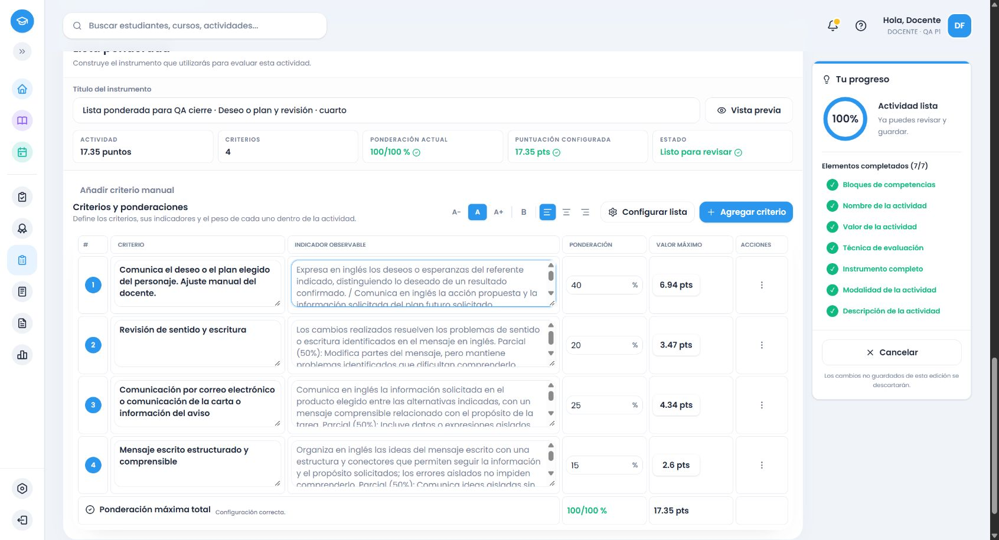

# Inglés común de cuarto: cierre de las familias verificadas

Rectificación de calidad,15/10/2026: los cierres curriculares se conservan, pero el cotejo de datos independientes y el criterio de revisión recibieron un ajuste posterior en.64–.66. Los ejemplos previos siguen siendo evidencia histórica; los corregidos, la conciliación de cantidades y las verificaciones nuevas están en el [informe de calidad de Inglés1–6](ingles-calidad-informe.md).

Fuente oficial: PDF158–162, páginas impresas157–161, ámbito011167a1-54f7-5915-9d75-5168ec1b0a97, segundo ciclo. Cinco páginas cotejadas visualmente, con162 registros y15 grupos. PDF161 continúa gramática con las otras columnas vacías. [Ledger por registro](ingles-4-cotejo-fuente.json).

Se conectaron once evidencias funcionales;44 familias gramaticales/115 formas y alias;15 familias de vocabulario;15 intenciones de13 registros expresivos;27 estrategias; y géneros separados por modalidad: comprensión oral12/escrita30, producción oral10/escrita14. Contextos, indicadores y consignas mixtas conservan acciones, datos, propósitos, alternativas, negaciones y recursos. No se exige conocimiento científico especializado ni información privada por mencionar esos ámbitos. Motivación, ansiedad, autocontrol y humildad internos se excluyen de puntuación.

## Causas y correcciones comprobadas

La reproducción del servicio .56 devolvía criterios generales para investigar información tecnológica y describir un problema: los proveedores de contexto aún no estaban conectados. [Reproducción](evidencias/ingles-4-contexto-reproduccion-56.json). Se conectaron antes de convertir el instrumento al editor, compartiendo resolución con la alternativa local.

Se corrigieron mediante pruebas rojas y verdes: sustantivos de recursos o referentes confundidos con acciones; explicar oralmente una función gramatical convertido en utilizarla; comparación de opiniones sin contraste; respuesta escrita omitida; campos explícitos de factura perdidos; deseos o planes y tres productos alternativos exigidos simultáneamente; preparación oral confundida con entrega. Las progresiones conservan el desempeño específico y sus grados de evidencia. La información científica confiable se relaciona con las fuentes disponibles, sin calificar honestidad personal. Una propuesta individual de tercero/cuarto no exige equipo.

La comprobación HTTP .57 encontró además que «información solicitada» se interpretaba como solicitar información, sustituyendo el género de conversación. .58 exige el verbo real. La revisión final añadió .59: solicitar instrucciones o indicaciones no obliga a darlas; una respuesta solidaria se reconoce como apoyo comunicativo observable. .56/.57/.58/.59 están congelados, sin modificar las versiones instaladas ni snapshots anteriores. .60 conserva ambas acciones al solicitar y dar indicaciones, en lugar de presentarlas como alternativas.

## Verificación

- Backend completo .60:22.227 pruebas/81 archivos. Frontend de cuarto, tercero y operaciones:9.868/5 archivos; cuarto cubre servicio, alternativa, adaptador, cuatro formatos y puntaje pendiente/20/17.35, además de añadir/completar sin perder textos, IDs ni puntos. Se reutilizan los checks recientes de los demás módulos cuando no cambió su código.
- Builds backend, frontend y `pnpm cloudflare:build` aprobados; Cloudflare se ejecuta exclusivamente como dry-run. Inventario y `git diff --check` forman parte del cierre.
- HTTP autenticado real .58:172 familias, ocho recomendaciones con totales20/17.35 y cuatro rechazos de exceso/conjuntos de candidatos mayores que20. .60: ocho casos dirigidos, incluidos solicitudes, solidaridad, adjetivo solicitado y seguimiento de tercero. [Integral](evidencias/ingles-4-integral-servicio.json), [seguimiento](evidencias/ingles-4-seguimientos-servicio-60.json).
- Las recomendaciones se basan en propósito: calidad multidimensional→rúbrica; presencia verificable→cotejo; regularidad observada→escala; componentes con pesos→ponderada. Elecciones manuales se respetan; no hay reparto por cuotas. Las cuatro sugerencias se aplicaron automáticamente en Chrome al completar la descripción.
- Cuatro recorridos auténticos en Chrome habitual y cuenta ficticia local: generación, edición, resumen, guardado y reapertura. Rúbrica20 .57 (investigación/noticia/presentación); cotejo17.35 .57 (factura con puntaje inicialmente pendiente); escala20 .57 (predicciones reiteradas/cortesía); ponderada17.35 .58 (producto e intención alternativos/revisión).
- Se cotejaron campos, IDs, objetivos, puntos y snapshots de los cuatro. Pesos manuales40/20/25/15% producen6.94/3.47/4.34/2.60 y se conservan al cancelar cambio y reabrir. Se completó un descriptor vacío reconocido; una paráfrasis manual no se sustituyó automáticamente y su vacío se restituyó de forma explícita antes de guardar. Una fila manual vacía añadida expresamente se retiró, conservando la edición previa; no se afirma que fuera un nuevo candidato automático.
- 125 snapshots actuales/95 instrumentos completos; históricos de referencia y base preservados. [Persistencia](evidencias/ingles-4-final-persistencia.json), [históricos](evidencias/lengua-historicos-evaluation-2026.60.json). [Instrumentos completos obtenidos](ingles-4-ejemplos-finales.md).

## Entorno, revisión y límites

Rama `amplia-instrumentos-secundaria`, repositorio [Proyecto-educativo-v3](https://github.com/thebuuba/Proyecto-educativo-v3). La evidencia .57–.59 ejecutó aae36ce73802376ae72e3820f9bbd2b017ce2b80 con cambios pendientes; no se le atribuye retroactivamente el hash del cierre. Último catálogo cargado60, Supabase local54321, frontend5173/backend3000. Un reinicio del entorno interrumpió la conexión del navegador; se recuperó la aplicación sin reset y se volvieron a comprobar escala y ponderada. La generación de solicitud en .59 se comprobó en navegador; ese seguimiento no se presenta como otro CRUD.

Revisión propia del diff, llamadas, contenido completo y progresiones; sin subagentes por instrucción del usuario. Cambios principales en proveedores compartidos de cuarto/contexto/gramática/géneros/estrategias, mecánica de acciones y alternativas, corrección condicional de tercero, catálogo/versiones, contratos backend/frontend y scripts/evidencias/documentación. Sin dependencias, IA de aplicación, rediseño, migraciones, main, despliegue ni secretos en Git.

Estado: familias y patrones definidos de cuarto verificados. No se garantiza cualquier redacción imaginable. Siguiente bloque autorizado: Inglés común de quinto, fuente PDF163–168, antes de sexto; sin francés ni optativas.
