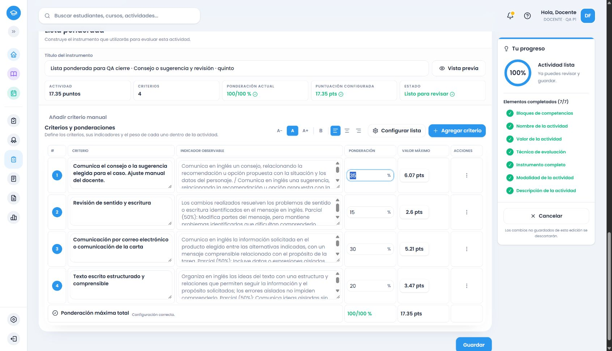

# Inglés común de quinto: cierre de las familias verificadas

Fuente oficial PDF163–168, impresas162–167, ámbito73fa64a1-0c71-58a0-90c2-7df2f33b7a62, segundo ciclo. Seis páginas cotejadas visualmente,156 registros/15 grupos. PDF166–167 continúan solo gramática;42/47 continúan ejemplos de modales/estilo indirecto,36/38 unen encabezado y contenido real. [Ledger por registro](ingles-5-cotejo-fuente.json).

Doce evidencias funcionales,60 familias gramaticales/120 formas y alias;22 familias de vocabulario y siete intenciones en dos registros expresivos compuestos;24 estrategias, géneros por modalidad, contexto/indicadores y siete consignas mixtas. Las listas de géneros coinciden con cuarto tras cotejo independiente: recepción12/30 y producción10/14. Se reutiliza mecánica y contenido común únicamente donde coincide el significado curricular; consultas simuladas, reclamaciones, compras, probabilidad/certeza, reporte y narración tienen propósitos propios de quinto. Compensación, principales/secundarias y cuatro aspectos culturales se configuran para este grado.

## Causa y cambios

La reproducción local .60 de doce consignas carecía de criterios de quinto: el inventario existía, pero el motor no tenía conectado un proveedor para el grado. [Reproducción](evidencias/ingles-5-reproduccion-60.json). Se incorporó al flujo compartido de servicio y alternativa, con guardas académicas/versionadas y progresiones específicas.

La revisión corrigió: duplicación de solución en reclamaciones; `can’t` interpretado además como `can`; perfecto continuo interpretado además como perfecto simple; planificar el mensaje convertido en comunicar planes; fecha de la fuente convertida en otra intención; estudio de adverbios convertido en otro producto; alternativas exigidas simultáneamente; ayuda/repetición y deseos/aspiraciones conjuntas convertidas en opciones. Chrome detectó errores de concordancia de «sugerencia»; .62 los corrige en el motor. Todo mediante pruebas rojas y verdes. .60/.61 congelados; .62 instalado, sin modificar snapshots anteriores.

Consultas y vocabulario médico usan fichas ficticias: se evalúa comunicar lo proporcionado, sin diagnóstico, tratamiento ni datos reales del alumnado. Honestidad se concreta en fidelidad a las fuentes; consumo/ahorro en decisiones justificadas con datos proporcionados. Motivación, ansiedad, humildad e iniciativa/creatividad como rasgos internos se excluyen de puntuación; no se crea una fila genérica por mencionarlos.

## Verificación y resultados

- Backend final:29.331 pruebas/86 archivos. Frontend final de quinto:6.140; regresión reciente de cuarto y operaciones incluida en12.020/5, sin cambios posteriores en esos módulos. Cuatro formatos, pendiente/20/17.35, igualdad servicio/alternativa/adaptador, detección, elección manual, añadir/completar/agotamiento y preservación de campos/IDs/puntos.
- Builds backend/frontend aprobados; Cloudflare dry-run aprobado y se reutiliza tras el último ajuste de un descriptor de contexto, con recompilación backend/frontend posterior. Inventario9 y `git diff --check` del cierre.
- HTTP autenticado .61:187 familias, ocho selecciones, cuatro rechazos de exceso y cuatro conjuntos de candidatos mayores que20. .62:40 verificaciones dirigidas, cinco casos × cuatro formatos ×20/17.35. [Integral](evidencias/ingles-5-integral-servicio.json), [seguimientos](evidencias/ingles-5-seguimientos-servicio-62.json).
- Recomendación por propósito, sin cuotas: calidad multidimensional→rúbrica; presencia verificable→cotejo; regularidad en oportunidades reiteradas→escala; pesos entre componentes→ponderada. Las elecciones explícitas se respetan. Escala utiliza frecuencias pertinentes y su indicador conserva la evidencia específica; no se le exigen los niveles cualitativos de la rúbrica.
- Cuatro CRUD auténticos en Chrome habitual/cuenta ficticia local, todos .62: rúbrica20 de reclamación/respuesta/revisión; cotejo17.35 de productos/precios de menú (puntaje inicialmente pendiente); escala20 de compra simulada reiterada/cortesía; ponderada17.35 de consejo o sugerencia y correo o carta/revisión. Generación, edición, resumen, guardado y reapertura real verificados.
- Manuales preservados; un descriptor parcial reconocido completado sin sustituir el indicador editado. Cancelar el cambio de formato conservó la ponderada. Pesos35/15/30/20% →6.07/2.60/5.21/3.47; IDs, objetivos, textos y puntos cotejados con snapshots. [Persistencia](evidencias/ingles-5-final-persistencia.json), [campos UI](evidencias/ingles-5-final-flujo-navegador.json), [instrumentos completos](ingles-5-ejemplos-finales.md).
-129 snapshots actuales/99 instrumentos completos; históricos y base preservados. [Comprobación](evidencias/lengua-historicos-evaluation-2026.62.json).

## Entorno y alcance

Rama `amplia-instrumentos-secundaria`, [repositorio](https://github.com/thebuuba/Proyecto-educativo-v3). Punto de código publicado `1f1abf9a34611e626be87980803b5d062386dff0`. El servicio .61 ejecutó6dc1e0b con cambios pendientes; .62 arrancó desde1f1abf9 con árbol limpio, según salud capturada. Las evidencias no se atribuyen retroactivamente al commit de cierre. Supabase local54321/frontend5173/backend3000, catálogo .62. Sin despliegue, reset ni cambios de esquema.

Revisión propia del diff, llamadas y contenido completo, sin subagentes por instrucción del usuario. Archivos principales: proveedores compartidos de quinto, comunicación común, despacho y catálogo/versiones, contratos backend/frontend, cotejo/matriz y scripts/evidencias/informes. Se conserva diseño, Lengua1–6/Inglés1–4 e históricos; sin IA de aplicación, nuevas dependencias, main ni secretos en Git.

Estado: familias y patrones definidos de quinto verificados; sin pendientes conocidos en ese alcance. No se garantiza cualquier redacción imaginable. Siguiente y último bloque autorizado: Inglés común de sexto, PDF169–174. No francés ni optativas.
