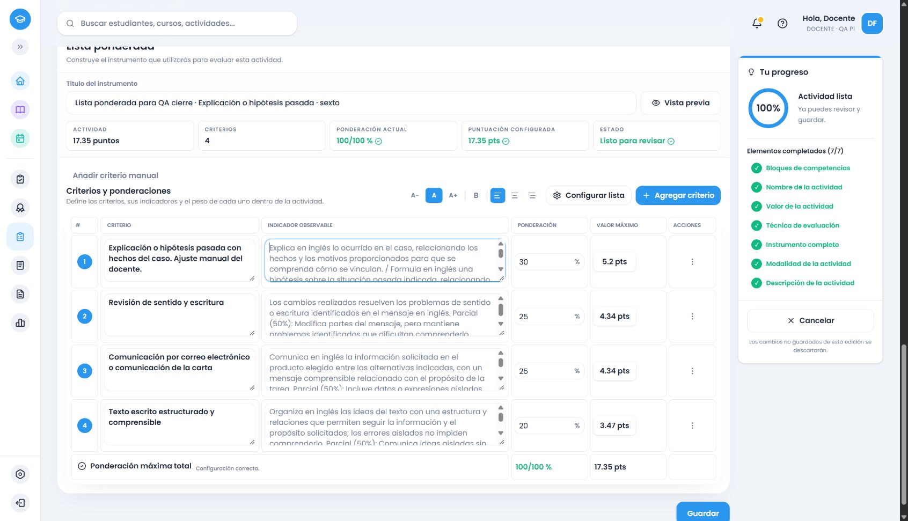

# Inglés común de sexto: cierre de las familias verificadas

Rectificación de calidad,15/10/2026: los cierres curriculares se conservan, pero el cotejo de datos independientes y el criterio de revisión recibieron un ajuste posterior en.64–.66. Los ejemplos previos siguen siendo evidencia histórica; los corregidos, la conciliación de cantidades y las verificaciones nuevas están en el [informe de calidad de Inglés1–6](ingles-calidad-informe.md).

Se completó la conexión y verificación de las familias y patrones definidos de sexto, último grado del encargo. Fuente oficial PDF 169–174, impresas 168–173, segundo ciclo común; ámbito `ae0c8305-150c-5996-ab4a-deb379827ea9`. Se cotejaron visualmente las seis páginas: 159 registros y 16 grupos. [Decisión y conexión por registro](ingles-6-cotejo-fuente.json).

PDF 172–173 continúa únicamente gramática. CONCEPT37 une encabezado y estructuras reales; CONCEPT44 continúa un diálogo de43/45; otros registros compuestos conservan todas sus formas. PROCEDURE23 incluye planificación y lenguaje no verbal, con dos evidencias cuando se solicitan. El espaciado extraído «l o» de PROCEDURE18 se contrastó como «lo», interpretable; no se inventó un procedimiento.

## Causa confirmada y cambios

La reproducción autenticada en catálogo .62 de once consignas no devolvía proveedores propios de sexto, aunque el contenido curricular estaba inventariado. Faltaban la conexión por grado y sus evidencias evaluativas. [Reproducción anterior](evidencias/ingles-6-reproduccion-62.json). Se conectó sexto al motor compartido del servicio y de la alternativa local, con aislamiento académico y de versiones. La alternativa conserva el mismo contenido; una prueba de igualdad comprueba criterios, descriptores, IDs, pesos, puntos y detección en ambos caminos.

La revisión corrigió en el flujo compartido el reconocimiento de «interactuarán» y «realizarán una entrevista». También se verifican «explicarán», «razonarán» e «hipotetizarán», sin imponer una entrega escrita a una hipótesis sin medio indicado. Se distingue explicar una función tecnológica de estudiar la función de una estructura gramatical. Omitir el pronombre relativo ya no añade simultáneamente el objetivo de usarlo; `be used to`/`get used to` no activan además `used to`. Los ajustes se reprodujeron en rojo antes de quedar verdes. No hay condiciones basadas en títulos exactos.

La mecánica de interacción también corrige «interactuarán en una consulta médica simulada» de quinto: ocho verificaciones HTTP nuevas .63, incluidas en los88 seguimientos. Los cuatro CRUD de quinto siguen acreditados en .62; no se presentan como repetidos en .63.

## Cobertura y pertinencia

- Once evidencias funcionales: pasado/presente, ideas abstractas o culturales, pedir/ofrecer razonamientos y explicaciones, costumbre/familiaridad, adaptación, hipótesis pasadas, entrevista simulada y narración detallada.
- Cincuenta y ocho familias gramaticales, 134 formas/alias; 17 familias léxicas y cuatro intenciones expresivas. Las formas compartidas se reutilizan solo si aparecen y conservan el propósito de sexto; no se trasladan los propósitos médicos/comerciales de quinto.
- Veintitrés estrategias observables; 36 géneros únicos con listas de recepción oral12/escrita30 y producción oral10/escrita14, cotejadas independientemente. Audiovisual requiere una consigna explícita. Principales/secundarias, compensación, planificación, revisión y aspectos culturales respetan sus requisitos concretos.
- Veintiuna condiciones de contexto/competencia/indicadores y ocho contratos de composición. Las acciones independientes de una consigna mixta conservan su evidencia; alternativas de producto o intención se valoran como alternativas. No se exigen ambos productos.

Motivación, ansiedad, humildad y creatividad/innovación como rasgos internos no se puntúan. Salud, empleo, creencias y proyecto de vida usan datos o personajes proporcionados; se evalúa comunicación, sin diagnosticar, decidir elegibilidad ni juzgar información íntima. Los encabezados y competencias organizadoras no generan filas genéricas. La matriz distingue estas decisiones de las familias conectadas.

## Verificaciones

- Backend completo vigente: **36.689 pruebas /91 archivos**. Frontend completo: **36.940 /117**; después del ajuste final de omisión del relativo se repitió la matriz específica de sexto: **6.140**, aprobada. Se reutiliza la regresión completa para los módulos que ese ajuste no modifica. Gramática específica:5.361; inventario:9.
- Builds backend y frontend aprobados; `pnpm cloudflare:build` aprobado en modo dry-run. Se reutilizan esas comprobaciones del código publicado61e8a5a; este cierre añade documentación, verificadores y evidencias, sin cambiar el motor. `git diff --check` y revisión del diff del cierre.
- HTTP autenticado .63: **178 familias/casos**, rotando formato/total, **ocho selecciones** con totales20/17.35 y **cuatro rechazos** del instrumento final superior a20, con cuatro conjuntos de candidatos mayores que20. La matriz automática sí cruza todas las familias con los cuatro formatos y ambos totales. [Integral](evidencias/ingles-6-integral-servicio.json).
- **88 seguimientos HTTP**: once casos × cuatro formatos ×20/17.35; interacción de quinto/sexto, hipótesis sin medio escrito, función tecnológica/gramatical, omisión del relativo, costumbre/adaptación y subconjuntos de comprensión/cultura. [Seguimientos](evidencias/ingles-6-seguimientos-servicio-63.json).
- Añadir/completar: candidato pertinente no usado; completar fila vacía y solo campos vacíos de una parcial; conservar IDs/textos/puntos; renombrar sin duplicar objetivo; agotamiento sin fabricar filas. Se conservan las regresiones compartidas de capacidad, respuestas obsoletas, reintento y conservar/adaptar/cancelar. No se atribuyen esas pruebas de componentes a un CRUD real.

La recomendación depende del propósito: calidad en varias dimensiones→rúbrica; presencia comprobable→cotejo; regularidad en oportunidades reiteradas→escala; pesos entre componentes→ponderada. Las selecciones manuales prevalecen. No hay reparto por cuotas. Las escalas utilizan frecuencias y conservan en sus indicadores la evidencia específica, sin exigirles los niveles cualitativos de la rúbrica.

## Navegador y persistencia real

Cuatro recorridos autenticados en Chrome habitual, cuenta ficticia local y catálogo .63: generar→editar→resumen→guardar→reabrir una página real de edición. Se compararon campos observados con snapshots persistidos, IDs, objetivos, descriptores y unidades de puntos. [Campos observados](evidencias/ingles-6-final-flujo-navegador.json), [persistencia](evidencias/ingles-6-final-persistencia.json), [cuatro instrumentos completos](ingles-6-ejemplos-finales.md).

| Formato / total | Tarea habitual | Resultado revisado |
|---|---|---|
| Rúbrica /20 | Lectura narrativa, pasado/presente, punto de vista cultural justificado y revisión escrita | Seis criterios diferenciados; progresiones de relaciones claras, relaciones incompletas y ausencia reconocible. |
| Cotejo /17.35 | Lectura de experiencia y capacidades en un CV ficticio | Indicador específico Sí/No. Puntaje inicialmente vacío, después17.35. |
| Escala /20 | Tres entrevistas simuladas, respuestas según ficha y cortesía | Cuatro indicadores específicos; frecuencias. Completar un descriptor vacío conservó el indicador manual y los puntos. |
| Ponderada /17.35 | Correo o carta; explicación o hipótesis pasada; revisión | Cuatro componentes;30/25/25/20% conservados→5.20/4.34/4.34/3.47. Cancelar cambio a rúbrica conservó el instrumento. |

Los cuatro conservaron la edición manual al guardar y reabrir. Revisión de los instrumentos completos aprobada por pertinencia, progresión, alternativas y acciones pedidas, además de las sumas. Históricos: **133 snapshots actuales /103 instrumentos completos**, con las108 actividades de la base de Inglés y28 referencias iniciales sin cambios. [Comprobación histórica](evidencias/lengua-historicos-evaluation-2026.63.json).

## Entorno, archivos y límites

Rama `amplia-instrumentos-secundaria`, [repositorio](https://github.com/thebuuba/Proyecto-educativo-v3). Código ejecutado: `61e8a5a10b891da6874a9d3ab3eb77c4a6a226c1`, con árbol limpio al arrancar según salud capturada. Catálogo instalado/cargado `evaluation-2026.63`; .62 conservado e inmutable. Frontend5173/backend3000/Supabase local54321. Este resultado no acredita el servidor de8787 ni el entorno remoto. El hash del commit de evidencias se confirma en la entrega; no se atribuye retroactivamente al proceso probado.

Archivos principales de implementación: `packages/shared/src/secondary-english-grade-six*.ts`, resolución superior compartida y despacho de Inglés; `apps/backend/src/modules/evaluation-instruments/recommendation-engine.ts`, catálogo actual/.62 congelado y cinco contratos de sexto; matriz frontend `englishGradeSixContract.spec.ts`; siete contratos de datos y scripts de fuente, HTTP, persistencia e instrumentos completos. Este commit de cierre contiene verificadores, matriz/ledger, informes y evidencias. Se revisaron los llamadores de los cambios compartidos y el contenido completo, sin subagentes.

Estado: **sin pendientes conocidos en las familias y patrones definidos de sexto**. La cobertura no promete comprender cualquier redacción imaginable. Se excluyen deliberadamente encabezados, rasgos internos, datos privados y productos no pedidos. No se modificó la interfaz, no se añadieron IA ni dependencias, no se alteraron históricos, esquema o migraciones, no hubo reset, main ni despliegue. Credenciales, cuentas, .env, temporales y logs de trabajo quedan fuera de Git. Inglés común2–6 cierra aquí; no se inicia otra asignatura.
