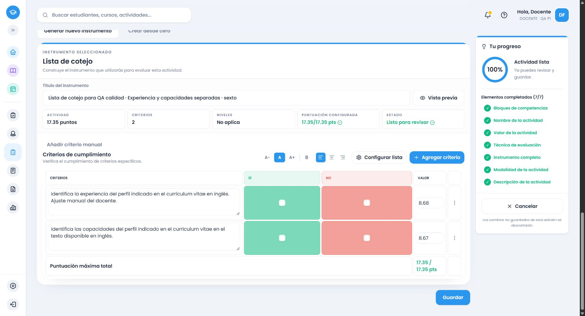

# Ajuste de calidad y cierre de Inglés común1.º–6.º

Seguimiento del cierre75ed6e9, solicitado en el adjunto `fdfa93c7-3ad4-4828-bb8b-4a75a3b5927b/Texto pegado.txt`. No amplía el currículo ni inicia otra asignatura. Se mantienen los cierres y evidencias anteriores como históricos, con las rectificaciones siguientes. Catálogo final local: `evaluation-2026.66`; .63/.64/.65 conservados.

## Causas confirmadas y alcance

**Cotejo.** El formateador compartido cambiaba el título del criterio por su observable, conservando una fila por criterio. El CV reunía experiencia y capacidades en un solo Sí/No; el proveedor de sexto concretaba ambos datos, pero no declaraba su independencia. El backend además tomaba solo el primer resultado del formateador y comprobaba capacidad antes de expandir. La alternativa local también comprobaba antes. La corrección declara partes semánticas explícitas y expande únicamente para cotejo, antes de aplicar el límite y repartir puntos. No divide textos por «y».

Auditoría de los seis grados: datos explícitos de CV, tarjeta/formulario, emisor/fecha/total de factura y destinatario/propósito del correo o carta son separables cuando se pide identificar datos individuales. En producción se separan campos expresamente pedidos de CV, formulario o tarjeta; la comunicación integrada conserva su representación en los demás formatos. También se separan subrayar/anotar cuando se piden ambos procedimientos, nombre/edad/nacionalidad/ocupación explícitos de primero y estados anímico/físico de un personaje de segundo cuando ambos se solicitan. Las alternativas se mantienen como opciones. Relaciones entre actividad/momento, precio/producto, ideas y su función, razones/conclusión, secuencia y significado no se descomponen automáticamente.

Se encontraron dos efectos relacionados: «experiencia» de un CV activaba además narración en1.º/2.º/4.º; nombre/edad de un formulario añadía una presentación personal en1.º. Se excluyen esas funciones cuando los datos pertenecen a la tarea estructurada, manteniendo una narración explícitamente pedida. Al renombrar la fila de experiencia, la comparación por similitud ocultaba capacidades porque las frases compartían muchas palabras. Ahora la evidencia e identidad conocidas prevalecen mientras no cambie la evidencia; cambiar el título exactamente al objetivo candidato sigue evitando duplicados. Los textos manuales se conservan.

Los hijos reciben IDs semánticos estables (`ing-6-genre-cv:experience`, `:capacities`), y comparten el peso relativo del padre. Total20→10+10;17.35→8.68+8.67. Se usa el distribuidor existente en centésimas. El instrumento que supera20 después de separar se rechaza explícitamente; el conjunto adicional puede ser mayor. Servicio y alternativa usan la misma conversión.

**Revisión.** Los seis grados heredaban de primero «Los cambios realizados resuelven…»: el nivel máximo exigía cambios aunque el texto fuese correcto. Se sustituyeron indicador, cinco progresiones y parcial por comprobación observable del sentido y la corrección: mantener lo correcto; identificar y corregir problemas cuando aparezcan; reconocer comprobaciones incompletas o problemas observados pendientes. No se infiere el proceso del producto final ni se exigen borradores, listas o registros. La detección de primero admite la misma expresión explícita de revisar sentido/corrección. Una consigna sin revisión no añade esa fila.

Rúbrica y ponderada conservan el desempeño integrado y su progresión; el cotejo permite marcar sentido/corrección por separado. La escala de grado conserva la progresión específica de revisión, en vez de sustituirla por frases genéricas. Las escalas de frecuencia siguen refiriéndose a oportunidades observadas. No se afirma que el sistema inspeccione errores del estudiante: el instrumento describe la evidencia que observa el docente.

## Aplicación de los descriptores

| Situación observada por el docente | Interpretación del instrumento |
|---|---|
| Comprueba un texto correcto y no lo modifica | Puede cumplir el nivel máximo; mantener lo correcto es explícito. No se exige encontrar errores. |
| Durante la comprobación identifica problemas y los corrige | Puede cumplir el máximo si comprueba los aspectos solicitados y conserva la intención. |
| Comprueba solo una parte o deja problemas observados pendientes | La progresión intermedia y el parcial de la ponderada lo distinguen. |
| Solo se dispone del producto final | No acredita por sí solo el proceso de revisión. No se inventa que ocurrió. |
| La consigna no pide revisión | No se añade una fila de proceso. |

Los escenarios son contratos de contenido del instrumento, no una calificación automática de trabajos de alumnos. [Ocho instrumentos completos del servicio y dos snapshots reales](ingles-calidad-ejemplos-completos.md).

## Conciliación de las cantidades

El verificador anterior llamaba `currentSnapshots` a las actividades devueltas por `/activities` que contenían un snapshot actual. `fullInstrumentsPreserved` contaba IDs únicos de actividades con evidencia completa de instrumento/campos guardados en fixtures; no todas las filas de la tabla de instrumentos. Las28 referencias iniciales eran otro conjunto de actividades con huella de su snapshot. Faltaba explicar las dos actividades de la corrección transversal. No faltaban datos.

**Antes:133 =103 +28 −0 +2.** Los103 y28 conjuntos son disjuntos. La base108 de Inglés se solapa:78 de los103 +28 referencias +esas mismas dos adicionales; no se suma otra vez. [Conciliación anterior con IDs](evidencias/ingles-calidad-conciliacion-antes-63.json), [base108](evidencias/ingles-2-historicos-base.json).

| Actividad adicional | ID de actividad | ID de instrumento | ID de snapshot |
|---|---|---|---|
| Presentamos nuestra rutina diaria en inglés. |9c485107-5a8e-4c0c-ae40-d6256df4a39b|68d153a7-6c50-43f7-a1d4-4e23378ed784|4ba0e7b7-d735-45b8-8530-77ebb0f4f2e6|
| Descubrimos y promocionamos los atractivos de nuestra comunidad. |e8c703f1-5b2d-4255-a99d-57bb429732d2|e7588c30-a1ed-4933-8d00-10e42703ce1a|9331143b-00b8-41c4-8020-d1e3645520a0|

La consulta directa y de solo lectura a la escuela ficticia local confirmó133 actividades,133 instrumentos y133 filas de snapshot; ninguno con `previousSnapshotId`, y ninguna versión adicional fuera de los snapshots actuales. Se distinguen ahora actividades, instrumentos, filas de snapshot y linaje (`versionNo`/`previousSnapshotId`), sin sumar subconjuntos. Esto describe este conjunto local, no una regla general de cardinalidad para otras bases.

**Después:135 =105 +28 −0 +2.** Son las dos nuevas actividades de navegador con evidencia completa, no una eliminación o reclasificación de históricos. La base108 continúa intacta. Los hashes de las133 filas completas de snapshot anteriores y los133 instrumentos/campos de actividad anteriores coinciden. Hay135 filas de instrumento y snapshot, cero predecesoras en este conjunto. [Conciliación final](evidencias/ingles-calidad-conciliacion-despues-66.json), [verificación histórica](evidencias/lengua-historicos-evaluation-2026.66.json).

## Pruebas y navegador

Los defectos se reprodujeron primero en pruebas rojas y en16 respuestas HTTP de.63. Los seguimientos de narración duplicada, candidatos tras renombrar, producción de CV, campos personales/estados y alternativas tuvieron su prueba antes de la corrección. Las expectativas antiguas se actualizaron para reconocer el objetivo padre a través de sus hijos; las pruebas nuevas exigen explícitamente los IDs y el número de hijos, evitando ocultar pérdidas o duplicados.

- Backend completo final: **36.753 pruebas /92 archivos**. Frontend completo: **37.191 /118**; regresión dirigida final de contenido/edición: **277 /2**, repetida tras el último ajuste de alternativas. Inventario y conciliación: **11**. Puntaje pendiente,20/17.35, cuatro formatos, servicio/alternativa, añadir/completar/agotamiento, renombrado, identidades y pesos manuales verificados.
- `pnpm --filter backend test`, builds backend/frontend y `pnpm cloudflare:build` aprobados. Cloudflare fue exclusivamente dry-run. Se repitió backend y la regresión dirigida tras el último ajuste de alternativa de subrayar/anotar; se conserva la regresión frontend completa para el resto del código sin cambios.
- HTTP final.66: **240 respuestas** (cinco tareas × seis grados × cuatro formatos × dos totales), **30 recomendaciones naturales** sin frases que dicten instrumento, y **16 respuestas** de campos funcionales propios1.º/2.º. [Evidencia](evidencias/ingles-calidad-servicio-66.json). Otros **16 seguimientos HTTP** comprobaron subrayar o anotar en ambos órdenes, con cuatro formatos y ambos totales, tras el último ajuste de esa alternativa. [Seguimiento](evidencias/ingles-calidad-alternativas-66.json). Las pruebas de capacidad incluyen una tarea con hasta20 criterios de rúbrica que supera20 al convertirse en cotejo; se rechaza sin recortar y ofrece el conjunto adicional.
- Las tareas de consulta de datos se recomiendan como cotejo; escribir/comunicar un texto y revisarlo requiere calidad en dimensiones relacionadas y conserva rúbrica. No se intenta producir las cuatro recomendaciones en estas tareas ni por cuotas. Los cuatro formatos se prueban también como elecciones explícitas, siempre respetadas. No se modificaron las reglas para forzar escala o ponderada por una repetición de la actividad.

Dos recorridos reales en Chrome habitual/cuenta ficticia local.65: generar, editar, resumen, guardar y abrir de nuevo la URL observada de edición. Se cotejaron otra vez bajo servicio.66 con campos, criterios, descriptores, IDs y puntuaciones persistidos. [Campos observados](evidencias/ingles-calidad-flujo-navegador.json), [snapshots](evidencias/ingles-calidad-persistencia.json).

- Cotejo del CV: dos filas; inicialmente sin puntos;17.35→8.68/8.67. Edición manual conservada; completar la capacidad vacía mantuvo el indicador de experiencia y los puntos.
- Rúbrica con revisión: tres criterios; revisión máxima admite mantener lo correcto. Completar un descriptor parcial conservó el título manual y los puntos manuales5/9/6; se guardó y reabrió sin cambios.
- Generación adicional de primero en.66: nombre y edad separados y claridad oral como desempeño relacionado, con elección manual de cotejo respetada. Es **generación, no un tercer CRUD**. [Evidencia](evidencias/ingles-calidad-generacion-primero-66.json).

Una compilación/recarga de desarrollo interrumpió el primer formulario aún no guardado; no se atribuye ese intento a una persistencia exitosa. Los dos recorridos acreditados se repitieron después de terminar las compilaciones. El intento inicial de añadir tras eliminar confirmó el diálogo de redistribución y conservación del texto; la regresión automática acredita esas operaciones para los seis grados. No se presentan como nuevos CRUD de todos los grados.

## Archivos, entorno y cierre

Implementación: `secondary-topic-criteria.ts` (partes declaradas), `authored-instrument-format.ts`, `secondary-topic-recommendation.ts`, `language-scale.ts`; proveedores de géneros/estrategias de primero heredados por1–6 y funciones de1/2/4; resolución de datos del CV; motor backend/tipo de criterio/catálogo actual; selección de candidatos frontend. Nuevos contratos `english-quality.spec.ts` y `englishQualityContract.spec.ts`, expectativas de linaje en13 contratos existentes y dos fixtures de revisión. Verificadores de HTTP, persistencia, conciliación y renderizado; informes/matriz/avance/continuación. No se modificó TSX, diseño, dependencias, esquema o migraciones.

Rama `amplia-instrumentos-secundaria`, [repositorio](https://github.com/thebuuba/Proyecto-educativo-v3). El servicio de prueba registra base `75ed6e9dd5d217afccdab30c59df874fdea9b49a` **con cambios pendientes de este ajuste**, catálogo.66, frontend5173/backend3000/Supabase54321. No se atribuye retroactivamente al proceso el hash del commit final; commit, push y árbol se confirman en la entrega. .63/.64/.65 se congelaron desde las versiones instaladas y siguen disponibles. .64/.65 fueron etapas verificadas antes de completar la auditoría funcional1/2; no se presentan como cierre final.

Revisión propia del diff y llamadores, sin subagentes. El trabajo queda acotado a los patrones semánticos definidos y comprobados, sin prometer entender cualquier redacción o campo imaginable. El docente conserva la elección de formato y edición; observar el proceso no se sustituye por inspección automática del producto. No hubo IA de aplicación, nuevas dependencias, reset, modificación de históricos, force push, main ni despliegue. Secretos/.env/cuentas/logs/temporales quedan fuera de Git. Terminado este ajuste, **detenerse**, sin Francés ni otra asignatura.
