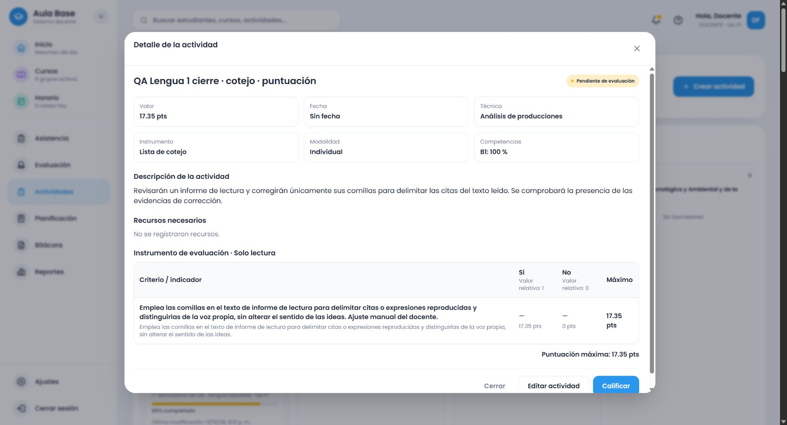

> Actualización del flujo de criterios (.46): el cierre previo conservó una regresión de añadir/completar no detectada en sus ejemplos. Se corrigieron agotamiento, recuperación, intención/identidades, respuestas obsoletas y procedencia; se verificaron los proveedores de las40 familias de Lengua y los cuatro formatos. [Informe y límites](criterios-adicionales-informe.md), [matriz](criterios-matriz-proveedores.md). Las evidencias anteriores permanecen intactas; no se amplía el ámbito curricular.

# Lengua Española común: cierre de las familias verificadas de 1.º

Los seis temas de 1.º quedan cubiertos dentro de las familias y requisitos documentados. Se cotejaron 55 subtemas y 30 bloques de procedimientos de PDF 69–75; no se asignó al caligrama el bloque anómalo de noticia situado al pie de PDF 74. Las condiciones didácticas de lectura y los medios alternativos no se convierten automáticamente en productos exigidos. Este cierre no garantiza comprender cualquier redacción imaginable ni completa 2.º–6.º.

## Cobertura por tema

| Tema | Familias conectadas y comprobadas |
|---|---|
| Noticia | Análisis/comprensión oral y escrita, redacción, noticiero, comparación, informe, debate e investigación de los hechos |
| Guía turística | Análisis/comprensión, elaboración, presentación oral, comparación, informe e investigación de lugares |
| Informe de lectura | Análisis/comprensión, escritura, exposición oral y comparación |
| Afiche | Análisis/comprensión, creación/planificación, comparación, presentación e informe de análisis |
| Cuento policíaco y detectivesco | Análisis/comprensión de texto o fragmento, escritura, narración oral, comparación, presentación del análisis e informe |
| Caligrama | Análisis/comprensión, creación, comparación, recitación, explicación e informe de análisis |

Todas utilizan rúbrica, cotejo, escala y ponderada. Los 34 recorridos principales se complementan con contratos focalizados de gramática, vocabulario, recursos y procedimientos. [Cotejo de cada bloque oficial con sus familias](lengua-1-cotejo-fuente.json). Los textos oficiales permanecen en el inventario; los criterios son adaptaciones evaluativas de Aula Base.

## Pendientes cerrados en este bloque

Once contratos adicionales cubren grados del adjetivo, puntuación de guía/informe, planificación sin formato impuesto, vocabulario de noticia oral, recursos de narración y exposición, apoyos visuales alternativos/conjuntos y reconstrucción gráfica de la guía comprendida. Se reprodujeron 40 fallos iniciales y otros cuatro de reconstrucción antes de implementar sus correcciones.

La comprobación real del cotejo detectó además que una corrección exclusiva de comillas añadía enumeraciones y revisión general. Se reprodujo con cuatro regresiones: ahora evalúa las citas delimitadas y su distinción respecto de la voz propia, sin pedir corregir otros aspectos ni aportar versiones que no se solicitaron. La selección explícita y los instrumentos anteriores se conservan.

La producción oral utiliza los recursos lingüísticos; el análisis los identifica y explica. La planificación genera un plan; solo exige esquema o guion cuando la consigna lo nombra. Mapas **y** fotografías se mantienen conjuntos; mapa **o** fotografías conserva la alternativa. Las puntuaciones usan los pesos originales y el mismo reparto exacto con total previo o posterior.

## Pruebas y persistencia

- Backend completo: **1.514** pruebas. Frontend completo: **1.333**, incluidas 472 verificaciones compartidas de contenido/reparto y dos de estructura de escala.
- Builds backend, frontend, shared y Cloudflare dry-run aprobados. Inventario: siete pruebas. Sin despliegue, cambios de esquema, restablecimiento de base ni dependencias nuevas.
- Catálogo local `evaluation-2026.23`; `.22` conservado. **220** solicitudes autenticadas de cierre: once contratos × cuatro formatos × títulos explícito/neutro/incompatible a 17,35, más 15 y 20. Evidencia final posterior a la corrección de comillas. Se mantienen separadas las baterías `.20` y `.21/.22`.
- Cuatro guardados finales mediante interfaz normal, confirmados en el resumen y reabiertos desde el listado: guía oral en rúbrica (20), corrección de citas en cotejo (17,35), grados del adjetivo en escala de regularidad (15), planificación de afiche ponderada (20). Cada uno conserva una edición manual. Textos, identidades, tipos y totales comparados con persistencia real, no callbacks simulados.
- Los 28 snapshots de la línea base siguen intactos. Los 12 instrumentos guardados durante los tres bloques conservan además todos sus campos completos. Total actual: 40 snapshots locales. [Comprobación](evidencias/lengua-historicos-evaluation-2026.23.json).

[Instrumentos completos del cierre](evidencias/lengua-1-cierre-instrumentos.json), [peticiones y entorno ejecutado](evidencias/lengua-1-cierre-servicio.json), [recorridos visibles](evidencias/lengua-1-cierre-flujo-navegador.json), [datos persistidos](evidencias/lengua-1-cierre-persistencia.json).

## Contratos transversales conservados

El [bloque .20](lengua-1-contratos-y-editor.md) documenta diálogo conservar/adaptar/cancelar, Escape/cierre, fallo de adaptación y respuestas obsoletas, protección de selección manual y borradores, adición de candidatos/completar celdas y puntos pendientes. El [bloque .21/.22](lengua-1-procedimientos-y-escala.md) documenta procedimientos y escala por frecuencia/grado, así como el límite compartido de descripción. Las suites vuelven a comprobarlos; no se presenta una repetición unitaria como nueva persistencia.

## Archivos y continuación

Proveedor adicional `language-procedure-completion.ts`, composición en `secondary-language-grade-one-complete.ts`, procedimientos/recursos compartidos, detector y catálogo `.23`; fixtures, regresiones de backend y contratos cruzados del frontend; scripts de servicio, cotejo de fuente y preservación histórica. El diseño del creador no cambia.

Rama `amplia-instrumentos-secundaria`, repositorio `https://github.com/thebuuba/Proyecto-educativo-v3.git`. Base publicada de este bloque: `8350fe887c0672652676174db749f2f3d31bebdb`; el health de las pruebas registra esa base con cambios locales del bloque. Tras commit/push se continúa con la auditoría de 2.º (PDF 76–81), incluyendo sus seis temas; no se arrastra un estado de cobertura completa desde sus implementaciones previas. 3.º–6.º siguen pendientes.
