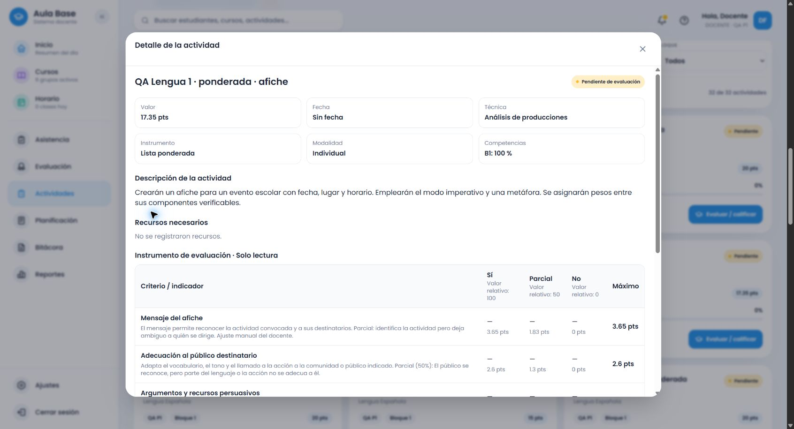

# Lengua común 1.º: contratos de contenido y editor (.20)

Este bloque verificable amplía los seis temas existentes y corrige dos contratos compartidos del creador. **No cierra todavía el grado**: la revisión de procedimientos detallados continúa antes de avanzar a 2.º. El encargo vigente comprende exclusivamente Lengua Española común de 1.º a 6.º, en orden.

## Causas y correcciones confirmadas

- Los proveedores anteriores cubrían familias principales, pero omitían requisitos focalizados de gramática y recursos. El título o una palabra aislada podían prevalecer sobre la acción/producto. Ahora se añaden evidencias específicas de los contenidos pedidos, se distinguen producción, análisis, comparación e informe, y «presentarán un trabajo escrito» no impone oralidad.
- La guía exigía publicar aun sin pedirlo. La escritura legible y las convenciones se evalúan en la versión presentada; publicación y revisión del borrador se incorporan cuando se solicitan. La exclusión de «sin publicar» conserva los requisitos de la oración siguiente. Se reprodujeron ambos fallos antes de corregirlos.
- El reparto del servicio redondeaba con una regla distinta de la usada por el editor; además el editor derivaba pesos de puntos ya redondeados. Ambos usan ahora centésimas y pesos relativos originales; la ponderada normaliza sus porcentajes antes de asignar puntos. Se preservan pesos manuales y puntaje pendiente.
- Cambiar el tipo con un instrumento preparado podía sustituir contenido. El diálogo solicitado ofrece conservar, adaptar o cancelar. La adaptación sólo se aplica con respuesta compatible y vigente; conserva el borrador ante fallos y descarta respuestas tardías. Conservar cambia la clasificación, preserva filas/IDs/puntos y al guardar alinea únicamente la clasificación del snapshot nuevo, sin modificar históricos.
- Dos cambios de campos antes del siguiente render podían sobrescribir datos. Una regresión reproduce modalidad seguida de descripción; el manejador aplica el cambio recibido sobre el último borrador. Se recargó el navegador para verificar el código actualizado, pues la sesión conservaba código previo durante cambios de desarrollo.

## Fuente y cobertura efectivamente comprobada

MINERD 2023, PDF 69–75, revisado visualmente. Se conservan las continuaciones entre páginas de noticia, guía e informe. El bloque anómalo sobre noticia al pie de PDF 74 no se asigna al caligrama. El texto oficial permanece separado de las adaptaciones evaluativas.

| Tema | Familias comprobadas por servicio normal |
|---|---|
| Noticia | análisis, comparación, redacción, noticiero, debate, informe, investigación |
| Guía turística | elaboración, análisis, presentación oral, comparación, informe, investigación |
| Informe de lectura | elaboración, análisis, comparación, presentación oral |
| Afiche | creación, análisis, comparación, presentación oral, informe |
| Cuento policíaco | escritura, análisis, comparación, narración, presentación del análisis, informe |
| Caligrama | creación, análisis, comparación, recitación, explicación, informe |

Hay 34 familias, 55 contratos de subtemas y cuatro formatos comprobados por HTTP autenticado mediante el proxy habitual: **660 solicitudes**, con títulos explícitos/neutrales/incompatibles, tres totales en la primera familia y 17,35 en las restantes. Otras **12 solicitudes** verifican publicación ausente, requisitos conjuntivos y negaciones después del último cambio. Esto no prueba cualquier combinación imaginable ni sustituye revisar cada procedimiento curricular.

La recomendación explícita usa calidad en varias dimensiones → rúbrica; presencia/ausencia → cotejo; regularidad/grados → escala; pesos entre componentes → ponderada. El instrumento elegido expresamente por el docente prevalece. No se distribuyen recomendaciones por cuotas.

## Edición y persistencia real

Cuenta ficticia autorizada, Supabase local, cursos/asignaturas/ámbitos reales del entorno de pruebas. Se guardaron y reabrieron desde el listado, incluso después de reiniciar el backend:

| Formato | Caso | Total | Comprobaciones |
|---|---|---:|---|
| Rúbrica | noticia: estructura, sinónimos y siglas | 17,35 | puntaje pendiente, conservar tipo sin cambiar filas, cancelar/Escape, completar una celda, descriptor manual |
| Cotejo | guía con mapas **y** fotografías | 20 | adaptación a análisis y vuelta a elaboración, edición manual, publicación no exigida |
| Escala | recitación de caligrama | 15 | descriptor manual; al agotar candidatos se añadió indicador manual sin contenido genérico |
| Ponderada | afiche: convocatoria, imperativo y metáfora | 17,35 | pesos manuales 21/15/16/12/12/12/12 conservados al cambiar total 20→17,35; indicador manual |

La adaptación de la ponderada se sometió a un **HTTP 400 real**, usando temporalmente una descripción que excede el límite del servicio: mensaje visible, reintento disponible, textos y pesos idénticos, sin alternativa local que ocultase el error. Se canceló y restauró la consigna válida antes de guardar. Las pruebas unitarias cubren además 403, fallo temporal con reintento exitoso, formato/tipo incompatible y respuesta tardía tras cancelar, cambiar descripción o contexto. La pantalla permite 10.000 caracteres mientras el DTO admite 5.000; la discrepancia preexistente queda identificada para su corrección dentro del flujo compartido.

Los **28 snapshots anteriores permanecen idénticos**; el entorno contiene ahora 32 actividades con snapshot. No se restableció la base, no se alteró producción ni se añadieron dependencias.

## Evidencia reproducible

- [Contratos oficiales de subtemas](../../../data/evaluation-instruments/language-grade-one-subtopic-contracts.json).
- [Servicio habitual y recomendaciones automáticas](evidencias/lengua-1-servicio-normal.json).
- [24 instrumentos completos: seis temas × cuatro formatos](evidencias/lengua-1-instrumentos-completos.json).
- [Requisitos ausentes y negaciones](evidencias/lengua-1-requisitos-ausentes.json).
- [Recorridos del navegador](evidencias/lengua-1-flujo-navegador.json) y [actividades persistidas completas](evidencias/lengua-1-persistencia.json).
- [Baseline de históricos](evidencias/lengua-comun-historicos.json).

## Verificación y entorno

Backend: **1.390 pruebas aprobadas**. Frontend: **971 pruebas aprobadas**, incluidas 54 del archivo del editor. Servicio y alternativa local: 112 contratos comparan criterios, descriptores y puntuaciones, incluyendo 15/20/17,35 y puntaje pendiente. Builds backend/frontend/shared y Cloudflare aprobados; Cloudflare usó exclusivamente `--dry-run`. `git diff --check` sin errores.

Rama `amplia-instrumentos-secundaria`, remoto `https://github.com/thebuuba/Proyecto-educativo-v3.git`. Evidencias ejecutadas sobre base `de15fce28ca70500b3061d03dc6e7edc6206af4d` más los cambios de este bloque, declarados `dirty: true` por `/health`. Catálogo instalado/cargado `evaluation-2026.20`; `.19` archivado. Frontend 5173, backend 3000 y Supabase 54321/54332 locales. El commit y push se registran al confirmar el bloque, sin atribuir previamente al runtime un hash todavía inexistente.

## Pendiente antes de cerrar 1.º

Revisar y conectar requisitos de procedimientos que no aparecen como subtemas conceptuales separados: paráfrasis, anticipación y comprobación de predicciones, vocabulario inferido del contexto, clasificación de lugares y conectores espaciales, planificación mediante esquema, ilustración solicitada y rima/ritmo del caligrama. Comprobar consignas de comprensión oral y las combinaciones pertinentes; conservar la diferencia entre evidencias nucleares y recursos expresamente solicitados. La matriz mantiene el estado parcial hasta cerrar estos puntos. Después siguen 2.º, 3.º, 4.º, 5.º y 6.º; las optativas permanecen separadas.
