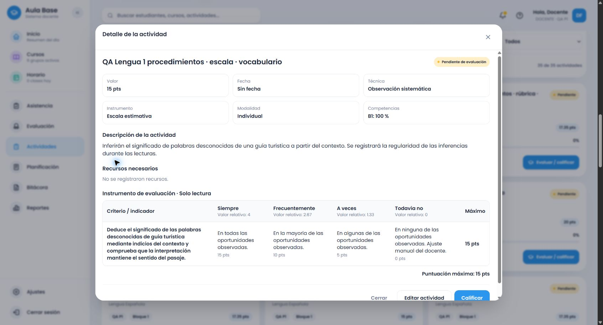

# Lengua 1.º: procedimientos explícitos y estructura de la escala

Bloque posterior a `521a3f153ef5ee2632db9433bce6a32b8c85ce5c`, rama `amplia-instrumentos-secundaria`, repositorio `thebuuba/Proyecto-educativo-v3`. Catálogos locales `.21` (procedimientos) y `.22` (grados de escala); `.20` y `.21` archivados. Producción y base remota no intervenidas.

## Causas y correcciones

El inventario contenía procedimientos que no tenían criterios propios conectados: paráfrasis, anticipación, vocabulario contextual, clasificación de lugares, planificación, ilustración del cuento y rima/ritmo. Algunos se confundían con producción escrita o recitación. Se añadieron 19 contratos vinculados a procedimientos oficiales de PDF 69–74, separados de sus adaptaciones evaluativas. Se conservaron las asociaciones revisadas visualmente y la anomalía de noticia al final de PDF 74.

La detección prioriza las acciones de comprensión cuando no se solicita producir el género. Una paráfrasis oral de caligrama ya no exige recitarlo; analizar un fragmento no impone su desenlace. Una anticipación sin comprobación posterior no exige esa comprobación. Caligrafía y tipografía, diálogo y descripción, se exigen por separado según la consigna. Los procedimientos se componen con los requisitos gramaticales y las familias existentes sin rellenar filas genéricas.

La recomendación de escala funcionaba, pero la conversión copiaba las progresiones de la rúbrica. Falló la regresión que esperaba frecuencia en lugar de «Destacado/Logrado». Ahora el indicador expresa la evidencia específica una sola vez y las celdas contienen grados breves: Siempre/Frecuentemente/A veces/Todavía no para regularidad; Completo/Suficiente/Parcial/Aún no logrado para grado de cumplimiento. Servicio y alternativa comparten la transformación; la rúbrica mantiene progresiones específicas. La elección explícita de instrumento conserva prioridad. Los snapshots existentes no se convierten.

El editor permitía 10.000 caracteres y los DTO rechazaban más de 5.000. Interpretación, recomendación y editor usan el mismo límite de 10.000. Se comprobó aceptación de 10.000 y rechazo de 10.001; no se ocultaron validaciones con una alternativa local.

## Verificación

- Backend: 1.470 pruebas; frontend: 1.201. Incluyen 78 controles nuevos de procedimientos, 340 contratos de igualdad entre servicio/alternativa y puntuación, y dos contratos de escala con adición de fila y conservación de la rúbrica. Los fallos de contenido y escala se reprodujeron antes de corregirlos.
- Builds de backend, frontend y Cloudflare (`--dry-run`) aprobados, además de shared. Sin despliegue.
- Servicio normal autenticado: 600 propuestas `.21`: 19 procedimientos × cuatro formatos × cinco combinaciones de título/total, más 55 subtemas × cuatro formatos. Títulos explícitos, neutrales e incompatibles; 15, 20 y 17,35.
- Comprobación adicional `.22`: 19 procedimientos en escala, tres totales y dos propósitos. Evidencia independiente de la batería `.21`.
- Navegador: cuatro actividades ficticias creadas mediante formulario, resumen y confirmación, reabiertas desde el listado y contrastadas con la respuesta persistida. Rúbrica de noticia/paráfrasis 17,35; cotejo de planificación de informe 20; escala de vocabulario contextual 15; caligrama ponderado con rima/ritmo 17,35. Puntos inicialmente pendientes y edición manual conservada en cada formato. Rúbrica/cotejo quedaron con `.21`; escala/ponderada con `.22`.
- Los 28 snapshots de la línea base y los cuatro instrumentos completos guardados en `.20` se conservan; hay 36 actividades con snapshot. Para los cuatro de `.20` se comparan también todos sus campos; la línea base antigua solo acredita snapshot, tipo y puntuación.

## Evidencias y archivos

[`language-grade-one-procedure-contracts.json`](../../../data/evaluation-instruments/language-grade-one-procedure-contracts.json) vincula las consignas y criterios con sus procedimientos oficiales. Proveedores: `language-procedure-criteria.ts`, `secondary-language-grade-one-complete.ts`, `language-feature-criteria.ts`, detector compartido y `language-scale.ts`. Integración en `recommendation-engine.ts` y `secondary-topic-recommendation.ts`; DTO y editor comparten el límite. Pruebas de regresión y scripts de comprobación acompañan el cambio.

[76 instrumentos completos de procedimientos](evidencias/lengua-1-procedimientos-instrumentos.json), [600 comprobaciones HTTP](evidencias/lengua-1-procedimientos-servicio.json), [escalas por grado/frecuencia](evidencias/lengua-1-escalas-grados-frecuencia.json), [recorridos visibles](evidencias/lengua-1-procedimientos-flujo-navegador.json), [persistencia completa y entorno ejecutado](evidencias/lengua-1-procedimientos-persistencia.json).

## Pendiente antes de cerrar 1.º

Este bloque no declara completo el grado: falta cerrar el cotejo detallado de las cláusulas de procedimiento con cada familia, especialmente grados del adjetivo, signos concretos de puntuación en guía/informe, planificación sin imponer esquema cuando no se pide y uso de recursos lingüísticos en producción oral. Continuar estos puntos y actualizar los límites de cobertura antes de pasar a 2.º. El diálogo conservar/adaptar/cancelar y la puntuación quedan verificados en el bloque `.20`; aquí no se repitió una simulación como si fuera un nuevo guardado real.
