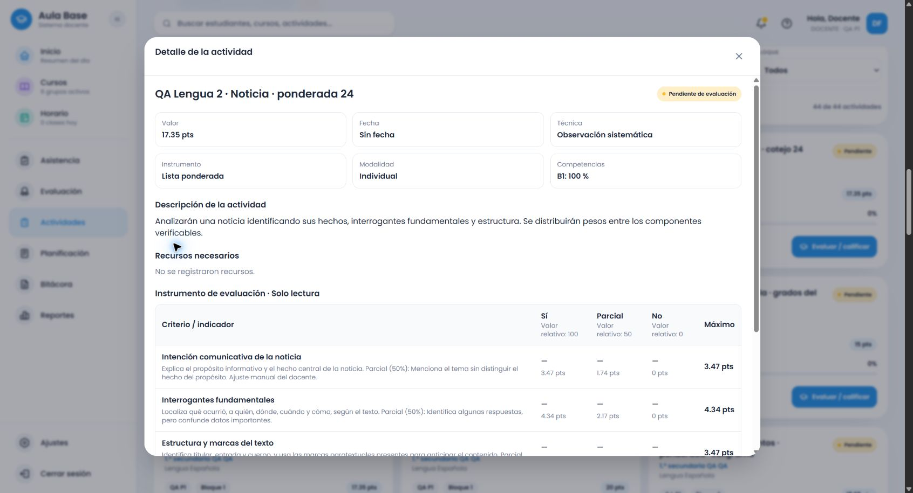

# Lengua Española común de 2.º: acciones, subtemas y procedimientos (.24)

Este bloque amplía los seis temas y verifica 100 contratos. **2.º continúa parcial**: se ha comprobado una familia representativa por cada bloque de procedimientos, pero quedan requisitos finos que no se confunden con cobertura total. 3.º–6.º siguen pendientes.

## Causas confirmadas y correcciones

- El detector interpretaba «presentarán» como oral sin evidencia oral. La entrega escrita, el análisis, la paráfrasis, la planificación y la exposición explícita ahora resuelven acciones diferentes.
- La alternativa local de noticia de 2.º dependía de recibir un tipo explícito; sin él generaba contenido anterior distinto del servicio. Comparación roja: 144 casos. Ambos recorridos utilizan el mismo proveedor contextual.
- Algunos subtemas estaban inventariados pero no conectados: características de noticia, persuasión e información gráfica produjeron 12 regresiones rojas. Se añadieron conexiones y criterios lingüísticos específicos.
- Los procedimientos mezclados perdían evidencias; producir oralmente un informe reutilizaba indicadores para analizar un informe ajeno. Se reprodujeron 36 fallos de procedimientos y se conectaron producción oral, organizadores de comprensión, apoyos, recursos alternativos/conjuntos, diálogo y pronombres.
- El título «La guía turística» desplazaba una descripción sobre noticia. Ahora el género explícito de la descripción impide ese reemplazo.
- En el navegador, «pesos entre los componentes» activaba el verbo componer y transformaba análisis de noticia en redacción. Dos regresiones (1.º y 2.º) fallaron antes de acotar la flexión verbal. La ponderada se guardó después de comprobar NEWS_ANALYSIS en el selector.
- Un empate de centésimas variaba al convertir porcentajes a coma flotante. El editor utiliza centésimas enteras de peso; los pesos editados permanecen y los repartos coinciden con los del servicio.

## Fuente y alcance

Revisión visual de PDF 76–81 del currículo MINERD 2023, SHA 80b22b3adb3290bd251bde65c98b78b60f24845ab43b70c1f4e3294e0b6f6c58. Se conservan 51 registros de subtemas y 24 bloques procedimentales, incluidos límites y continuaciones de página. La lista de autores del cuento continúa entre 79 y 80. La escritura de noticia no se atribuye como bloque oficial a PDF 76. Optativas separadas.

| Tema | Familias y requisitos comprobados en este bloque |
|---|---|
| Noticia | Comprensión, noticiero, oraciones, tiempos, párrafos, predicción y vocabulario en contexto |
| Guía turística | Lectura, clasificación, escritura, oral, topografía, signos, anticipación, reconstrucción y mapas/fotografías |
| Artículo expositivo | Lectura y paráfrasis, producción oral/escrita, investigación, planificación, organizador de comprensión, concordancia, demostrativos, conectores y apoyos |
| Informe de lectura | Comprensión oral/escrita, producción oral/escrita, oración temática, tiempos y proceso de revisión/publicación solicitado |
| Cuento de amor y amistad | Comprensión, fragmento sin desenlace impuesto, narración, escritura, autoría, actantes, subjuntivo, diálogo y pronombres |
| Décima espinela | Comprensión, recitación, escritura, versos/rima, figuras, interjecciones y revisión/publicación solicitada |

Los cuatro formatos se prueban en cada contrato. La escala mantiene indicador contextual y grados breves; ponderada incluye cumplimiento parcial. Los textos evaluativos son adaptaciones de Aula Base, no citas oficiales. [Cotejo con cada elemento y bloque](lengua-2-cotejo-fuente.json).

## Evidencia

- Backend completo: 1.919 pruebas; frontend completo: 2.533. Después de corregir «componentes» y dos concordancias, 1.693 pruebas específicas de contratos/reparto también pasan. Los 403 casos de backend de 2.º incluyen subtemas, procedimientos y regresiones; 1.200 contrastes de frontend comparan contenido, títulos incompatibles y reparto con 15, 20 y 17,35, antes/después de preparar.
- 596 solicitudes autenticadas: 100 contratos × cuatro formatos; los 24 procedimentales también con títulos incompatibles; cuatro recomendaciones automáticas según calidad, presencia, regularidad y pesos. No se reparten instrumentos por cuotas.
- Cuatro creaciones mediante interfaz normal, edición manual, resumen, guardado y reapertura desde listado: rúbrica de artículo oral (20), cotejo de demostrativos (17,35), escala de regularidad de recitación (15), ponderada de análisis de noticia (17,35). IDs/textos/snapshot/catálogo comprobados por API contra persistencia local real.
- Preservados 28 snapshots de línea base y 16 instrumentos completos; 44 snapshots actuales. El primer guardado de rúbrica/escala precedió a dos correcciones menores de concordancia: se conserva esa edición histórica; las propuestas HTTP finales contienen las correcciones. La ponderada incorrecta detectada en UI no se guardó.
- Builds backend, frontend y Cloudflare dry-run aprobados; siete pruebas del inventario. Sin despliegue, migraciones ni restablecimiento de base.

[Instrumentos completos](evidencias/lengua-2-cierre-instrumentos.json), [servicio y entorno](evidencias/lengua-2-cierre-servicio.json), [navegador](evidencias/lengua-2-cierre-flujo-navegador.json), [persistencia real](evidencias/lengua-2-cierre-persistencia.json), [históricos](evidencias/lengua-historicos-evaluation-2026.24.json).

## Archivos y continuación

Proveedores nuevos secondary-language-grade-two-features/complete; detector y adaptadores compartidos; puntuación y fallback del editor; catálogo .24 y archivo inmutable .23; fixtures de 51 subtemas/24 procedimientos/25 contratos, regresiones y scripts de HTTP/persistencia. El creador y el diálogo transaccional se conservan; sus regresiones pasan, no se presenta ese resultado como una nueva repetición manual del diálogo.

**Pendiente inmediato:** Completar requisitos finos de procedimientos: registro/soporte y destinatario; operaciones de omisión, selección, generalización y reconstrucción del resumen; vocabulario temático y recursos no verbales; clasificación de personajes y conectores subordinantes. Contrastar familias complementarias y requisitos compuestos antes de cerrar 2.º; después continuar 3.º–6.º.

Rama amplia-instrumentos-secundaria; repositorio https://github.com/thebuuba/Proyecto-educativo-v3.git. Base ejecutada 56e72f427df454e4477117c35ca35b9d8de90292 con cambios de este bloque; catálogo local evaluation-2026.24. El hash final queda en el historial Git y en el informe de continuidad tras commit/push.
