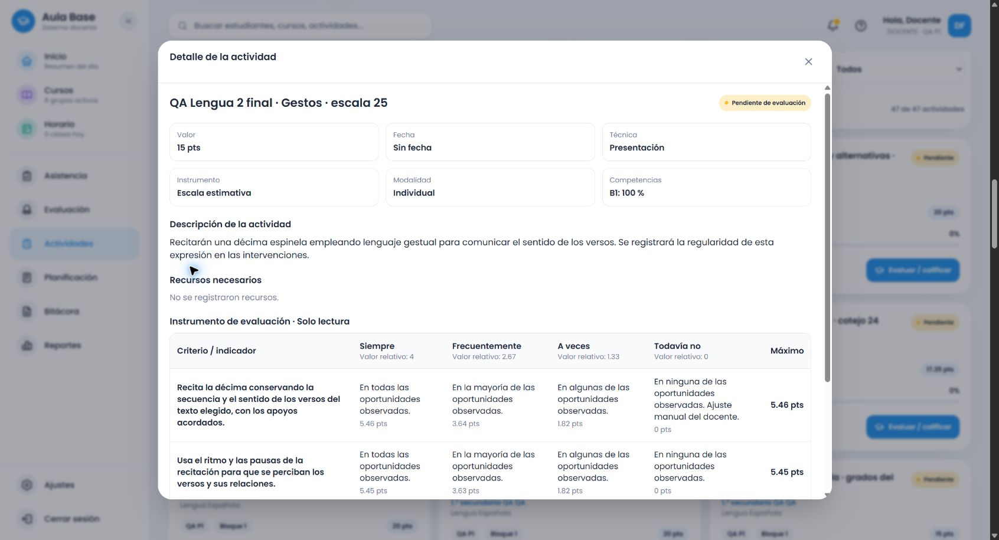

# Lengua Española común: cierre de las familias verificadas de 2.º

Se cierran los pendientes definidos de los seis temas de 2.º, tras cotejar 51 registros de subtemas y 24 bloques de procedimientos en PDF 76–81. El alcance es el conjunto de familias y requisitos documentados; no la interpretación universal de cualquier descripción. 3.º–6.º siguen pendientes.

## Cobertura conectada

| Tema | Familias verificadas |
|---|---|
| Noticia | Comprensión/análisis, redacción, noticiero, comparación, informe, debate e investigación de hechos |
| Guía turística | Comprensión/análisis, elaboración y planificación, oral, comparación, informe e investigación de lugares |
| Artículo expositivo | Comprensión/análisis y organizadores, producción/planificación escrita, oral, comparación, informe e investigación |
| Informe de lectura | Comprensión/análisis, escritura, producción oral y comparación |
| Cuento de amor y amistad | Comprensión/análisis de texto o fragmento, escritura/planificación, narración, comparación e informe |
| Décima espinela | Comprensión/análisis, escritura, recitación, comparación e informe |

Cada familia utiliza rúbrica, cotejo, escala y ponderada. Los requisitos lingüísticos/procedimentales se añaden cuando se solicitan; no se concatenan títulos para fingir contenido. [Cotejo de fuente, familias, contratos y límites](lengua-2-cotejo-fuente.json). El [bloque .24](lengua-2-acciones-y-procedimientos.md) documenta la auditoría visual, los primeros 100 contratos y las causas compartidas.

## Cierre de pendientes

Treinta y un contratos adicionales comprueban operaciones de resumen, registro, soporte, léxico temático, recursos no verbales, roles y ambiente de personajes, conectores subordinantes, tono informativo, investigación de noticias y familias complementarias. Incluyen mapas semánticos/conceptuales, esquema o guion y recursos gráficos alternativos o conjuntos.

Se reprodujeron 48 fallos iniciales, ocho de familias y 24 de requisitos adicionales con consignas revisadas. En particular, elaborar un organizador **para comprender lo leído** se confundía con redactar el género estudiado; ahora conserva la acción de comprensión. Comparar clasificaciones de guías ya no se reduce a clasificar. La investigación de noticia llega al proveedor compartido del servicio, que antes no la admitía aunque la alternativa local sí.

La recitación integra los gestos cuando se piden. Un fragmento no exige un desenlace ausente. Los soportes físico **y** digital son conjuntos cuando así se solicitan; **o** conserva alternativas. Ocho regresiones adicionales reprodujeron la activación incorrecta de gráficos y exposición a partir de «sin mapas» y «sin exposición oral»: detector y selección de criterios ahora eliminan esas cláusulas negativas antes de interpretar requisitos. El catálogo .24 queda archivado con sus datos originales; .25 contiene la nueva política y los requisitos ampliados. No cambian los snapshots anteriores.

## Pruebas y evidencia real

- Backend completo final: **2.051** pruebas; frontend completo: **2.905**, más 2.064 verificaciones de contratos repetidas tras corregir las negaciones. Los 1.572 casos cruzados de 2.º comparan servicio/alternativa, contenido, títulos incompatibles y puntajes 15, 20 y 17,35 antes/después de preparar. Los contratos globales mantienen selección manual, añadir criterios/completar celdas, borradores y diálogo transaccional.
- **132 solicitudes autenticadas** finales: 31 contratos × cuatro formatos, con títulos neutros o incompatibles y totales alternados entre 15, 20 y 17,35, más ocho peticiones posteriores para verificar las negaciones. Se conservan por separado las 596 del bloque .24. Pruebas unitarias y HTTP no se presentan como persistencia.
- **Cuatro nuevas creaciones en navegador** con cuenta ficticia local: guía oral con alternativas y registro formal en rúbrica (20); operaciones de resumen en cotejo (17,35); gestos de recitación en escala de regularidad (15); organizador de comprensión ponderado (20). Cada formato se recomendó por la finalidad escrita en la consigna, sin selección forzada. Se introdujo el total después de preparar, se hizo una edición manual, se confirmó el resumen y se reabrió desde el listado.
- Se compararon todos los textos capturados en el editor con los campos realmente persistidos, además del catálogo, tipo, snapshot y total. **48 snapshots** preservados: 28 de línea base y 20 instrumentos completos capturados durante la tarea. Ocho de los guardados corresponden a 2.º.
- Builds backend, frontend y Cloudflare dry-run, y siete pruebas de inventario aprobados. Sin despliegue, cambios de base, dependencias ni IA.

[Instrumentos completos finales](evidencias/lengua-2-final-instrumentos.json), [servicio y entorno](evidencias/lengua-2-final-servicio.json), [negaciones](evidencias/lengua-2-final-negaciones.json), [flujo del navegador](evidencias/lengua-2-final-flujo-navegador.json), [persistencia](evidencias/lengua-2-final-persistencia.json), [preservación histórica](evidencias/lengua-historicos-evaluation-2026.25.json).

## Continuidad

Se mantienen el creador vertical, tarjetas, progreso y resumen. El diálogo conservar/adaptar/cancelar y sus fallos está documentado en el bloque .20: sus pruebas vuelven a pasar; no se afirma una nueva repetición manual en este bloque. La cobertura de familias no incluye combinaciones contradictorias o requisitos no previstos; se conserva la posibilidad de edición docente.

Archivos principales: secondary-language-grade-two-features/complete, secondary-language-topics, language-procedure-criteria y conexión de investigación en recommendation-engine; catálogo .25/archivo .24; contratos y regresiones, scripts de servicio/persistencia y documentos de cobertura. No se modificaron migraciones ni historiales.

Rama amplia-instrumentos-secundaria; repositorio https://github.com/thebuuba/Proyecto-educativo-v3.git. Base ejecutada 9832264d58ff5a689a94cd153d6dc06b5b1e2a0e con cambios del cierre; catálogo local evaluation-2026.25. **Siguiente: 3.º, PDF 82–88**, antes de continuar 4.º–6.º. No hay bloqueo ni se necesita nueva autorización.
