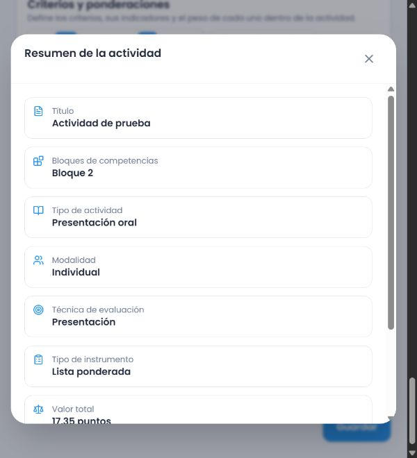

# Lengua Española 2.º — primer bloque contextual

## Alcance y fuente

Se incorporan cinco módulos específicos: guía turística, artículo expositivo, informe de lectura, cuento de amor y amistad y décima espinela. La noticia conserva su módulo anterior; su reauditoría no se da por terminada.

Fuente: PDF aportado por el usuario, SHA256 registrado en `revision.json`. Se revisaron visualmente las tablas PDF 76–81 (impresas 75–80). Las asociaciones de los 23 procedimientos se registran mediante sus identificadores originales. No se enlazan competencias o indicadores por proximidad de columnas. La continuación de producción escrita de noticia que aparece en PDF 74 permanece como anomalía de extracción pendiente; no se reasigna silenciosamente a 2.º.

| Tema | PDF / impresa | Adaptación revisada |
|---|---|---|
| Guía turística | 77 / 76 | Propósito, lugares, organización y orientación espacial; información gráfica sólo cuando se pide. El análisis de estructura se limita a esa evidencia y su sustento. |
| Artículo expositivo | 77–78 / 76–77 | Problema-solución, ideas, explicación causal y evidencias. Comparar, analizar y escribir producen observaciones diferentes. |
| Informe de lectura | 78–79 / 77–78 | Resumen fiel, análisis sustentado, estructura y cohesión. No se exige crear un cuento por utilizarlo como texto leído. |
| Cuento de amor y amistad | 79–80 / 78–79 | Conflicto, personajes, ambiente y recursos expresivos. La narración oral valora secuencia, referencias narrativas y claridad expresiva; no impone un análisis literario escrito. |
| Décima espinela | 80–81 / 79–80 | Tema, diez versos octosílabos, rima y recursos expresivos cuando corresponden. Recitar valora secuencia del texto elegido, ritmo, pausas y expresión; no exige composición, análisis métrico ni memorización. No se añadió un esquema de rima ausente del texto de referencia. |

Los criterios y descriptores son adaptaciones evaluativas editables de Aula Base, no citas ni instrumentos aprobados por MINERD. Los apoyos de acceso acordados son válidos; no se califica personalidad, vivencias privadas, contacto visual ni dominio de equipamiento.

## Arquitectura y preservación

- Datos por tema en `packages/shared/src/secondary-topics/language/grade-2.ts`; compositor compartido por backend y alternativa local. Sin IA durante la ejecución ni dependencias nuevas.
- Los siete módulos anteriores de Lengua se separaron del motor sin cambiar sus criterios. La duplicación anterior con la alternativa frontend y la calidad de sus descriptores siguen pendientes de la reauditoría de 1.º/noticia de 2.º.
- Nuevo release `evaluation-2026.8`; el archivo del release `evaluation-2026.7` no se modificó. La validación acepta snapshots de ambas versiones.
- La asignación compartida distribuye centésimas exactas. Las selecciones explícitas del docente preceden a la inferencia. Los recursos no se convierten en productos o requisitos por coincidencia de palabras.
- El creador mantiene sus cinco tarjetas, instrumento editable, progreso y resumen. No se agregaron campos, pasos, estilos de identidad o avisos técnicos permanentes.
- Catálogo instalado únicamente en Supabase local confirmado, puerto 54332. Dos reinstalaciones devuelven `UNCHANGED`; los fingerprints de todos los releases anteriores permanecen iguales. Para la comprobación posterior de persistencia se aplicó localmente la migración existente `20261012210038_instrument_snapshot_lineage.sql`, sin modificar su archivo, dentro de una transacción que también registra el historial. No se modificó la base remota.

## Verificación realizada

- Backend completo después de verificar persistencia: 34 archivos, 447 pruebas aprobadas. Incluye 52 pruebas del bloque, 86 pruebas anteriores del motor y diez casos de validación de tipos en el contrato HTTP. La revisión detectó y corrigió el rechazo de «Análisis» y «Comparación» seleccionados explícitamente.
- Frontend completo: 78 archivos, 503 pruebas aprobadas. Incluye 20 casos de alternativa editable (cinco temas × cuatro formatos) y cinco casos del creador que cambian formatos, asignan 17.35 y confirman el resumen. La descripción está sustituida por un textarea en estas pruebas de componentes.
- Inventario: cinco pruebas aprobadas; regeneración conserva las asociaciones y rechaza referencias de otro ámbito o fuente.
- Compilaciones backend, frontend y `pnpm cloudflare:build` aprobadas. Cloudflare ejecuta `--dry-run`; no se publicó un Worker.
- Revisión directa de ejemplos: se corrigieron recitación que exigía análisis métrico, narración oral confundida con análisis, informe breve no detectado y recursos que imponían gráficos. Pruebas de regresión documentan las entradas concretas.
- Navegador: fixture temporal con el componente real y editor de descripción real, alternativa local tras fallo simulado del servicio, sin cuenta ni datos reales. Décima: puntos inicialmente vacíos, criterios orales, cuatro formatos, total 17.35, resumen y confirmación ficticia observados. La fixture se elimina del árbol antes del commit.



## Pendientes y límites

Este bloque no certifica toda Lengua de 2.º ni toda secundaria. La persistencia posterior se verificó mediante HTTP local con sesión sintética y guards reales; no se probó el inicio de sesión con contraseña. El callback simulado del navegador no demuestra escritura en base de datos. Los cinco temas se probaron en componentes; sólo la décima se recorrió directamente en navegador en este bloque.

Reauditar Lengua 1.º y La noticia de 2.º; revisar preservación manual y ejemplos adicionales antes de cerrar el bloque A. Continuar luego con 3.º–6.º y el resto de la matriz. No activar optativas en ámbitos equivocados. Quedan sin cubrir los diseños específicos técnico-profesionales y de menciones artísticas que requieren fuentes adicionales.

Incidencia visual anterior observada en la escala: los valores relativos pueden mostrar decimales largos (por ejemplo 2.6666666666666665). No afecta la suma en centésimas; corregir su presentación sin alterar los valores guardados ni el diseño acordado.

## Persistencia local posterior

Se ejecutó `scripts/evaluation-instruments/verify-secondary-local.mjs` contra Supabase local confirmado (DB 54332, API 54321). El script crea exclusivamente una escuela, un docente y una asignación ficticios, sin estudiantes ni calificaciones. Levanta el backend compilado en un puerto local efímero. Usa el adaptador real del frontend para construir y alinear los campos finales; no copia la definición del instrumento.

[Evidencia estructurada de los 20 casos](evidencias/persistencia-lengua-2.json): cinco temas × cuatro formatos guardados, con reintento idéntico sin duplicados. Una edición manual genera snapshot versión 2 enlazado a versión 1; el fingerprint de la versión 1 permanece igual. Se rechaza un reintento con datos diferentes y una petición sin sesión. Los fingerprints de releases y snapshots ajenos a la escuela ficticia permanecen idénticos. La cuenta, su rol, docente y escuela se desactivan al terminar, conservando la evidencia ficticia.

La ejecución real detectó pérdida mínima de precisión al convertir una fracción diagnóstica desde JSON de PostgreSQL: `0.16666666666666666` volvió como `0.1666666666666667`. La comparación de reintentos ahora tolera únicamente precisión de máquina para números finitos; conserva diferencias de un centésimo y cambios de ponderación reales. La prueba de regresión reproduce el caso y rechaza esos cambios.

Para reproducir con los paquetes existentes, primero compilar backend e instalar el catálogo en la DB local. Después ejecutar desde la raíz:

```powershell
pnpm exec node packages/database/node_modules/tsx/dist/cli.mjs scripts/evaluation-instruments/verify-secondary-local.mjs <ruta-absoluta-al-CLI-pnpm.mjs>
```

El script confirma los destinos antes de importar la aplicación, no imprime claves y no aplica migraciones automáticamente. La sesión JWT sintética representa sólo al docente ficticio; la validación carga sus roles y asignación desde la DB local.
