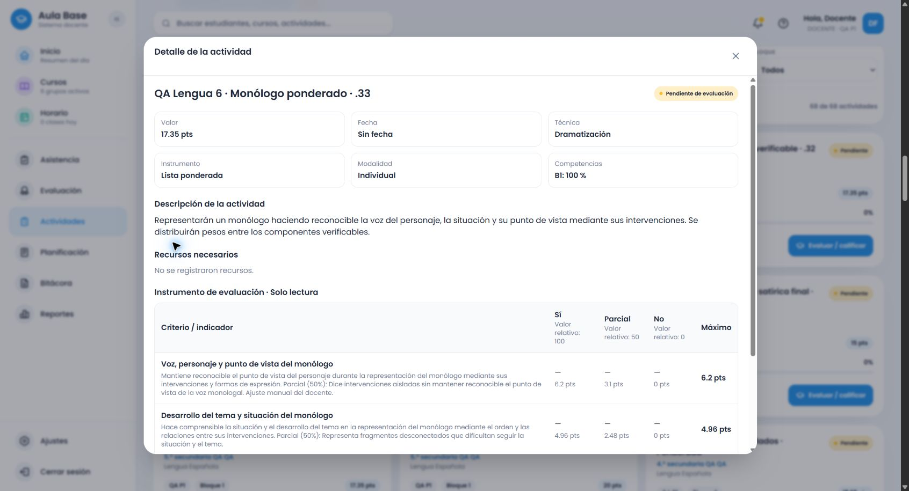

> Actualización del flujo de criterios (.46): el cierre previo conservó una regresión de añadir/completar no detectada en sus ejemplos. Se corrigieron agotamiento, recuperación, intención/identidades, respuestas obsoletas y procedencia; se verificaron los proveedores de las40 familias de Lengua y los cuatro formatos. [Informe y límites](criterios-adicionales-informe.md), [matriz](criterios-matriz-proveedores.md). Las evidencias anteriores permanecen intactas; no se amplía el ámbito curricular.

# Lengua Española común: cierre de sexto

Se verifican los siete temas de sexto dentro de las familias y requisitos definidos. Catálogo final `evaluation-2026.33`; `.31` y `.32` archivados sin modificar los snapshots guardados. Los criterios son adaptaciones evaluativas de Aula Base; el texto curricular oficial permanece diferenciado.

## Fuente y cobertura

PDF MINERD 2023, páginas PDF113–121 revisadas visualmente. Se cotejaron 59 conceptos y 40 registros de procedimientos, correspondientes a 26 modalidades con encabezados y continuaciones. El [cotejo completo](lengua-6-cotejo-fuente.json) conserva cada subtema, procedimiento, fuente, familia y contrato.

| Tema | Familias definidas y comprobadas |
|---|---|
| Informe de investigación | comprensión/análisis, planificación y escritura, producción oral, comparación, debate, investigación |
| Reportaje | comprensión/análisis, planificación y escritura, producción oral, comparación, debate, informe, investigación de fuentes |
| Ensayo argumentativo | comprensión/análisis, planificación y escritura, comparación, debate, informe |
| Discurso de graduación | comprensión/análisis, planificación y escritura, producción oral, comparación, debate, informe |
| Novela | comprensión/análisis del pasaje disponible, comparación, debate, informe |
| Poesía social | comprensión/análisis, escritura, recitación, comparación, debate, informe |
| Monólogo | comprensión/análisis, escritura, representación, comparación, debate, informe |

Todas se adaptan a rúbrica, cotejo, escala y ponderada. Los requisitos gramaticales y recursos se activan según la consigna. La novela no exige creación ni un desenlace ausente del fragmento. La nota curricular de preparación oral del ensayo no obliga a exponer un producto escrito. La escritura del discurso de graduación se distingue de su oralización.

El original no rotula la comprensión escrita del ensayo en PDF116: se registra la modalidad por el párrafo que habla del ensayo que se lee, sin inventar un encabezado. Un registro de PDF117 combina final de producción oral y comienzo de comprensión escrita de graduación. La clasificación gramatical ambigua del reportaje y la repetición de indicaciones orales en comprensión escrita del monólogo se conservan como fuente, sin convertirlas en exigencias o reglas pedagógicas falsas. Las optativas permanecen separadas.

## Fallos reproducidos y corregidos

Los siete temas aún no estaban conectados a un proveedor contextual de sexto. La batería inicial reprodujo 28 fallos de contenido. La composición compartida se amplió con perfiles y requisitos específicos, reutilizando lo válido de otros grados.

La búsqueda elegía el primer género registrado, aunque apareciera después en la descripción; podía tomar reportaje como tema de un ensayo sobre reportajes. Ahora usa la primera referencia del texto afirmativo de la consigna. Contrastar fuentes durante una redacción conserva la producción principal. «Recital» como objeto analizado no equivale al verbo recitar, y «representado» no impone una actuación. No hay condiciones basadas en títulos exactos.

La revisión del reportaje en navegador detectó que «bibliográficas» activaba «gráficas». Doce regresiones rojas en tercero, cuarto y sexto reprodujeron el problema en los cuatro formatos. El reconocimiento compartido respeta el inicio de palabra; la referencia bibliográfica ya no exige un gráfico. El cotejo real de sexto confirma tres criterios sin un recurso gráfico añadido.

La última revisión visual encontró que el monólogo se clasificaba como representación, pero sus dimensiones nucleares seguían usando redacción de análisis. Ocho regresiones rojas reprodujeron el mismo problema en monólogo y entremés, con los cuatro formatos. El compositor compartido utiliza ahora evidencias de actuación cuando el perfil dispone de ellas: punto de vista, situación, desarrollo y expresión del parlamento; en entremés, conflicto y crítica expresados en la escena. La lectura conserva sus evidencias de interpretación. La corrección final tiene versión `.33` y se verificó de nuevo por HTTP y con dos guardados reales.

## Pruebas y evidencia

- 136 consignas de sexto: siete básicas, 59 conceptuales y 70 de procedimientos/familias/requisitos. Backend final: **4.293 pruebas en 55 archivos**. Frontend final: **9.553 en 98 archivos**, incluidas 1.632 combinaciones de contrato de sexto (136 × cuatro formatos × tres totales), comparando servicio y alternativa, título incompatible y total antes/después de preparar.
- **308 recomendaciones HTTP** autenticadas en `.32`: 77 consignas × cuatro formatos. **25 solicitudes finales en `.33`**: cuatro propósitos de recomendación, cuatro elecciones manuales, clasificación/técnica del monólogo, ocho propuestas de representación/recitación y cuatro del entremés. Los subtemas restantes se comprobaron automáticamente; no se presentan como recorridos manuales.
- Puntaje pendiente y totales 15, 20 y 17.35; pesos originales, exactitud en centésimas y ediciones conservadas. Las regresiones globales incluyen añadir criterios, completar filas, selección manual/borradores, errores 4xx, respuesta incompatible u obsoleta y el diálogo transaccional.
- Builds backend y frontend aprobados; Cloudflare terminó con `--dry-run: exiting now`. Ocho pruebas de inventario aprobadas. No despliegue, restablecimiento ni cambio de esquema.

| Recorrido real | Formato | Total | Catálogo | Actividad persistida |
|---|---|---:|---|---|
| Lectura de fragmento de novela | Rúbrica | 20 | .32 | `10f76c82-de5e-48c6-a4df-178a450df53d` |
| Redacción de reportaje con referencias bibliográficas | Cotejo | 17.35 | .32 | `b36bf2e0-1257-406d-861f-2fa94ebf4eac` |
| Recitación de poema social | Escala | 15 | .32 | `41dbe84d-ca74-4f02-bc29-0df9678f46a7` |
| Representación de monólogo | Ponderada | 17.35 | .33 | `e75ef4ff-ab55-4e64-a2c0-d9a66abfc581` |

Se entró mediante la cuenta ficticia autorizada, se preparó sin puntaje, se asignó el total, se editó un campo manualmente, se confirmó el resumen y se reabrió desde el listado. Los campos y snapshots persistidos coinciden con todos los textos capturados. El borrador de monólogo anterior al ajuste fue cancelado antes de guardarse. Se conservan las versiones reales de cada evidencia; no se atribuye `.33` a los tres guardados previos en `.32`.

[HTTP .32](evidencias/lengua-6-final-servicio.json) · [instrumentos .32](evidencias/lengua-6-final-instrumentos.json) · [selección e instrumentos finales .33](evidencias/lengua-6-seleccion-servicio.json) · [navegador](evidencias/lengua-6-final-flujo-navegador.json) · [persistencia completa](evidencias/lengua-6-final-persistencia.json) · [69 históricos intactos](evidencias/lengua-historicos-evaluation-2026.33.json).

## Entorno, archivos y límites

Rama `amplia-instrumentos-secundaria`, remoto `thebuuba/Proyecto-educativo-v3`. Durante las verificaciones: base `5f7061070468aed5221019d8f37caeb29d1305b8` más los cambios de este bloque, `dirty: true`; frontend Vite5173, backend3000 y Supabase local54321. Catálogo final instalado y cargado `.33`. El commit final se identifica en el historial Git y en la entrega; el informe no atribuye a las pruebas un hash que todavía no existía cuando se ejecutaron.

Archivos principales: `secondary-topics/language/grade-6.ts`, `secondary-language-grade-six-features.ts`, `secondary-language-grade-six-complete.ts`; selección, tipos y composición compartidos; perfil de actuación de quinto; catálogos31/32/current; fixtures, pruebas backend/frontend/editor y scripts de fuente/servicio; matriz, revisión e informes. El creador y su diseño se conservan.

No quedan pendientes de estas familias y requisitos definidos. Esto no garantiza interpretar cualquier redacción posible ni completa las optativas o las demás asignaturas. El entorno es local con una cuenta ficticia; no se verificó producción. Las pruebas automáticas no sustituyen los recorridos reales identificados arriba.
