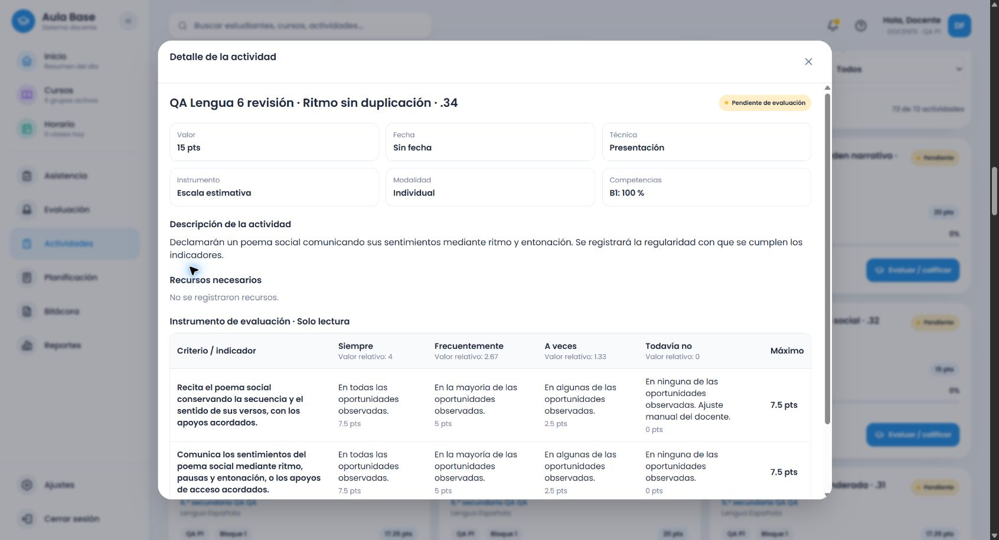

# Revisión de Lengua antes de continuar con otras asignaturas

Encargo ampliado por el usuario el 14/10/2026. Base `6687c21d8712973e43d30e4d0d971750d8094ccf`, rama `amplia-instrumentos-secundaria`. Se revisaron el diff final, la composición compartida y los ejemplos completos persistidos. Se mantienen los cotejos de fuente y familias de los 40 temas de Lengua común.

## Hallazgos corregidos

La recitación de poesía social añadía una fila de ritmo además de la fila de expresión que ya valoraba ritmo, pausas y entonación. Se elimina esa doble puntuación; una rima u otra forma solicitada conserva su evidencia distinta. La actuación del entremés agregaba una fila de comunicación oral general además de sus evidencias escénicas. El compositor ya no agrega esa fila a las representaciones. También se corrigió «ejemplos de el» por «ejemplos del» en los descriptores compartidos.

Trece regresiones: nueve fallaron antes de la corrección y las cuatro que protegen la rima expresamente solicitada ya pasaban. Las trece pasan después. El catálogo `.33` se conserva congelado; las nuevas propuestas usan **evaluation-2026.34**. No se reescribieron los ejemplos ni snapshots anteriores.

## Verificaciones

- Backend completo: **4.306 pruebas /56 archivos**. Frontend completo: **9.553 /98**. Inventario: ocho. Builds backend/frontend y Cloudflare dry-run aprobados.
- [24 propuestas HTTP normales](evidencias/lengua-revision-final-servicio.json): seis grados × cuatro propósitos/instrumentos; catálogo, formato recomendado, contenido y suma exacta 17.35 comprobados. Las selecciones manuales, borradores, alternativas y diálogo conservan sus regresiones globales.
- Cinco recorridos nuevos con cuenta ficticia autorizada: rúbrica de orden narrativo20, cotejo de recitación17.35, escala de recitación15, ponderada de monólogo17.35, ponderada de entremés17.35. Generación sin puntaje, asignación de total, edición manual, resumen, guardado y reapertura desde el listado.
- [Cuatro formatos de sexto: datos persistidos](evidencias/lengua-6-cierre-persistencia.json) y [captura de campos](evidencias/lengua-6-cierre-flujo-navegador.json). [Entremés: datos persistidos](evidencias/lengua-5-procedimientos-persistencia.json) y [captura](evidencias/lengua-5-procedimientos-flujo-navegador.json). Comparación completa de textos y snapshots, no callbacks simulados.
- [Control histórico](evidencias/lengua-historicos-evaluation-2026.34.json): 28 snapshots iniciales y 46 instrumentos completos conservados, **74 en total**.

El entorno de las pruebas ejecutó la base indicada con los cambios del bloque, informado como dirty; frontend5173, backend3000, Supabase local54321. Catálogo instalado/cargado `.34`. No hay despliegue, reset, cambios de esquema ni subagentes.

## Continuación

No quedan pendientes conocidos de las familias definidas de Lengua común tras esta revisión. No se promete interpretar cualquier redacción. El estado previo y los 24 ejemplos históricos están en el [informe de los seis grados](lengua-comun-1-6-informe-final.md); las evidencias de arriba documentan la revisión posterior.

La siguiente asignatura en el orden físico del PDF es **Inglés**, tras el cierre de Lengua en PDF121 y la portada de Lenguas Extranjeras en PDF122. Sus mallas comunes comienzan en PDF134. El orden se establece por páginas y encabezados, no por un índice inexistente ni por el orden alfabético de la aplicación. Se auditará primero 1.º y después 2.º–6.º. Inglés mantiene estado pendiente hasta que exista contenido contextual y evidencia completa; la extracción contiene encabezados gramaticales y ejemplos confundidos con temas, que requieren revisión visual.
