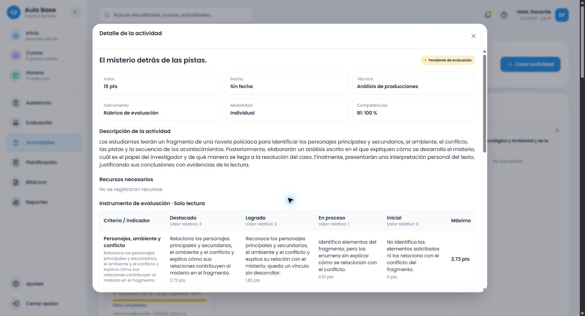

# Corrección del contrato entre tema, acción y producto

La consigna de «El misterio detrás de las pistas.» genera ahora criterios sobre el análisis del fragmento: personajes/ambiente/conflicto, pistas/investigador, secuencia/misterio, interpretación sustentada y claridad del escrito. Rúbrica sigue siendo la recomendación pertinente. La corrección no amplía todo el currículo ni completa Lengua Española.

## Causa confirmada y evidencia previa

La reproducción autenticada en el entorno habitual, antes de cambiar el motor, está en [novela-antes.json](evidencias/novela-antes.json). El servicio `.17` resolvió **ANALYSIS**, técnica **analisis-producciones**, instrumento **rubrica**, ámbito real de Lengua 5.º y estado **RESOLVED**. Pese a ello devolvió `language-content`, `language-structure`, `language-coherence`, `language-correctness` y `language-organization`. La primera descripción era «Desarrolla las ideas del las pistas de acuerdo con la consigna».

El desajuste estaba después de clasificar la actividad:

- `detectSecondaryLanguageActivity` solo conectaba proveedores de Lengua 1.º/2.º. El inventario de La novela de 5.º no constituía un proveedor evaluativo.
- `recommend` en `recommendation-engine.ts` recurría a plantillas de área/evidencia. La familia escrita incluía análisis, pero las plantillas de Lengua no diferenciaban el texto estudiado del producto entregado. Por eso aparecían convenciones de producción y criterios formales solapados aunque la interfaz y el servicio indicaran Análisis.
- `teacherTopic` extraía «las pistas» del título y `prudentObservable` interpolaba `del ${topic}`. No era contextualización pedagógica y producía el error gramatical.
- Las progresiones genéricas añadían modificadores a la misma base, sin diferencias específicas de la evidencia del fragmento.

**Hipótesis descartada para el caso exacto:** «elaborarán un análisis escrito» no se había clasificado como creación literaria en 5.º. El servicio ya decía Análisis; no había una clasificación secreta diferente en el selector. **Hallazgo relacionado confirmado mediante pruebas rojas:** en proveedores de 1.º, esos verbos sí podían anticipar la rama de creación de afiche, caligrama y noticia. Se corrigió la resolución compartida del producto analítico antes de esa selección.

Alcance: fallo compartido del contrato y de la alternativa por acción, con una ausencia concreta de proveedor para esta consigna de 5.º. No era simplemente falta de elementos inventariados ni un problema de sumas.

## Recorrido corregido

| Etapa | Evidencia y resultado |
|---|---|
| Editor | `activityDescriptionText` conserva la consigna completa y elimina HTML. Prueba de integración con `
` y comprobación de texto visible en navegador. |
| Ámbito | `sectionSubjectId` real del docente ficticio; secundaria, 5.º, `LEN`, Lengua Española. Scope `1ef1e94e-5976-5272-af8b-6b2d6e093b2b`, versión curricular local `d98f8201-3cac-5da6-b855-38f7bb8c8011`. |
| Tema/acción/producto | `resolveEvaluationTask`: descripción antes que título; producto `ANALYTICAL_TEXT`, acción `ANALYSIS`, `fragment=true`, `oral=false`. «Presentarán una interpretación» no obliga a exponer. |
| Proveedor | `secondaryNovelAnalysisCriteria`: secundaria/LEN/5.º común, novela policíaca/policial/detectivesca y análisis; excluye creación narrativa y optativas. No compara títulos exactos. |
| Criterios | Cinco evidencias con pesos relativos 4/5/4/5/2. Resolución limitada a lo disponible. La comprensión prima sobre la forma escrita. Candidato adicional: límites entre hechos e hipótesis. |
| Formato | Adaptadores existentes: progresiones para rúbrica/escala, cumplimiento para cotejo, componentes y Parcial específico para ponderada. |
| Servicio/editor | Respuesta `.19` válida conservada; conversión mediante `recommendationToFields` y puntuación existente. |
| Alternativa local | Usa el mismo contrato/proveedor. Ocho recorridos de componente prueban respuesta válida y error 503 en los cuatro formatos; una respuesta válida no se sustituye. |
| Persistencia | Cuatro actividades creadas por navegador, lectura HTTP autenticada del snapshot y reapertura visual; IDs, plantilla, textos, descriptores, ámbito y puntos contrastados. |

La [traza final](evidencias/novela-traza-final.json) contiene interpretación, entrada y respuesta completas. [Servicio normal](evidencias/novela-servicio-normal.json) conserva todas las variantes. No se imprimieron contraseñas ni cookies.

La selección manual de tipo de actividad sigue teniendo prioridad. Una selección amplia de Producción escrita puede describir la entrega del análisis sin convertirlo en una novela. Los cuatro instrumentos elegidos explícitamente antes de escribir la descripción se conservan, tanto con respuesta válida como con alternativa local. Se comprobó también una lista ponderada elegida antes de la descripción en el navegador real. No se añadió una rúbrica inicial ni cuotas de recomendación.

## Instrumentos completos y contraste de acciones

[Los cuatro instrumentos completos para la consigna exacta, a 15 puntos](novela-5-instrumentos-completos.md) incluyen todos los criterios, descriptores y puntuaciones de nivel. La generación directa a 15 conserva el reparto existente **3/4/3/4/1**. Los JSON incluyen además 20 y 17,35.

Con el mismo título, «Escribirán una narración policíaca…» devuelve **WRITTEN_PRODUCTION** y evidencias de producción. «Leerán… elaborarán un análisis escrito…» devuelve **ANALYSIS** y `novel-analysis-*`. El contraste completo está en `contrasts` de la evidencia del servicio. La creación narrativa de 5.º sigue usando una alternativa general de escritura; no se declara un nuevo módulo temático de creación implementado.

Cuando falta un proveedor, `actionContentCriteria` ofrece una alternativa coherente de análisis/informe con progresiones observables, sin usar el título como evidencia ni atribuir cobertura curricular. Informe científico y explicación matemática no reciben creación literaria. Sigue siendo una alternativa general por acción, no conocimiento completo del contenido estudiado.

## Pruebas automáticas

- Primero fallaron los criterios del caso real en backend y las 17 pruebas de alternativa/editor; también fallaron los contrastes analíticos de 1.º. Se corrigió después de observar esos fallos.
- Backend completo: **46 archivos, 1.239 pruebas aprobadas** (`pnpm --filter backend test`). Incluye 25 pruebas nuevas del contrato: acción, título incompatible, elección manual, otros grados/asignaturas, candidato y 4 formatos × 15/20/17,35.
- Frontend completo: **90 archivos, 826 pruebas aprobadas**. Después se añadieron ocho verificaciones de selección explícita antes de la descripción, respuesta válida/503 y extracción HTML; el archivo completo del editor volvió a pasar: **41 pruebas**. No se presenta esto como una segunda ejecución completa de 834 pruebas.
- Alternativa y conversión: cuatro formatos × pendiente/15/20/17,35; candidato no utilizado, completar solo vacíos y conservar campos manuales/puntos. Las regresiones existentes de respuestas obsoletas y protección de ediciones permanecen aprobadas.
- Inventario: **7 pruebas aprobadas**. Build shared, backend, frontend y `pnpm cloudflare:build` aprobados; Cloudflare fue un **dry-run**, sin despliegue. `git diff --check` sin errores.
- Durante la implementación se detectó un ciclo de imports por reutilizar normalización; se trasladó a `evaluation-task-text.ts`. La suite completa final pasó sin modificar el cargador de las pruebas.

## Verificación del entorno real

Sin página simulada, callbacks de guardado falsos ni autenticación sustituida: frontend `localhost:5173`, API `localhost:3000`, Supabase local `127.0.0.1:54321`, login normal del docente ficticio autorizado.

- **36 respuestas HTTP**: título exacto, neutral e incompatible × cuatro instrumentos × 15/20/17,35. Los criterios completos son iguales al cambiar únicamente el título.
- **4 conjuntos de candidatos**, **4 contrastes de acción/asignatura**, **10 regresiones** de células, Ohm, matrices, trigonometría, noticia, afiche y caligrama. Todos con asignaciones académicas reales.
- Navegador: formulario vertical y resumen existentes; caso exacto con puntaje pendiente, posterior entrada de 15 y actualización inmediata. Descriptor de Logrado del segundo criterio editado; Inicial del primero vaciado y completado; edición del segundo preservada. Cambio de formato protegido con «Conservar cambios». Añadido «Distinción entre hechos e hipótesis».
- Guardados/reabiertos: rúbrica exacta de **15** con seis filas, cotejo de **20**, escala de **17,35**, ponderada de **15**. Comparación fila a fila de contenidos, IDs, descriptores, máximos y versión: [evidencia persistida](evidencias/novela-guardados-reabiertos.json).
- La rúbrica que empezó pendiente mantuvo el reparto proporcional existente al introducir 15: 3/3,75/3/3,75/1,5. Tras añadir la sexta fila: **2,73/3,41/2,73/3,41/1,36/1,36**. Se contrastó contra lo mostrado, sin rediseñar la política de reparto ni exigir que ese recorrido coincida con una generación directa inicial a 15.
- **24 snapshots históricos sin cambios**, comparados por SHA256 antes y después. Dos instalaciones idempotentes del release actual dieron `UNCHANGED`, con releases anteriores conservados.

Más evidencias: [cotejo](evidencias/novela-cotejo-reabierto.png), [escala](evidencias/novela-escala-reabierta.png), [ponderada](evidencias/novela-ponderada-reabierta.png), [lecturas del formulario](evidencias/novela-flujo-navegador.json).

La caída 503 y el descarte de respuestas obsoletas se comprobaron automáticamente; no se provocó una caída del servicio ni una carrera artificial en el navegador. El navegador sí utilizó servicio, sesión, guardado y reapertura reales. No se afirma haber recorrido visualmente cada una de las 36 variantes HTTP.

## Catálogo, rama y cobertura pendiente

Base encontrada: `2a87f33ab5dba773a41952189306e1d028acd27a`; último cambio funcional anterior `f037918ad4204bbfe37ad779be838be55d4c1407`, catálogo `.17`. Rama conservada: `amplia-instrumentos-secundaria`; repositorio `https://github.com/thebuuba/Proyecto-educativo-v3.git`.

Catálogo final instalado y cargado: **evaluation-2026.19**. Se archivó `.17` sin alterar su payload. Durante la instalación local se creó una versión intermedia `.18` desde un build shared antiguo, sin los metadatos del proveedor nuevo. La comprobación de inmutabilidad impidió reemplazarla: se conserva exactamente y se avanzó a `.19` tras reconstruir shared. `.18` no se usó para crear estas actividades ni se inició un servicio con ella. [Instalación idempotente y preservación](evidencias/novela-catalogo-local.jsonl).

Las primeras pruebas `.19` ejecutaron el árbol modificado sobre la base indicada (`dirty=true`). Después se publicó y reinició el commit funcional **`54aaf4ff80d7ee483e30f8f06f0cf3a6ca86d911`**, confirmado con `dirty=false` al arranque, frontend Vite y una nueva respuesta autenticada específica: [entorno ejecutado](evidencias/entorno-catalogo19-ejecutado.json). El navegador recargado reabrió la actividad exacta. El commit posterior solo registra esta verificación; el árbol se comprueba limpio al finalizar y no cambia el motor ejecutado.

La matriz registra La novela de 5.º como **PARTIAL_TASK_DERIVED_NOVEL_ANALYSIS / TASK_DERIVED_PROVIDER**, cuatro formatos verificados en servicio e interfaz normal. Conserva revisión visual de límites y asociación de procedimientos **pendientes**, sin referentes oficiales inventados. El inventario ubica La novela en PDF 108, página impresa 107; eso no valida por sí solo el módulo policíaco ni autoriza atribuir el contenido de la optativa a Lengua común.

Pendientes: alineación oficial revisada, otras acciones/géneros/grados, descripciones focalizadas fuera de este contrato conservador, creación narrativa contextual de 5.º y la cobertura completa ya registrada en la matriz. Ninguna asignatura se declara completa. La ampliación global queda fuera de este encargo.

## Archivos modificados

- Contrato/proveedores compartidos: `evaluation-task-text.ts`, `evaluation-task-contract.ts`, `secondary-novel-analysis.ts`, `action-content-criteria.ts`, `index.ts`, `secondary-language-topics.ts` en `packages/shared/src`.
- Motor/catalogado: `recommendation-engine.ts`, `catalog-current.ts`, archivos nuevos `catalog-v17.ts` y `catalog-v18.ts`; pruebas `task-content-contract.spec.ts` y `recommendation-engine.spec.ts`.
- Consumidores frontend: `instrumentPreparation.ts`, `activityDefaultSuggestions.ts`; pruebas `novelRecommendation.spec.ts` y `ActivityEditorWorkspace.spec.tsx`. No se modificó el diseño ni los componentes de puntuación.
- Fixture `novel-task-regression.json`; scripts `trace-novel-local.mjs`, `verify-novel-normal-local.mjs`, `verify-novel-browser-saves-local.mjs`, `render-contextual-examples.mjs`, `coverage-summary.mjs`.
- Plan, informe, instrumentos completos, evidencias, avance/continuación, registro de revisión y matriz/inventario regenerados.

Sin dependencias, migraciones, cambios remotos, IA añadida, reset ni sobrescritura de instrumentos históricos.
