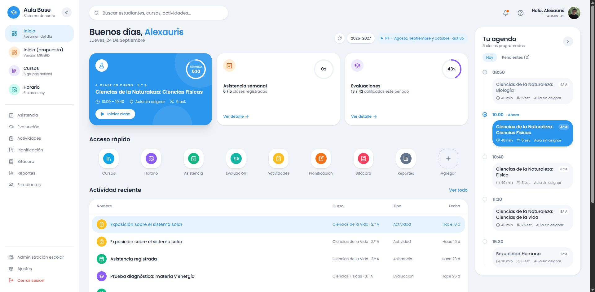
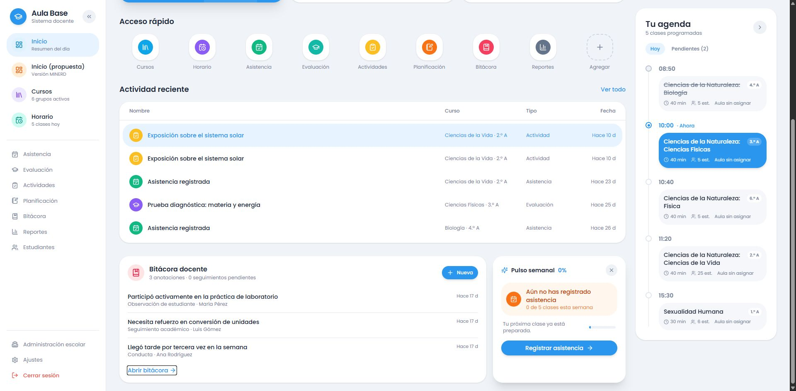
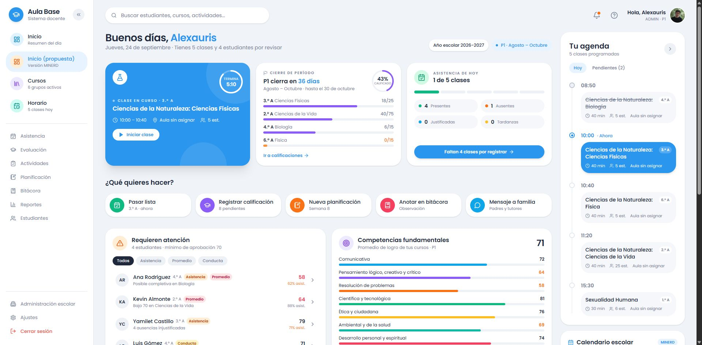
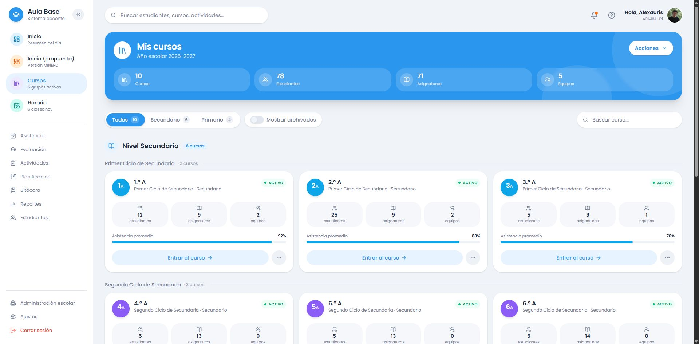
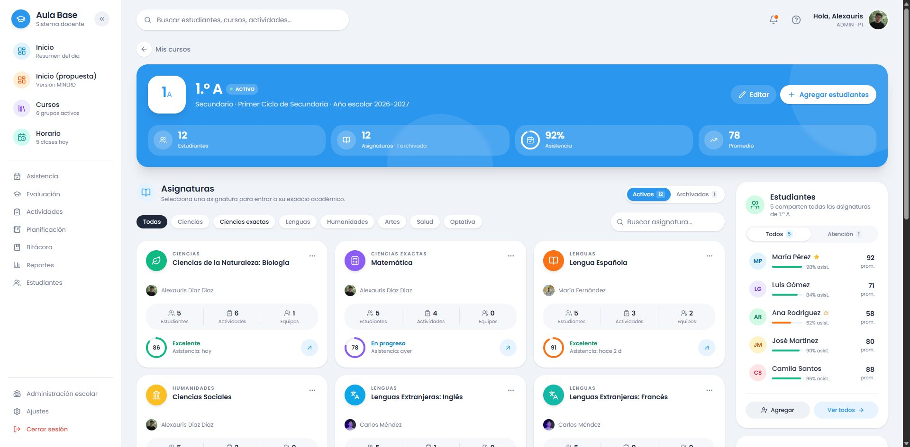
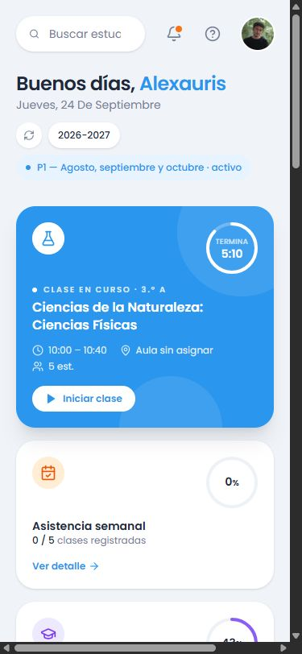
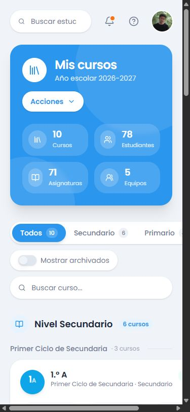

# AulaBase: referencia visual original de Inicio y Cursos

## 1. Fuente, propósito y alcance

**Referencia original confirmada por el propietario del proyecto:** [dev-untitled-pro-z37d3q6k.polymet.app](https://dev-untitled-pro-z37d3q6k.polymet.app/).

**Fecha de inspección:** 13 de octubre de 2026.

Este documento conserva cómo está construido visualmente el prototipo que dio origen a AulaBase. Sirve para revisar futuras modificaciones sin perder su composición, jerarquía, espaciado, formas y tratamiento de las superficies.

Se inspeccionaron estas vistas y estados:

| Vista | Ruta en la referencia | Cobertura |
| --- | --- | --- |
| Inicio original | `/` | Pantalla principal, secciones inferiores, agenda Hoy/Pendientes, menú abierto/cerrado y móvil |
| Inicio (propuesta), versión MINERD | `/inicio-v2` | Composición de escritorio y diferencias respecto a Inicio original |
| Mis cursos | `/cursos` | Cabecera, métricas, filtros, agrupación, tarjetas, menús, archivados, búsqueda sin resultados, móvil y tablet |
| Detalle de un curso | `/cursos/s1a` | Cabecera, indicadores, asignaturas, filtros, estudiantes y acciones rápidas |

Las medidas proceden del DOM visible y de los estilos calculados del navegador, acompañados de capturas. El escritorio principal se midió a **1920 × 945 px**; también se observaron **375 × 812 px** y **768 × 900 px**. Las anchuras de tarjetas son resultados de esas ventanas, no tamaños fijos que deban imponerse a todas las pantallas.

Los nombres, fechas, porcentajes y cantidades que aparecen en las capturas pertenecen al contenido del prototipo. Documentan la presentación; no establecen reglas de negocio.

## 2. Qué define su estética

La identidad se construye con un fondo gris azulado muy claro, superficies blancas, Poppins, esquinas redondeadas y sombras de poca opacidad. El texto oscuro sostiene la jerarquía. El azul concentra las acciones y la selección; los iconos pequeños aportan identidad a módulos y cursos.

La página se organiza por bloques de información, con espacios amplios entre secciones y espacios más pequeños dentro de cada tarjeta. Las cifras y el estado se reconocen antes que el detalle. La navegación general permanece separada del contenido académico.

Hay dos tratamientos principales de superficie:

- **Superficie de consulta:** blanca, con sombra pequeña y contenido oscuro; domina en listas, tarjetas, agenda y paneles.
- **Superficie destacada de la referencia:** azul sólido, texto blanco, sombra más amplia y círculos decorativos semitransparentes recortados por el contenedor. Aparece en la clase actual y en las cabeceras de Cursos.



## 3. Estructura compartida de la aplicación

### 3.1. Distribución y desplazamiento

La envolvente ocupa la altura de la ventana: un contenedor horizontal combina barra lateral y área principal. El cuerpo exterior evita el desplazamiento general; el contenido principal tiene su propio desplazamiento vertical. La barra lateral puede desplazarse de manera independiente cuando no cabe toda la navegación.

| Elemento | Medida o comportamiento observado |
| --- | --- |
| Barra lateral abierta | 256 px de ancho; altura de la ventana |
| Fondo de la barra | Blanco; borde derecho fino; sin sombra calculada en la barra completa |
| Relleno lateral | 16 px horizontal y 20 px vertical |
| Área principal | Ocupa el espacio restante, con `min-width: 0` |
| Relleno del contenido | 20 px en móvil; 32 px horizontal desde `sm`; 20 px vertical |
| Cabecera superior | 44 px de alto en la muestra; separación interna de 16 px |
| Separación cabecera/contenido | 24 px: la cabecera comienza en y=20 y el contenido en y=88 |
| Ancho interior a 1920 px | 1585 px con barra abierta y scrollbar vertical |

### 3.2. Barra lateral original

La marca ocupa la parte superior. Incluye un icono de graduación blanco sobre una superficie azul de 40 × 40 px, el nombre **Aula Base**, el subtítulo **Sistema docente** y un botón de contracción de 32 × 32 px.

La navegación tiene tres grupos:

1. **Accesos destacados:** Inicio, Inicio (propuesta), Cursos y Horario. Cada uno combina icono sobre una pequeña superficie de color, título y segunda línea descriptiva.
2. **Módulos:** Asistencia, Evaluación, Actividades, Planificación, Bitácora, Reportes y Estudiantes. Usan una sola línea, iconos de contorno y texto gris.
3. **Pie:** Administración escolar, Ajustes y Cerrar sesión. Se separa con una línea y se mantiene abajo mediante la distribución flexible. Cerrar sesión utiliza coral.

| Parte | Medida observada |
| --- | --- |
| Título de marca | 18 px, peso 600, interlineado 22,5 px |
| Acceso destacado | Alto aproximado 56,5 px; relleno 10 × 12 px; separación icono/texto de 12 px |
| Separación de destacados | 4 px |
| Acceso secundario | Alto aproximado 35,5 px; relleno 8 × 12 px; texto de 13 px |
| Separación de secundarios | 2 px |
| Estado activo | Superficie azul muy clara; texto de la etiqueta destacado en azul |
| Separadores | Línea gris fina; espacio alrededor del cambio de grupo |

**Comportamiento comprobado:** en esta referencia original, pulsar **Contraer menú** oculta toda la barra. El contenido aprovecha el ancho liberado y aparece **Abrir menú** en la cabecera. No queda una columna permanente de iconos en ese estado.

[Captura del menú cerrado](assets/referencia-original/inicio-barra-contraida.jpg).

### 3.3. Cabecera superior

El buscador se sitúa a la izquierda. A la derecha se agrupan notificaciones, ayuda, saludo, rol/período y avatar. La zona intermedia permanece libre y permite que ambos grupos se separen sin llenar la cabecera de controles.

| Elemento | Tratamiento |
| --- | --- |
| Buscador general | Blanco, alto 44 px, máximo 448 px de ancho, relleno horizontal 16 px, icono y texto separados 12 px, sombra pequeña |
| Texto del buscador | 14 px, peso 400; placeholder gris |
| Notificaciones y ayuda | Controles de 40 × 40 px; iconos grises; fondo transparente en reposo |
| Indicador de notificación | Punto naranja de 8 px con anillo del color del fondo |
| Saludo | 14 px, peso 600, alineado a la derecha |
| Rol y período | 11 px, mayúsculas, gris y espaciado de letras |
| Avatar | 40 × 40 px, radio calculado de 20 px, anillo blanco de 2 px |
| Foco del buscador | La clase visible declara un anillo azul al enfocar su contenido |

## 4. Tipografía y jerarquía

La familia calculada comienza con **Poppins**, seguida de fuentes de sistema como respaldo. La base heredada del cuerpo es de 16 px con interlineado de 24 px, aunque buena parte de la interfaz utiliza texto de 12–14 px.

| Uso | Tamaño | Peso | Interlineado / detalle |
| --- | --- | --- | --- |
| Saludo principal de Inicio, escritorio | 28 px | 600 | 32 px; espaciado de letras −0,7 px |
| Saludo principal de Inicio, móvil | 24 px | 600 | 32 px |
| Título «Mis cursos» | 24 px | 600 | 32 px; espaciado −0,6 px |
| Título «Tu agenda» | 20 px | 600 | 28 px |
| Encabezado de sección o nivel | 18 px | 600 | 28 px |
| Nombre del curso / título de tarjeta | 16 px | 600 | 20–24 px según el componente |
| Materia de la clase actual | 16 px | 600 | 22 px; limita el título a dos líneas |
| Texto de controles principales | 14 px | 500–600 | 20 px |
| Descripciones de tarjetas | 12 px | 400 | 16 px |
| Subtítulos de rol y asistencia | 11 px | 400–600 | 16,5 px |
| Estado ACTIVO y etiquetas pequeñas | 10 px | 600 | 15 px; mayúsculas y tracking |
| Etiqueta del temporizador | 9 px | 400 | 13,5 px; mayúsculas y tracking de 0,45 px |

Los títulos se destacan principalmente por peso y tamaño. Las descripciones usan gris y menor tamaño. El nombre del usuario en el saludo se colorea en azul. Las fechas y el contexto académico ocupan una línea secundaria.

## 5. Colores observados en la referencia

### 5.1. Base compartida

Estos son valores calculados del prototipo, expresados como hex equivalentes para facilitar la comparación.

| Función visual | RGB calculado | Hex equivalente |
| --- | --- | --- |
| Fondo de página | 240, 244, 249 | `#F0F4F9` |
| Superficies y texto sobre azul | 255, 255, 255 | `#FFFFFF` |
| Texto principal | 32, 41, 60 | `#20293C` |
| Texto secundario | 115, 128, 150 | `#738096` |
| Azul principal | 43, 150, 238 | `#2B96EE` |
| Azul suave de selección | 231, 243, 254 | `#E7F3FE` |
| Superficie neutra interior | 238, 242, 247 | `#EEF2F7` |
| Borde general | 225, 231, 239 | `#E1E7EF` |
| Coral destructivo | 235, 82, 71 | `#EB5247` |

### 5.2. Identidad de accesos rápidos

| Acceso | Color del pequeño contenedor de icono |
| --- | --- |
| Cursos | `#0EA5E9` |
| Horario | `#8B5CF6` |
| Asistencia | `#10B981` |
| Evaluación | `#14B8A6` |
| Actividades | `#FBBF24` |
| Planificación | `#F97316` |
| Bitácora | `#F43F5E` |
| Reportes | `#64748B` |

Estos colores se observaron en los contenedores de iconos del Inicio original. La barra lateral tiene su propia distribución de acentos; no debe suponerse que usa exactamente el color del acceso rápido homónimo.

### 5.3. Identidad de los cursos y estado

En el listado, el avatar de grado/sección y la barra de asistencia comparten el color de su ciclo:

| Grupo de la referencia | Color de identidad |
| --- | --- |
| Primer ciclo de Secundaria | `#0EA5E9` |
| Segundo ciclo de Secundaria | `#8B5CF6` |
| Primer ciclo de Primaria | `#14B8A6` |
| Segundo ciclo de Primaria | `#FBBF24` |

El estado **ACTIVO** tiene fondo `rgb(236, 253, 245)`, texto `rgb(5, 150, 105)` y un punto verde de 6 px. **ARCHIVADO** utiliza fondo neutro y texto gris. El estado se distingue por etiqueta y color, además de la reducción de opacidad de la tarjeta archivada.

## 6. Formas, sombras y decoración

### 6.1. Radios reales

El prototipo modifica los radios habituales de las clases utilitarias. Para reproducirlo hay que atender al valor calculado, no solamente al nombre de la clase.

| Superficie | Radio calculado |
| --- | --- |
| Tarjetas grandes `rounded-3xl` | 24 px |
| Superficies `rounded-2xl` de las muestras | 24 px |
| Controles `rounded-xl` de las muestras | 20 px |
| Botones pequeños y badges `rounded-lg` de las muestras | 16 px |
| Círculos, anillos y progreso | Radio suficientemente alto para ser completamente redondos |

Un icono de 36 px dentro de un contenedor con radio de 20 px termina pareciendo circular. Un botón de 40 px con radio de 20 px tiene extremos de cápsula. Las tarjetas grandes conservan esquinas redondeadas reconocibles sin convertirse en cápsulas.

### 6.2. Sombras calculadas

Se omitieron las capas transparentes de anillos que también devuelve el navegador. Las capas visibles medidas son:

| Nivel | Capas visibles de `box-shadow` | Usos observados |
| --- | --- | --- |
| Pequeña | `0 1px 3px 0 rgba(0,0,0,.10), 0 1px 2px -1px rgba(0,0,0,.10)` | Tarjetas blancas, agenda, buscadores y algunos botones |
| Media | `0 4px 6px -1px rgba(0,0,0,.10), 0 2px 4px -2px rgba(0,0,0,.10)` | Marca, identidades de cursos, selección de filtros y menús |
| Grande | `0 10px 15px -3px rgba(0,0,0,.10), 0 4px 6px -4px rgba(0,0,0,.10)` | Identificador grande del detalle del curso; estado elevado declarado de tarjetas |
| Extra grande | `0 20px 25px -5px rgba(0,0,0,.10), 0 8px 10px -6px rgba(0,0,0,.10)` | Clase actual, cabeceras azules y pulso semanal |

Aunque algunas clases del DOM incluyen nombres como `shadow-primary/30` o `shadow-sky-900/5`, en las muestras calculadas las capas visibles fueron negras al 10 %. La tabla registra el resultado observado y evita atribuirles una sombra azul que no apareció en esa medición.

### 6.3. Decoración de superficies destacadas

La tarjeta de clase actual contiene dos círculos blancos al 10 % de opacidad: uno de **160 × 160 px**, desplazado fuera de la esquina superior derecha, y otro de **128 × 128 px**, parcialmente fuera del borde inferior. El contenedor usa `overflow: hidden`, por lo que se ven fragmentos suaves de esos círculos.

La decoración se coloca detrás de la información y no recibe eventos de puntero. La tarjeta mantiene un relleno azul sólido; los círculos aportan profundidad sin añadir una imagen de fondo.

## 7. Espaciado y organización

La escala más repetida es **4, 8, 12, 16, 20, 24 y 32 px**.

| Relación | Espacio observado |
| --- | --- |
| Icono pequeño / etiqueta | 4–8 px |
| Elementos de un grupo de controles | 8–12 px |
| Tarjetas de una misma cuadrícula | 16 px |
| Columna principal / panel lateral | 24 px |
| Secciones principales de Inicio | 32 px |
| Relleno de tarjetas de consulta | 20 px |
| Relleno de agenda y cabeceras grandes | 24 px |
| Título de sección / contenido | Habitualmente 16 px |
| Métricas / encabezado de tarjeta de curso | 16 px |

La información interna sigue una dirección constante: identidad y título arriba, contexto en una segunda línea, métricas en el centro y acción principal abajo. Los menús secundarios se colocan junto a la acción o en la esquina superior derecha.

## 8. Inicio original: composición completa

### 8.1. Mapa de la pantalla

```text
Barra lateral de 256 px | Área principal
                       | Cabecera: buscador ................ perfil
                       | Columna de trabajo          | Agenda de 340 px
                       | Saludo + fecha + período    | Título + pestañas
                       | Clase | Asistencia | Eval.  | Línea temporal
                       | Acceso rápido               | Clases del día
                       | Actividad reciente          |
                       | Bitácora | Pulso semanal    |
```

En escritorio ancho, la cuadrícula exterior es `minmax(0, 1fr) 340px`, con separación de 24 px. En la muestra, la columna de trabajo mide 1221 px. La agenda se alinea con el saludo y usa una envolvente `sticky` dentro del desplazamiento principal.

### 8.2. Saludo y contexto académico

El saludo se alinea a la izquierda y separa el nombre en azul. La fecha gris aparece debajo. A la derecha hay un botón pequeño de actualización, una cápsula blanca del año escolar y una etiqueta azul suave con el período y su estado.

No hay una tarjeta que envuelva todo este encabezado: descansa directamente sobre el fondo general. Eso conserva aire antes de las tarjetas de resumen.

### 8.3. Tres tarjetas de resumen

La fila usa tres columnas desde `md`, separación de 16 px y comienza 32 px después del encabezado. A 1920 px cada tarjeta mide aproximadamente **396 × 233 px**. Tienen radio de 24 px y relleno de 20 px.

**Clase actual:** fondo azul, texto blanco, icono de materia sobre blanco, temporizador circular de 64 px arriba a la derecha, etiqueta en mayúsculas con un punto de 6 px, título de materia, horario/aula/estudiantes y botón blanco «Iniciar clase». El botón mide 32 px de alto y usa texto azul de 12 px seminegrita. La sombra es la más amplia de la fila.

**Asistencia semanal:** tarjeta blanca, pequeño icono cálido arriba a la izquierda, anillo porcentual arriba a la derecha, título y recuento en el centro. «Ver detalle» se alinea al fondo mediante distribución flexible. El estado de ejemplo muestra 0 %.

**Evaluaciones:** comparte la estructura de Asistencia; utiliza icono y anillo violeta. El ejemplo presenta porcentaje y fracción de actividades calificadas.

Los anillos representan una cifra con texto en el centro. La información permanece legible incluso cuando la porción de progreso es pequeña o nula.

### 8.4. Acceso rápido

El título está fuera de cualquier tarjeta. Debajo hay nueve posiciones: ocho módulos y «Agregar».

- Cuadrícula de **9 columnas en `xl`**, **5 en `sm`** y **3 en móvil**.
- Separación de 12 px entre posiciones.
- Cada acceso combina una superficie blanca de **64 × 64 px**, un contenedor de icono de **36 × 36 px** y una etiqueta inferior de 12 px.
- La superficie blanca tiene radio de 24 px y sombra pequeña.
- La etiqueta se separa 8 px de la superficie.
- «Agregar» conserva el tamaño, pero sustituye el fondo por un borde discontinuo de 2 px y un signo más.
- Las clases visibles declaran una elevación de 2 px y sombra media al pasar el cursor por un acceso.

### 8.5. Actividad reciente

El título y «Ver todo» comparten una línea. La lista blanca comienza 16 px debajo y tiene radio de 24 px, sombra pequeña y recorte del contenido.

En escritorio se presenta como una tabla visual con columnas **Nombre / Curso / Tipo / Fecha**. La definición de columnas es `1fr 180px 110px 90px`, con separación de 16 px. El encabezado usa texto gris de 12 px y relleno de 14 × 24 px.

Cada fila es un control de ancho completo con unos **56 px de alto**, relleno de 12 × 16 px e icono de tipo a la izquierda. El primer elemento de la muestra tiene fondo azul suave y textos destacados en azul. Los demás usan fondo blanco/transparente y una superficie neutra declarada al pasar el cursor.

En móvil desaparece el encabezado de columnas; la fila usa `1fr auto`. El curso puede pasar a segunda línea junto al nombre y la fecha permanece a la derecha. Los nombres largos pueden truncarse o repartirse según el componente.

### 8.6. Bitácora y pulso semanal

Debajo de la actividad reciente hay una cuadrícula `minmax(0, 1fr) 320px` desde `lg`, con separación de 16 px y margen superior de 32 px.

**Bitácora:** tarjeta blanca, radio 24 px, relleno 20 px y sombra pequeña. El encabezado combina icono rosado, título, resumen de anotaciones y botón azul «Nueva». Cada anotación tiene texto principal, tipo/persona en gris y antigüedad alineada a la derecha. Líneas finas separan las filas. «Abrir bitácora» cierra el panel.

**Pulso semanal:** tarjeta blanca de 320 px en escritorio, con sombra extra grande. Arriba se muestra título, porcentaje y botón para descartar. En el centro hay una superficie cálida de alerta con icono, mensaje y fracción de clases; debajo, una explicación corta y pequeño progreso. La acción final azul ocupa el ancho disponible.



### 8.7. Agenda lateral

La agenda tiene **340 px de ancho**, radio 24 px, relleno 24 px y sombra pequeña. Se compone de título, cantidad de clases, botón de semana y selector Hoy/Pendientes.

**Hoy:** una línea vertical gris conecta marcadores circulares. Cada hora precede a una tarjeta de clase. Las clases anteriores tienen título tachado y apariencia neutra; la clase actual usa azul sólido, texto blanco y marcador azul; las futuras vuelven a una superficie neutra. Dentro se muestran materia, sección, duración, estudiantes y aula mediante texto e iconos pequeños.

**Pendientes:** reemplaza la línea temporal por filas de tareas sobre gris suave, con indicador circular a la izquierda y plazo a la derecha. Una tarea completada aparece tachada y con un indicador azul marcado. «Agregar tarea» utiliza una cápsula azul suave.

[Agenda en estado Pendientes](assets/referencia-original/inicio-agenda-pendientes.jpg).

## 9. Inicio (propuesta): variante dentro de la misma referencia

La ruta `/inicio-v2` aparece explícitamente como **Inicio (propuesta), Versión MINERD**. Mantiene la envolvente, Poppins, agenda de 340 px, radios de 24 px y sombras de tarjetas, pero cambia la organización del trabajo.

| Parte | Cambio respecto a Inicio original |
| --- | --- |
| Encabezado | Añade número de clases y estudiantes por revisar a la línea secundaria |
| Resumen | Clase actual + cierre de período + asistencia de hoy |
| Cierre del período | Anillo de calificación, fechas, filas por curso y barras de progreso |
| Asistencia de hoy | Fracción de clases, barra segmentada, presentes/ausentes/justificadas/tardanzas y CTA de registro |
| Accesos | Cinco tarjetas horizontales con acción y contexto, bajo «¿Qué quieres hacer?» |
| Primera fila de trabajo | «Requieren atención» y «Competencias fundamentales», dos columnas desde `lg` |
| Atención | Filtros por asistencia/promedio/conducta; filas con avatar, nombre, curso, motivos y cifras |
| Competencias | Siete barras con etiquetas, logro numérico y recomendación inferior |
| Segunda fila de trabajo | Planificación y Bitácora, dos columnas desde `lg` |
| Planificación | Lista por curso/asignatura con estado de entrega y acceso al módulo |
| Columna derecha | Agenda, Calendario escolar, efeméride y Avisos y familias |

La fila superior usa tres columnas desde `lg`. Los accesos usan 2 columnas base, 3 desde `sm` y 5 desde `lg`, con separación de 12 px. Las parejas de tarjetas de trabajo tienen separación de 16 px; la columna principal y la derecha mantienen 24 px.

Las cifras de esta variante también son contenido del prototipo. Su organización se documenta aparte para poder elegir conscientemente entre el Inicio original y la propuesta, sin fusionar sus secciones por accidente.



[Secciones inferiores de la propuesta](assets/referencia-original/inicio-propuesta-secciones.jpg).

## 10. Mis cursos: composición completa

### 10.1. Mapa de la pantalla

```text
Cabecera general compartida
Cabecera azul: icono + Mis cursos + año ........ Acciones
               Cursos | Estudiantes | Asignaturas | Equipos
Filtros: Todos / Secundario / Primario + Archivados ..... Buscar
Nivel Secundario + contador
  Primer ciclo + contador + línea horizontal
    Tarjeta | Tarjeta | Tarjeta
  Segundo ciclo + contador + línea horizontal
    Tarjeta | Tarjeta | Tarjeta
Nivel Primario + contador
  Ciclos y tarjetas con la misma estructura
```



### 10.2. Cabecera azul y métricas

La cabecera ocupa el ancho interior completo. En la muestra mide **1585 × 186,5 px**, con radio 24 px, relleno 24 px, sombra extra grande y círculos blancos decorativos recortados.

El icono de cursos se coloca sobre blanco en un contenedor de 48 × 48 px. A su lado aparecen título blanco de 24 px y año escolar en una segunda línea. «Acciones» es un botón blanco con texto azul, alto 40 px, radio 20 px y relleno horizontal 16 px.

Las cuatro métricas se sitúan 24 px debajo del encabezado:

- Cuadrícula de 4 columnas desde `md` y 2 en móvil, con separación de 12 px.
- Cada superficie tiene fondo blanco al 15 % de opacidad, relleno 12 px y radio 24 px.
- Icono dentro de un contenedor de 36 × 36 px, blanco al 20 %.
- Cifra arriba y etiqueta debajo, ambas blancas; la cifra tiene mayor peso y tamaño.
- En escritorio cada métrica mide aproximadamente 375 × 62,5 px.

### 10.3. Filtros y buscador local

La fila de filtros comienza 32 px después de la cabecera. El selector de nivel es una superficie blanca con sombra pequeña, dentro de la que se disponen Todos, Secundario y Primario.

El seleccionado tiene fondo azul, texto blanco y sombra media. Cada opción mide 36 px de alto, con relleno 8 × 16 px, texto de 14 px y pequeño contador separado 8 px. Las opciones inactivas son grises y transparentes.

«Mostrar archivados» está en otra cápsula blanca con su etiqueta. El switch mide **36 × 20 px**: pista gris en reposo y azul al activarlo, con un pequeño círculo blanco desplazable.

El buscador local se alinea a la derecha en escritorio, sobre blanco y con icono gris. Su texto de ayuda es «Buscar curso...». En móvil cambia de fila y ocupa el ancho interior.

### 10.4. Agrupación por nivel y ciclo

El listado no se entrega como una cuadrícula sin jerarquía. Primero aparece el nivel con icono azul, título oscuro de 18 px y contador azul pequeño. Debajo, cada ciclo usa texto gris de 14 px, cantidad de cursos y una línea horizontal que ocupa el espacio restante.

La cuadrícula de cada ciclo tiene separación de 16 px: **1 columna base, 2 desde `md`, 3 desde `xl`**. Los cursos del mismo ciclo comparten tratamiento de identidad.

### 10.5. Anatomía de una tarjeta de curso

Cada tarjeta es blanca, con radio 24 px, relleno 20 px y sombra pequeña. A 1920 px mide aproximadamente **518 × 277,5 px**.

| Zona | Composición y medidas |
| --- | --- |
| Encabezado | Identidad de grado/sección de 48 × 48 px; nombre de curso de 16 px seminegrita; ciclo/nivel de 12 px gris; badge de estado a la derecha |
| Identificador | Grado de 18 px, sección de 12 px, texto blanco y sombra media; radio 24 px |
| Estado | Texto de 10 px seminegrita y mayúsculas; relleno 4 × 8 px; punto de 6 px; alto aproximado 23 px |
| Métricas | Estudiantes, asignaturas y equipos en 3 columnas, separación de 8 px y margen superior 16 px |
| Superficie de métrica | Gris neutro al 60 %, radio 24 px, relleno 10 × 8 px; alto aproximado 69 px |
| Número de métrica | 14 px seminegrita; etiqueta de 10 px debajo; icono gris encima |
| Asistencia | Etiqueta y porcentaje de 11 px; porcentaje seminegrita a la derecha; pista gris de 6 px de alto con relleno del color de identidad |
| Pie | «Entrar al curso» sobre azul suave y texto azul; botón de elipsis neutro a la derecha |

Las clases del DOM declaran que la tarjeta se eleva **2 px** y pasa a sombra grande al recibir hover. Las transiciones calculadas emplean **150 ms** y curva `cubic-bezier(0.4, 0, 0.2, 1)`. Se registró la declaración del estado, además de la sombra calculada en reposo.

### 10.6. Menús

**Acciones generales:** Nuevo curso, Importar estudiantes y Exportar listado.

**Elipsis de tarjeta:** Editar curso, Duplicar y Archivar. Archivar se distingue con icono y texto coral, separado del resto.

Los menús son superficies blancas con borde fino, radio calculado de 20 px, relleno de 4 px y sombra media. El menú general mide 192 px de ancho. Las filas combinan icono de contorno y texto; el foco utiliza azul suave.

[Menú Acciones](assets/referencia-original/cursos-menu-acciones.jpg) · [Menú de tarjeta](assets/referencia-original/curso-menu-contextual.jpg).

### 10.7. Archivados y resultados vacíos

Activar «Mostrar archivados» añade el curso archivado al grupo correspondiente. Su tarjeta conserva la anatomía del resto, pero utiliza **opacidad 0,7** y badge gris **ARCHIVADO**. No desaparecen sus datos ni su entrada al curso.

Una búsqueda sin coincidencias conserva la cabecera y los filtros. El listado se reemplaza por una gran superficie blanca redondeada con icono azul suave centrado, título **No se encontraron cursos** y texto **Prueba con otro nivel o término de búsqueda.**

[Curso archivado](assets/referencia-original/cursos-archivados.jpg) · [Sin resultados](assets/referencia-original/cursos-sin-resultados.jpg).

## 11. Detalle de un curso

### 11.1. Cabecera y resumen

Antes de la cabecera hay una vuelta a **Mis cursos**, con flecha y texto gris de 14 px. La cabecera azul mantiene radio 24 px, relleno 24 px y sombra extra grande; en la muestra mide 216,5 px de alto.

La identidad del curso crece a **80 × 80 px**, con fondo blanco, texto azul y sombra grande. A su lado aparecen nombre, estado y línea de nivel/ciclo/año. A la derecha se alinean «Editar», sobre blanco al 15 %, y «Agregar estudiantes», sobre blanco sólido con texto azul.

Debajo se muestran cuatro indicadores: estudiantes, asignaturas —con anotación de archivadas—, asistencia y promedio. Comparten el tratamiento translúcido de la cabecera del listado.

### 11.2. Organización del contenido

La distribución exterior es `minmax(0, 1fr) 320px` desde `xl`, con separación de 24 px. La columna principal muestra asignaturas. La derecha contiene Estudiantes y Acciones rápidas.



### 11.3. Asignaturas

El encabezado combina icono de libro, título y explicación. A la derecha hay un selector pequeño Activas/Archivadas. Debajo se encuentran categorías en cápsulas y un buscador local.

Las categorías visibles son Todas, Ciencias, Ciencias exactas, Lenguas, Humanidades, Artes, Salud y Optativa. **Todas** aparece sobre fondo oscuro con texto blanco; las otras usan blanco y texto gris.

La cuadrícula de asignaturas tiene margen superior de 20 px, separación de 16 px, 2 columnas desde `md` y 3 desde `2xl`. En la muestra, cada tarjeta mide aproximadamente **403 × 268 px** y conserva radio de 24 px, relleno 20 px y sombra pequeña.

La tarjeta contiene, en este orden:

1. Icono de identidad coloreado, etiqueta de área en mayúsculas y nombre de materia oscuro. El menú de opciones se coloca en la esquina superior derecha.
2. Avatar pequeño y nombre del docente en gris.
3. Una banda neutra de tres métricas: estudiantes, actividades y equipos; las columnas tienen pequeños separadores.
4. Un anillo de promedio, texto de resultado y fecha del último registro de asistencia.
5. Un botón de flecha de acceso en la esquina inferior derecha.

Se observaron estados **Excelente**, **En progreso**, **Requiere atención** y **Sin calificaciones**. El último sustituye la cifra por un guion y añade **Sin registro de asistencia** cuando corresponde. La tarjeta «Agregar asignatura» tiene una presentación de incorporación de contenido y texto explicativo.

### 11.4. Estudiantes y acciones rápidas

El panel Estudiantes utiliza una tarjeta blanca, radio 24 px y sombra pequeña. Incluye icono verde suave, resumen y selector Todos/Atención. Cada fila muestra avatar con iniciales, nombre, una barra pequeña de asistencia y promedio alineado a la derecha. Algunos registros incluyen estrella o triángulo de atención. El pie separa las acciones Agregar y Ver todos mediante una línea.

Debajo, Acciones rápidas presenta tres filas: Pasar asistencia, Nueva actividad y Reporte del curso. Cada una combina icono coloreado, título, descripción breve y flecha derecha.

**Límite observado:** el botón Editar y el acceso «Abrir Ciencias de la Naturaleza: Biología» no cambiaron de vista ni abrieron un diálogo durante la inspección. Por ello este documento no atribuye al prototipo un formulario de edición ni un espacio de asignatura que no se pudieron observar.

## 12. Adaptación responsive observada

| Parte | Móvil / base | Tablet o tamaño intermedio | Escritorio ancho |
| --- | --- | --- | --- |
| Barra lateral | El contenedor de escritorio se oculta | Sigue oculta antes de `lg` | Visible a 256 px cuando está abierta |
| Relleno horizontal | 20 px | 32 px desde `sm` | 32 px |
| Inicio: resumen | 1 columna | 3 columnas desde `md` | 3 columnas |
| Inicio: accesos | 3 columnas | 5 desde `sm` | 9 desde `xl` |
| Inicio: agenda | Se apila después del contenido principal | Sigue apilada antes de `xl` | Columna de 340 px, sticky |
| Inicio: Bitácora/Pulso | Se apilan | 2 columnas desde `lg` | Columna flexible + 320 px |
| Cursos: métricas del hero | 2 columnas | 4 desde `md` | 4 columnas |
| Cursos: tarjetas | 1 columna | 2 desde `md` | 3 desde `xl` |
| Curso: asignaturas | 1 columna | 2 desde `md` | 3 desde `2xl` |

Las clases de breakpoint se registraron tal como aparecen en el DOM. Se comprobaron específicamente las composiciones de 375, 768 y 1920 px; no se midió cada umbral individual.

### Límites reales del prototipo en móvil

Las capturas permiten conservar la intención de adaptación, pero también muestran recortes que deben revisarse antes de trasladar el diseño:

- A 375 px, el ancho interior habitual es 320 px. En Cursos una tarjeta llegó a medir aproximadamente **420 px** dentro de una cuadrícula de 320 px.
- El panel desplazable de Cursos mostró `clientWidth: 360` y `scrollWidth: 455`: existe desplazamiento horizontal interno, aunque el ancho del documento completo no lo refleje.
- El selector de niveles puede continuar fuera del borde derecho; no se debe copiar ese recorte como un requisito visual.
- Inicio mostró un área de desplazamiento con `clientWidth: 360` y `scrollWidth: 467`; su composición pasa a una columna, pero todavía hay contenido que excede el ancho móvil.
- Al reducir una ventana con la barra abierta, la barra de escritorio se ocultó y en ese estado no se observó un botón de apertura móvil. Ese caso necesita revisión específica en una implementación real.





## 13. Relación con el proyecto actual

La referencia original explica el origen de las formas y de la organización. El proyecto actual ha incorporado modificaciones visuales y funcionales; este documento no solicita revertirlas automáticamente.

| Aspecto | Referencia inspeccionada | Situación o regla del repositorio actual |
| --- | --- | --- |
| Barra lateral cerrada | Oculta completamente la navegación lateral | La barra actual conserva una columna de 80 px y permite expandirla a 256 px |
| Tarjeta de clase de Inicio | Azul principal sólido | El CSS actual calcula un color de materia mezclado con el texto oscuro y una sombra propia |
| Inicio de consulta | Resumen semanal + accesos de módulos + actividad reciente + pulso | El Inicio actual incorpora bloques próximos a la propuesta: cierre, asistencia diaria, atención, competencias y planificación |
| Colores de identidad históricos | Incluye sky, violeta, teal, naranja, rose y slate | `AGENTS.md` limita el código nuevo a la paleta oficial y a tokens semánticos |
| Cabeceras de Cursos | Azul saturado y título blanco | Las reglas actuales piden superficies principales blancas y títulos oscuros |
| Componentes | Presentación del prototipo | El repositorio dispone de `SemanticUI`, Button, Card y otros componentes compartidos |

Para una implementación futura, consultar conjuntamente:

- [Sistema visual actual](../../apps/frontend/DESIGN_SYSTEM.md).
- [Paleta y tokens actuales](../../apps/frontend/src/semantic-palette.css).
- [Componentes semánticos compartidos](../../apps/frontend/src/components/ui/SemanticUI.tsx).
- [Reglas del proyecto](../../AGENTS.md).

La composición, jerarquía, escala tipográfica, radios, rellenos y organización descritos aquí pueden guiar la adaptación. Los colores históricos y las grandes superficies azules son observaciones de la fuente; su traslado debe resolverse con las instrucciones vigentes del proyecto y las decisiones explícitas del propietario.

## 14. Cómo usar esta guía al revisar una pantalla

- Comparar la pantalla completa con la captura correspondiente, conservando el contexto de navegación y cabecera.
- Revisar primero la distribución de columnas y el orden de la información; después tipografía, espacios, radios y sombras.
- Mantener 16 px entre tarjetas de una misma cuadrícula y 24 px entre zona principal y panel lateral cuando se adopte ese patrón.
- Reservar 20–24 px de relleno en tarjetas grandes; evitar acumular tarjetas pequeñas dentro de otras sin jerarquía clara.
- Separar título, contexto, métricas y acción; ubicar acciones infrecuentes en menús.
- Diferenciar estado de identidad: un color de curso o asignatura no debe sustituir la semántica de éxito, alerta o error del proyecto.
- Verificar texto largo, ausencia de datos, resultados vacíos, archivados y diferentes tamaños de ventana.
- Comprobar navegación por teclado y apertura/cierre del menú; corregir los recortes móviles observados en la referencia.
- Conservar los datos, permisos y flujos funcionales existentes al adaptar la presentación.

## 15. Evidencias y trazabilidad

Las capturas están guardadas localmente para que la referencia siga disponible si cambia la página pública.

| Evidencia | Archivo |
| --- | --- |
| Inicio original, escritorio | [inicio-escritorio.jpg](assets/referencia-original/inicio-escritorio.jpg) |
| Inicio original, zona inferior | [inicio-secciones-inferiores.jpg](assets/referencia-original/inicio-secciones-inferiores.jpg) |
| Agenda con pendientes | [inicio-agenda-pendientes.jpg](assets/referencia-original/inicio-agenda-pendientes.jpg) |
| Barra lateral cerrada | [inicio-barra-contraida.jpg](assets/referencia-original/inicio-barra-contraida.jpg) |
| Inicio original, móvil | [inicio-movil.jpg](assets/referencia-original/inicio-movil.jpg) |
| Inicio propuesta, escritorio | [inicio-propuesta-escritorio.jpg](assets/referencia-original/inicio-propuesta-escritorio.jpg) |
| Inicio propuesta, secciones inferiores | [inicio-propuesta-secciones.jpg](assets/referencia-original/inicio-propuesta-secciones.jpg) |
| Listado de cursos | [cursos-escritorio.jpg](assets/referencia-original/cursos-escritorio.jpg) |
| Menú general | [cursos-menu-acciones.jpg](assets/referencia-original/cursos-menu-acciones.jpg) |
| Menú de tarjeta | [curso-menu-contextual.jpg](assets/referencia-original/curso-menu-contextual.jpg) |
| Curso archivado | [cursos-archivados.jpg](assets/referencia-original/cursos-archivados.jpg) |
| Cursos sin resultados | [cursos-sin-resultados.jpg](assets/referencia-original/cursos-sin-resultados.jpg) |
| Cursos en móvil | [cursos-movil.jpg](assets/referencia-original/cursos-movil.jpg) |
| Detalle de un curso | [curso-detalle.jpg](assets/referencia-original/curso-detalle.jpg) |

Los registros JSON complementarios guardan los valores calculados y las clases del DOM observadas:

- [Inicio: medidas de escritorio](assets/referencia-original/inicio-medidas.json).
- [Inicio: componentes e iconos](assets/referencia-original/inicio-componentes.json).
- [Inicio: medidas móviles](assets/referencia-original/inicio-movil-medidas.json).
- [Inicio propuesta: medidas](assets/referencia-original/inicio-propuesta-medidas.json).
- [Cursos: medidas de escritorio](assets/referencia-original/cursos-medidas.json).
- [Cursos: detalle de componentes](assets/referencia-original/cursos-detalles.json).
- [Cursos: medidas móviles](assets/referencia-original/cursos-movil-medidas.json).
- [Cursos: medidas de tablet](assets/referencia-original/cursos-tablet-medidas.json).
- [Detalle del curso: medidas](assets/referencia-original/curso-detalle-medidas.json).

**Límites de esta inspección:** no se inspeccionó modo oscuro ni cada resolución intermedia. No se ejecutaron creación, edición, duplicación, archivo, importación, exportación ni cambios en estudiantes. Las clases de hover y foco se distinguen de las mediciones en reposo. Las pantallas que un botón del prototipo no abrió permanecen sin especificación en esta guía.
