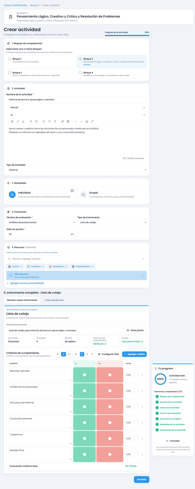
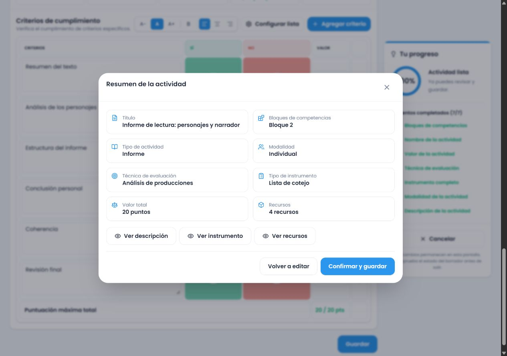
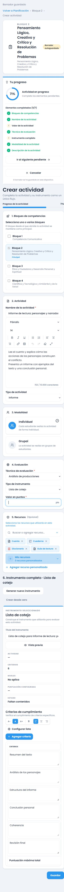
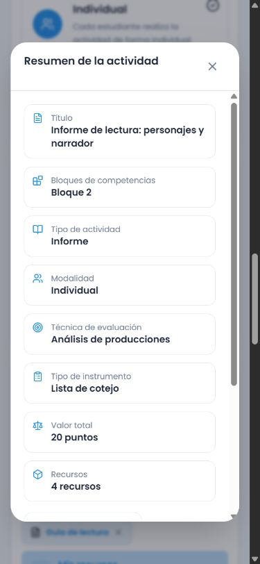
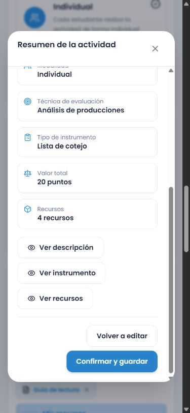

# Restauración del creador de actividades — 12 de octubre de 2026

Restaurado el flujo vertical mediante cambios selectivos sobre `6dee60a46fc1790adbfbca928f029bf469e3b769`. Se consultó `ffabbed` como referencia; no se revirtió el commit ni se copiaron componentes antiguos. El árbol estaba limpio al comenzar y no había commits posteriores.

## Elementos retirados y restablecidos

- Retirados los pasos «Actividad → Instrumento → Revisar y guardar», sus botones de navegación, estado y metadatos de validación por pestaña.
- Restablecidas, en orden y en una pantalla, las tarjetas de bloques, actividad, modalidad, evaluación y recursos; debajo aparece el instrumento editable completo.
- Retirados del formulario fecha, momento de planificación, roles del estudiante/docente, evidencia esperada y observaciones. También se retiró el bloque visible de contenidos curriculares sugeridos.
- Retirado «Procedencia: …». Se mantienen referencias, procedencia y recomendaciones internamente. La alternativa tras un fallo real usa el componente habitual FeedbackBanner con un aviso breve, descartable y que desaparece a los ocho segundos; los errores que impiden continuar permanecen visibles y permiten reintentar. Añadir un criterio a una alternativa existente no simula un fallo remoto.
- «Guardar» abre el resumen y sólo «Confirmar y guardar» persiste. Se conservan título, bloques, modalidad, técnica, instrumento, puntos, recursos y vistas ampliadas de descripción/instrumento/recursos. «Volver a editar» mantiene el contenido.
- Progreso a la derecha y sticky desde 1024 px; en móvil aparece en una columna. Los pendientes desplazan, resaltan y enfocan el campo. Para descripción se enfoca el contenido real de Tiptap, no sus controles de formato.

## Mejoras conservadas

El creador continúa independiente de GradingBook. No se modificaron backend, definición compartida, migraciones, esquema, permisos, atomicidad, copia de instrumentos, idempotencia, historial inmutable, cálculo exacto ni «No aplica». Se conservan aislamiento y recuperación de borradores, límites de edición con calificaciones, sugerencias automáticas y selecciones manuales, protección de ediciones/respuestas obsoletas, entradas y retorno a Actividades/Cursos/Planificación.

La edición conserva **exactamente** los valores originales de los campos invisibles, incluso espacios y valores ausentes; no los vacía ni les aplica trim. Los vínculos y el contexto legítimo de Planificación siguen en el borrador y en el guardado. Nuevas actividades mantienen fecha vacía en ese campo opcional, sin inventar una fecha de agenda; la fecha de creación automática sigue a cargo de la persistencia existente.

Se mantienen tres bloques en primaria y cuatro en secundaria, con el bloque recibido como principal. Se conserva preparación sin puntaje visible predeterminado, actualización inmediata al escribir, pesos relativos y criterios/descriptores. Se corrigió un desfase de recuperación: la vista del instrumento recibe ahora el puntaje vigente directamente del borrador, evitando pasar cero durante la sincronización de un ref.

No se modificó el editor de descripción ni se añadieron dependencias, IA, contenidos curriculares u opciones personalizadas a los selectores.

## Archivos modificados

Producción, bajo `apps/frontend/src/modules/activities/`:

- `components/editor/ActivityCreationView.tsx`
- `components/editor/ActivityDataSections.tsx`
- `components/editor/ActivityProgress.tsx`
- `components/editor/editorModel.tsx`
- `utils/activityDraftStorage.ts`

Pruebas:

- `apps/frontend/src/modules/activities/components/ActivityEditorWorkspace.spec.tsx`
- `apps/frontend/src/modules/activities/components/editor/restorationHistory.spec.tsx` (nuevo)
- `apps/frontend/src/modules/activities/services/activitiesService.spec.ts`
- `apps/frontend/src/modules/grading/components/GradingBook.spec.tsx`
- `apps/frontend/src/modules/planning/pages/PlanningCreatorFlow.spec.tsx`

Documentación: petición íntegra en `docs/superpowers/specs/2026-10-12-restaura-creador-design.md`, plan en `docs/superpowers/plans/2026-10-12-restaura-creador.md`, este informe y las capturas en `restaura-creador-assets/`. Los dos archivos temporales del QA se retiraron antes de las compilaciones.

## Pruebas automáticas

| Comando | Resultado final |
|---|---|
| `pnpm --filter backend test` | Exit 0; 32 archivos, 384 pruebas. |
| `pnpm --filter backend build` | Exit 0. |
| `pnpm --filter frontend test` | Exit 0; 76 archivos, 478 pruebas. |
| `pnpm --filter frontend build` | Exit 0; TypeScript, Vite y PWA. |
| `pnpm cloudflare:build` | Exit 0; empaquetado con `--dry-run`, sin despliegue. |
| `git diff --check` | Sin errores de whitespace. |

Pruebas nuevas reprodujeron primero los fallos de navegación, transformación de datos históricos, foco en el toolbar y aviso falso de servicio. Después pasaron con las correcciones. La prueba de Planificación vuelve a guardar directamente tras recuperar el borrador, sin introducir una espera adicional para esconder el desfase. Se conserva el contrato HTTP de vaciado explícito para otros consumidores; el editor simplificado preserva sus campos invisibles.

La cobertura incluye cuatro instrumentos, cambio de formato, adición de criterios, protección manual, distribución exacta, No aplica, puntaje pendiente y actualización de pesos/descriptores, resumen/cancelación/confirmación/reintento con creationId estable, borradores, perfiles 3/4 bloques, recuperación y retorno de Planificación, y regresiones de Lengua Española de 1.º y 2.º. Revisión independiente aprobada, sin hallazgos pendientes en el diff. Persisten avisos existentes de jsdom sobre `Window.scrollTo` y de tamaño de chunks; no son fallos de las comprobaciones.

## QA visual y alcance de persistencia

**Datos ficticios:** se utilizó ActivityEditorWorkspace, Tiptap y estilos reales en una página temporal. Los callbacks simulan un primer guardado fallido y un segundo exitoso; no escriben en la API. Se comprobó formulario/resumen en 1280×900 y 390×844, vistas ampliadas, regreso a edición, puntaje vacío sin ceros, actualización al escribir y conservación de criterios. A 1024×768 se comprobó que progreso y formulario comparten las dos columnas y la tarjeta es sticky. No hubo desbordamiento horizontal de la página en esos tamaños. El resumen móvil permite desplazamiento vertical para acceder a las acciones.

**Sesión autenticada, sólo lectura:** se inspeccionó el creador local abierto con un curso real y bloque b1 recibido por URL. Se observaron las cinco tarjetas, los cuatro bloques de secundaria, el puntaje vacío, progreso inicial real y el instrumento en la misma pantalla. No se alteró ni se guardó ese formulario.

**Persistencia real autenticada:** no se ejecutó una creación/edición contra la base remota en esta tarea. La conservación histórica y los reintentos se verificaron con pruebas automáticas y callbacks ficticios; no se presentan como escrituras reales. Tampoco se verificaron todos los tamaños de pantalla ni todas las combinaciones curriculares en navegador. No se desplegó producción ni se modificó la base de datos.

## Evidencia visual ficticia

Formulario de escritorio:

Resumen de escritorio:

Formulario móvil con puntaje pendiente:

Resumen móvil:

Reintento ficticio en móvil:

## Git al cerrar la implementación

Este estado corresponde al cierre de la implementación, antes de la petición posterior del usuario de hacer commit y push.

- Rama local: `restaura-flujo-creador`, creada desde `instrumentos`.
- HEAD y base conservada: `6dee60a46fc1790adbfbca928f029bf469e3b769`.
- Commit nuevo de esta restauración: ninguno.
- Push de esta restauración: ninguno. El push previo de `6dee60a` a `origin/instrumentos` se conserva.
- Árbol de trabajo: cambios de restauración, pruebas, documentos y capturas pendientes de commit; no hay archivos temporales del QA ni cambios de backend/DB/dependencias.
