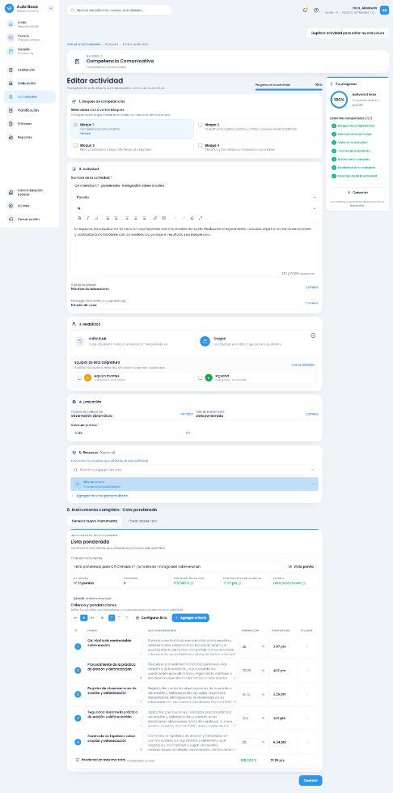

# Ciencias de la Naturaleza común — 1.º de secundaria

Estado: patrones definidos de 1.º verificados con instrumentos completos, pruebas automáticas, HTTP/DB y cuatro recorridos visuales. No acredita los grados 2.º–6.º.

## Fuente y alcance conectado

MINERD, Adecuación Curricular del Nivel Secundario2023, PDF293–295 / impresas292–294. Tablas originales renderizadas e inspeccionadas: Ciencias de la Tierra y el Universo, dentro del área Ciencias de la Naturaleza; columnas de conceptos/procedimientos/actitudes y continuación294; indicadores en295. SHA256 `80b22b3adb3290bd251bde65c98b78b60f24845ab43b70c1f4e3294e0b6f6c58`.

[Matriz con texto oficial, páginas e identidades](../../curriculum/cobertura-secundaria/ciencias-naturaleza-matriz.json). [272 instrumentos completos de las 68 consignas en cuatro formatos](../../curriculum/cobertura-secundaria/ciencias-naturaleza-1-instrumentos.json). Los criterios y descriptores son adaptaciones de AulaBase, no rúbricas oficiales del MINERD.

[Evidencia final estructurada](2026-10-16-ciencias-naturaleza-1-verificacion.json): comprobaciones, identidades QA, fuente, runtime y conservación histórica. La revisión de alcance se conserva en `ciencias-naturaleza-1-revision.json`.

Se conectaron 29 grupos temáticos: masa/volumen/densidad; estructura terrestre; hidrosfera; atmósfera; formación terrestre; tectónica; movimientos; fuerzas; seres vivos/fósiles; rocas/minerales; magma; suelo; erosión/deforestación; ciclo del agua; agua; aire; volcanes; sismos/ondas/fallas; vientos; tiempo/clima; lluvia ácida; tormentas/ciclones; contaminación; energía/eficiencia; radiación/salud; cambio climático; higrómetro; filtro de agua; sistema solar. Los grupos no equivalen a 29 actividades fijas: las 68 consignas ejercitan las familias pertinentes, sin imponerlas todas a cada tema.

Se distinguen explicación, observación/descripción, identificación, clasificación, comparación, lectura/análisis, interpretación de datos y modelos, cálculo, preguntas/hipótesis, ejecución de prácticas, informes, investigación documental, representación/construcción, argumentación, comunicación oral y proyectos. Las condiciones generales del currículo no se añaden como tareas obligatorias a todas las actividades.

## Causas encontradas y cambios

El motor anterior podía interpretar explicar una práctica como realizarla y entregar criterios genéricos de Ciencias. El proveedor compartido ahora usa la descripción vigente, reconoce acciones y no hereda un tema del título antiguo. El servicio y la alternativa local consumen el mismo proveedor; la preparación reconocida evita una solicitud redundante de interpretación.

La revisión de instrumentos completos detectó y corrigió apoyos visuales opcionales convertidos en producción obligatoria; aspectos expresos perdidos en una exposición de volcanes; registro duplicado de prácticas; descripción de observaciones duplicada como explicación causal; adjetivos «contrastable» e «investigables» interpretados como comparar o investigar. Las alternativas se evalúan como una elección, incluso entre temas distintos. Se reconocen imperativos habituales. Explicar cómo ejecutar una práctica o calcular tampoco exige ejecutarlos cuando la frase empieza con «Los estudiantes». Contrastar una hipótesis con evidencias no se convierte en comparar estructuras ni exige confirmarla; registrar resultados inesperados correctamente no se penaliza. El filtro no garantiza potabilidad. No se añaden materiales ni procedimientos peligrosos.

La escala utiliza frecuencia solamente cuando hay observación de regularidad/frecuencia; en otros casos, grados de logro. Se conserva la elección explícita de formato y los mecanismos compartidos de distribución, edición, añadir/completar, límites y snapshots.

Archivos principales: `packages/shared/src/secondary-science-{common,common-types,grade-1}.ts`; integración en recomendador, servicio, sugerencias, preparación local y atajo del creador; `catalog-current.ts` y congelado85; pruebas focalizadas y de ciclo de solicitudes; scripts `science-*` para evidencia e instalación limitada. Sin rediseño del editor ni dependencias nuevas.

## Development e históricos

Exclusivamente `eolgunypmtgrsyrjzcld`, rol `app_backend_local` sin bypassRLS. PostgreSQL, Auth, Storage y variables públicas frontend comprobados; entry/chunks/sw idénticos a dist por SHA256. La lectura HTTP de sw no acredita todas las registraciones privadas del navegador. No se borró caché ni almacenamiento.

Fuente instalada `MINERD_SECUNDARIA_2023_NAT_COMUN_G1_V1`, versión `4dcc85da-0f84-5670-8a56-656d56f63fea`, scope `3f5745a4-bcd3-5936-98dd-e19cb65133bf`:112registros y7relaciones; primera instalación CREATED, repetición UNCHANGED. Publicación solo después de comprobar fuente, columnas, identidades y contenido almacenado; instalación limitada a1.º. Sin migraciones de esquema.

Catálogo85 congelado;86 instalado CREATED/UNCHANGED y repetido UNCHANGED/UNCHANGED. Fuentes parciales incluyen el grado autorizado: con código genéricoNAT, una fuente de otro grado no puede desplazar esta. Las18releases y73snapshots iniciales conservan sus huellas completas. Producción, Hyperdrive y cuentas no se modificaron.

## Evidencia por medio

- Automático: 563 pruebas focalizadas backend de Ciencias; 545 de paridad/frontend; ciclo de solicitudes 15. La descripción cambia de sismos a energía dentro del mismo borrador mientras la primera respuesta sigue pendiente: se descarta la antigua. Manuales conservados; puntuación pendiente vacía; cuatro formatos con 20 y 17.35; suma exacta, añadir sin duplicar, completar solo vacíos y límite 20.
- Regresiones: suite backend final 41.155 aprobadas sobre el código final; frontend completa 41.593 aprobadas antes del último ajuste acotado de interpretación; luego 560 focalizadas de paridad y ciclo aprobadas sobre el código final. Builds backend/frontend/Cloudflare aprobados sobre los cambios finales; Cloudflare solo dry-run. Logs y resultados en `.wrangler/science-source/checks.json`. Sin cambios posteriores de implementación para cerrar este grado.
- HTTP/DB autenticado con cuentaQA de Development: cuatro formatos editados, guardados y reabiertos; texto/pesos conservados; cambio exclusivo a estrategia manual conserva hash de instrumento, identidad y snapshot. Actividades: rúbrica `683d3dbd-130d-41a2-b7a5-4e88cd80125d`; cotejo `09637808-fd4f-4da6-9011-e9891b80da39`; escala `9767faa0-5ea0-4557-bf64-b8b39700de69`; ponderada `5b27826a-af73-4c67-99c1-a7e9dced56ab`. Checkpoints locales evitan repetir creaciones interrumpidas.
- Navegador real, sesión personal Development, datos nuevos marcados QA: formulario vacío con cuatro controles, estrategia sin forzar y puntaje vacío; rúbrica de densidad preparada silenciosamente; 20=8+4+8 y 17.35=6.94+3.47+6.94; edición y completar descriptor conservando texto manual; cambio de estrategia con igualdad exacta; cancelar y confirmar adaptación. Rúbrica `1b33acaf-5409-4f84-8891-a05b8252c569`; cotejo `cb9d8594-bbd1-49bf-b8ea-92475cbb7262`; escala `605b7cce-9266-4058-8e16-9c97cb17a822`; ponderada `3dcdd732-ca43-46b2-a678-32587f667328`: generación, edición, guardado y reapertura con todos los campos de cada tabla idénticos. El cotejo agotado mostró aviso y opción manual sin duplicados. La escala usó niveles de frecuencia. En la ponderada se comprobó INQUIRY automático, cambio manual a CASE_STUDY sin alterar campos, pesos manuales y conservación al reabrir. Se recuperó su mismo borrador desde Actividades tras recompilar. DB confirmó identidades, snapshots, catálogo86 y fuente/scope de1.º para las cuatro actividades visuales.

## Rendimiento y límites

Primera muestra HTTP autenticada: recomendaciones 6125, 8407, 6820 y 6220 ms (transporte+servidor). El primer instrumento visual ya estaba disponible al inspeccionarlo a 14.1 s desde introducir la descripción; la escala, a 8.4 s: cotas superiores, no tiempos exactos de renderizado. Los logs Worker permiten contrastar duración de solicitud; no se dispone de separación fiable de red, consultas y render. No se cambiaron timeouts ni se añadieron banners para ocultar la latencia. La latencia remota es una limitación observada, no una afirmación de preparación instantánea.

No se promete interpretar toda redacción imaginable ni se considera el inventario como cobertura terminada. Una consigna sin contenido o producto suficiente necesita revisión docente. Optativas, Ciencias Sociales y grados2.º–6.º quedan fuera del bloque actual; los antecedentes de células/Ohm se conservan. No se modifican instrumentos históricos.

## Cierre del bloque

Solo se publican código, pruebas, fuente/matriz e informes. Secretos, credenciales/contextos QA, respaldos y `.wrangler` permanecen excluidos; auditoría de valores privados sin coincidencias. Rama `amplia-instrumentos-secundaria`, sin merge ni despliegue. La continuación registra la última operación real de Git; comprobar HEAD/upstream antes de repetir un commit o push. El siguiente bloque autorizado es 2.º, con revisión visual de su fuente antes de conectarlo.
