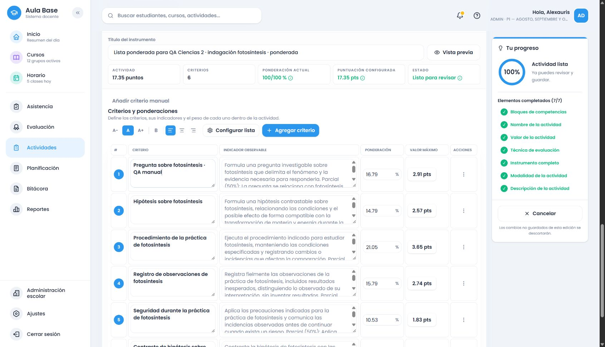

# Ciencias de la Naturaleza común: 2.º de secundaria

Estado: bloque de2.º verificado en Development, catálogo `evaluation-2026.87`. Commit y push del bloque: consultar el commit que contiene este informe; no duplicarlos al reanudar. 3.º–6.º continúan pendientes.

## Fuente y cobertura

MINERD, Adecuación Curricular del Nivel Secundario2023, PDF296–299 / impresas295–298. Se inspeccionaron visualmente las cuatro páginas, las columnas de conceptos/procedimientos, sus continuaciones y los indicadores separados. El componente es **Ciencias de la Vida** dentro de Ciencias de la Naturaleza común; no una optativa independiente.

La matriz conserva literalmente145registros y7relaciones; los criterios son adaptaciones evaluativas AulaBase. Fuente Development `MINERD_SECUNDARIA_2023_NAT_COMUN_G2_V1`, versión `92ffa3d0-96a6-5d35-bcd2-b90cec35f014`, scope `2806efe2-03f8-53e8-b537-c2d07937e708`. Primera instalaciónCREATED; segundaUNCHANGED, con81snapshots conservados. Sin migraciones de esquema ni producción.

Se conectan30grupos: bioelementos, organización de la materia viva, células, mitosis, tejidos/órganos/sistemas, fotosíntesis, metabolismo/enzimas, desnaturalización, principios físicos de sistemas biológicos, genes, ADN/ARN, Mendel, enfermedades hereditarias, ingeniería genética, reproducción, aparatos reproductores/hormonas, embarazo, evolución, metamorfosis, biodiversidad, ecosistemas, cadenas/energía, biotecnología, recursos naturales, contaminación, clima, inmunidad, nutrición, infecciones e higiene.

Las68consignas definidas conectan explicación, observación, identificación, comparación/clasificación, secuencia, interpretación de datos/modelos, ejercicios cualitativos o numéricos expresos, preguntas/hipótesis, práctica, fuentes, informe, representación, debate, exposición y proyecto según lo solicitado. No se impone ese menú completo a cada tema. Los cinco registros sin tema específico son encabezados o menús generales de procesos; sus acciones se combinan con el contenido concreto, sin convertirlos en tareas adicionales.

## Cambios y revisión

Proveedor `packages/shared/src/secondary-science-grade-2.ts`, integrado en el motor común y la alternativa local. Catálogo87 incorpora2.º y congela86 para preservar releases anteriores. La antigua prueba parcial de células sigue cubierta; la versión86 conserva sus cinco criterios históricos, mientras el proveedor actual distingue lo realmente pedido.

Se revisaron los272instrumentos generados mediante lectura completa de las vistas de rúbrica y sus progresiones, más inspección de las transformaciones de cotejo, escala de logro y ponderada. Ejemplos completos: [instrumentos](../../curriculum/cobertura-secundaria/ciencias-naturaleza-2-instrumentos.json). La revisión y sus límites están en [revisión](../../curriculum/cobertura-secundaria/ciencias-naturaleza-2-revision.json).

La revisión detectó y corrigió participios de recursos proporcionados que parecían órdenes («representados», «elaborado»), duplicación de flujo energético como otra dimensión general de ecosistemas y una alteración inmunitaria exigida al pedir solamente la función de defensa. Los tres casos fallaron antes de corregir y luego pasaron. También se separaron explicación de partes/funciones de producir dibujos, secuencias de interpretación general, ejercicios hereditarios cualitativos de cálculos y datos registrados de datos proporcionados. No se añaden diagnósticos personales, cultivos, materiales, destreza artística ni exigencia de confirmar hipótesis.

## Verificación final

- Backend completo:41.710pruebas aprobadas; build aprobado. El contrato antiguo de exposición sobre biodiversidad se actualizó para el proveedor específico: una consigna breve no exige cuatro filas de relleno.
- Frontend completo:42.139pruebas/130archivos aprobados. Builds backend/frontend/Cloudflare aprobados; Cloudflare únicamente `--dry-run`, sin despliegue. Backend41.710pruebas/103archivos.
- HTTP/DB autenticado con cuentaQA: cuatro formatos20/17.35, edición manual, completar/añadir, identidad/snapshot, guardado/reapertura y estrategia exclusiva exacta aprobados. Recheck final de los cuatro y cuatro controles semánticos aprobados; regresionesFRA/ING/MAT con fuentes aisladas aprobadas. Lengua Española conserva su cobertura de regresiones automáticas; no se creó un recorrido HTTP adicional de esa asignatura en este bloque.
- Navegador real, sesión personalDevelopment, contextoNAT-VIDA/2.º comprobado también enDB: cuatro formatos generados, editados, guardados y reabiertos con igualdad de todos los campos de las tablas. Rúbrica2filas(células), cotejo2(mitosis), escala3(práctica de enzimas) y ponderada6(indagación de fotosíntesis). Puntaje inicialmente vacío, reparto20/17.35, cuatro selectores visibles y preparación silenciosa. Se completó un descriptor vacío conservando título manual compatible y puntos; se repuso solo el candidato faltante de mitosis tras confirmar redistribución y se comprobó el aviso de agotamiento. Una reformulación manual no reconocida como equivalente no se completó automáticamente; se conservó y pudo editarse, sin asignarle otro objetivo por identidad.
- Estrategia: sin forzar en las consignas breves;INQUIRY automática con pregunta/hipótesis/práctica/contraste. CASE_STUDY manual conservó exactamente textos y pesos tanto en rúbrica como en ponderada. No se añadieron roles a la modalidad grupal.
- Identidades visuales: rúbrica `c3c05136-92dc-47b7-973c-feae7e37d8f3`; cotejo `e84ef930-b6b1-40b2-a3b0-73721aebc323`; escala `dd0d88d9-41a8-4676-9f0e-df418bab6e35`; ponderada `5bedc024-b7b2-495c-b7dc-9b8b4a386672`. DB confirmó instrumentos/snapshots distintos, catálogo87 y fuente/scope2.º para los cuatro. [Evidencia resumida](2026-10-16-ciencias-naturaleza-2-verificacion.json).
- Conservación:19releases/81snapshots anteriores a2.º mantienen las huellas completas, incluidos los de1.º. Resultado20releases/89snapshots;8actividadesQA nuevas (4HTTP+4visuales). También siguen intactos los18releases/73snapshots de la línea inicial. No se modificaron cuentas ni borradores anteriores.
- Runtime: PostgreSQL `app_backend_local` sin bypass, Auth/Storage200, variables públicas exclusivamenteDevelopment `eolgunypmtgrsyrjzcld`. Entrada `/assets/index-CpR7JjpD.js` igual en build/HTTP/DOM; assets y `sw.js` iguales porSHA256. No se borró caché ni almacenamiento. No se inspeccionaron todas las registraciones privadas del service worker.
- Sin cambios en esquema, migraciones, producción, Hyperdrive remoto ni despliegue. Secretos/respaldos/credencialesQA excluidos y contenido del diff auditado antes de publicar. Mensaje de commit en español y push normal en la rama actual, sin main.

No se garantiza interpretar cualquier redacción. Los criterios generales de comparación se ciñen a características científicas solicitadas, sin imponer una tabla. Salud se evalúa mediante fuentes o casos ficticios, sin prescripciones. 3.º–6.º y las optativas no están cubiertos por este bloque.

La primera muestra HTTP de recomendación midió6906/6940/9928/9542ms; las cuatro recomendaciones del recheck6816/6992/8078/6801ms. Hubo pruebas de navegador concurrentes en la primera muestra; no es un benchmark aislado. Las duraciones del Worker observadas son cercanas al totalHTTP y las lecturas de contexto también tardan segundos; no se atribuye esa latencia a la generación determinista ni se oculta con banners/timeouts. No se separó el tiempo de PostgreSQL, Auth, red y renderizado. En la UI se observaron cotas superiores de12.345ms(células) y11.909ms(escala), no instantes exactos de finalización.

