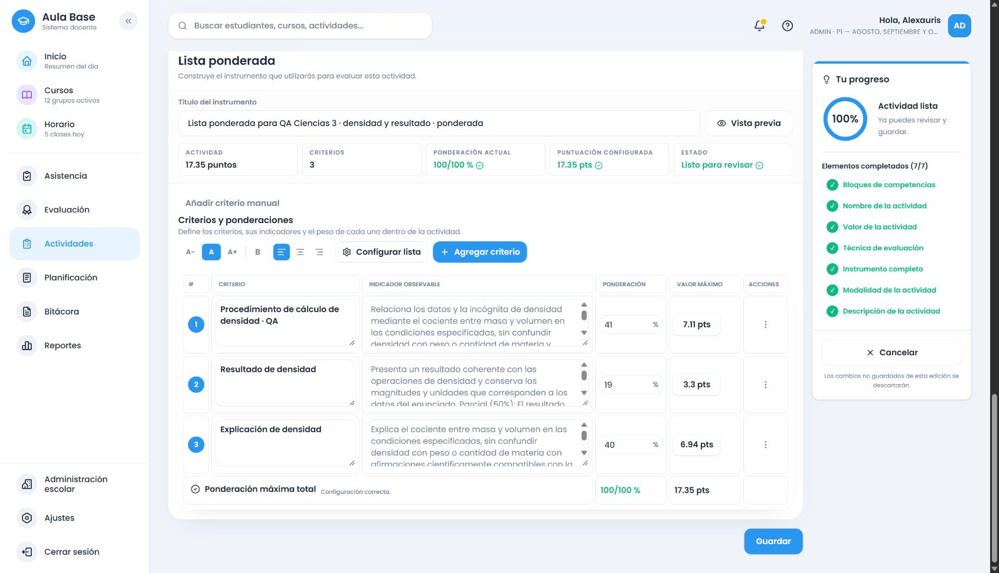

# Ciencias de la Naturaleza común: 3.º de secundaria

Estado: bloque de3.º verificado en Development, catálogo `evaluation-2026.88`. Este informe acompaña su commit de cierre; consultar Git para confirmar hash/push y evitar duplicarlos. La latencia del entorno sigue como limitación real. 4.º–6.º tienen inventario, todavía sin proveedor conectado.

## Fuente y alcance

MINERD2023, PDF300–304 / impresas299–303, componente **Ciencias Físicas** de Ciencias de la Naturaleza común. Se inspeccionaron visualmente las tablas, columnas, continuaciones y los indicadores separados de304. Fuente `MINERD_SECUNDARIA_2023_NAT_COMUN_G3_V1`, versión `3c6e1038-a19e-5d75-ae8f-ff8191ff7afd`, scope `096a33fc-0b8a-5ffc-9365-61f5cecfec9a`:207registros y7relaciones, instalados exclusivamente en Development. No se hicieron migraciones de esquema.

Se conectan50grupos: naturaleza de la ciencia y medición; posición/trayectoria, velocidad/rapidez, aceleración, fuerzas, gravitación, choques, máquinas; mezclas/separación/cambios, energía mecánica/térmica/solar/conservación, estados, presión/densidad/fluidos, propiedades, calor/temperatura/gas ideal/capilaridad/ósmosis, energía y sistemas biológicos; átomos/isótopos/tabla/enlaces/reacciones/enzimas/soluciones/pH; ondas/fenómenos/sonido/óptica/colores/radiación; cargas/corriente/circuitos/bioelectricidad/seguridad, ambiente, alimentos/medicamentos, tecnología y movimiento natural. La matriz mantiene los textos oficiales separados de las adaptaciones evaluativas. Solo queda sin tema específico el encabezado general de indagación, un menú de procesos que no constituye otra tarea.

Las103consignas definidas conectan las acciones apropiadas a cada contenido;412instrumentos completos de ejemplo están en [el artefacto por grado](../../curriculum/cobertura-secundaria/ciencias-naturaleza-3-instrumentos.json). No se presenta ese conjunto como una lista didáctica exhaustiva ni como rúbricas oficiales.

## Cambios y revisión

Proveedor compartido `secondary-science-grade-3.ts`, catálogo88 y87 congelado. La revisión leyó las evidencias y formulaciones de progresión por bloques secuenciales y comprobó las transformaciones de cotejo, escala de logro y ponderada, especialmente construcción y precauciones de circuitos. Se fortalecieron las comparaciones con la relación científica solicitada, manteniendo las fuentes/snapshots anteriores.

Correcciones verificadas con casos rojos antes del arreglo: interpretar un circuito construido no construye otro; construir un dispositivo y diseñar una escala tienen dimensiones observables sin imponer experimentos; medir no equivale a describir; gráficas femeninas se interpretan como datos; mezclas de luz no son mezclas de sustancias; clasificar mezclas no duplica la categoría soluciones; señales no significa señalar; un circuito de apoyo no exige otra explicación; conservación energética no obliga a proponer eficiencia. Las ondas longitudinales/transversales se comparan por orientación de oscilación/propagación y las radiaciones por capacidad de ionización. Densidad, rapidez media, aceleración y cantidad de movimiento explicitan sus relaciones matemáticas, sin inventar valores.

No se introducen materiales, riesgos, prácticas clínicas, arte, roles grupales ni exigencia de confirmar hipótesis. Las aplicaciones médicas se estudian mediante fuentes/modelos, sin diagnósticos ni intervenciones.

## Verificación final

- Backend final tras corregir radar:42.543pruebas/104archivos aprobados. Frontend focalizado:1.932pruebas de paridad/scoring/edición de1.º–3.º y ciclo del creador, incluida respuesta obsoleta durante transición densidad→circuitos. Buildsbackend/frontend/Cloudflare repetidos y aprobados; Cloudflare solo dry-run. La última suite completa del frontend fue42.139/130 al cerrar2.º; el cierre3.º ejecutó las comprobaciones afectadas.
- Fuente3 y release88:CREATED→UNCHANGED. HTTP/DBQA: cuatro formatos editados, guardados y reabiertos con snapshot/fuente correctos, puntuación pendiente/20/17.35 y estrategia exclusiva exacta. Recheck final4+controles semánticos5+regresionesFRA/ING/MAT y Ciencias1/2 aprobados, incluido radar con ondas electromagnéticas. No se repitieron creaciones al reanudar: se usaron checkpoints e identidades.
- Navegador real con la sesión personalDevelopment(Alexauris),NAT-FISICAS/3.º comprobado enDB: rúbrica6filas de indagación sobre capilaridad, cotejo2 de construcción/precauciones de circuito, escala3 de regularidad en práctica de medición y ponderada3 de cálculo/resultado/explicación de densidad. Generación, edición, guardado y reapertura con igualdad de todos los campos de las cuatro tablas. Cuatro selectores visibles desde vacío, puntaje inicialmente vacío, reparto exacto20/17.35 y preparación silenciosa.
- Completar rellenó solo un descriptor vacío, conservando el título manual compatible y los puntos. Añadir repuso únicamente el criterio faltante del borradorQA, conservó la fila manual y pidió confirmar redistribución. Agotamiento mostró aviso y opción manual. INQUIRY automática solo con pregunta/hipótesis/práctica/contraste; el cálculo grupal no forzó estrategia. CASE_STUDY manual mantuvo exactamente instrumento, textos y pesos en rúbrica y ponderada. Pesos finales41/19/40; puntos7.11/3.30/6.94, total17.35.
- Identidades visuales: rúbrica `d2d42e85-0e69-451c-90d9-916a3c8928bc`; cotejo `753cbbff-2b04-408c-9f42-b70d610c98a8`; escala `04fc0acb-efbc-486c-b71f-13d73ebac70b`; ponderada `18721be9-b265-43b5-a06b-138f7781831c`. DB confirmó instrumentos/snapshots distintos, catálogo88 y fuente/scope3.º para los cuatro. [Evidencia resumida](2026-10-16-ciencias-naturaleza-3-verificacion.json).
- Conservación:20releases/89snapshots anteriores a3.º mantienen huellas completas; resultado21/97,8QA nuevos(4HTTP+4visuales). También permanecen los18releases/73snapshots iniciales. Sin cambios en cuentas, borradores previos o datos de producción.
- Runtime final: Development exclusivo `eolgunypmtgrsyrjzcld`, PostgreSQL `app_backend_local` sin bypass, Auth/Storage200 y variables públicasDev. Entrada `/assets/index-DlUYCCST.js` igual en dist/HTTP/DOM; assets y `sw.js` porSHA256. No se borró almacenamiento/caché ni se auditó toda la registración privadaSW.
- Diff y material publicable revisados; secretos, respaldos, credencialesQA y logs privados excluidos. Sin migraciones de esquema, cambios de producción, Hyperdrive remoto, despliegue ni main. Commit español/push normal del bloque, confirmado mediante Git al publicarlo.

Patrones deterministas definidos; no toda redacción imaginable. La precisión de cada evidencia depende del caso, diseño o datos que proporciona el docente. 4.º–6.º, optativas y otras asignaturas quedan fuera de este bloque.

La revisión adicional distinguió radar(ondas electromagnéticas) de sonar(ondas mecánicas), aunque el currículo los agrupa como sistemas de localización. Se corrigió el foco de interpretación y se repitieron las comprobaciones. Los payloads del catálogo y snapshots existentes permanecen intactos.

Durante la reapertura con el build final apareció un timeout real de contexto: `activities/center` devolvió200 en24.578ms, después del límite del cliente; el recheck final registró recomendaciones de19.9–31.8s y un500 por `Connection terminated due to connection timeout`, reintentado mediante la recuperación existente. No se aumentaron límites ni se borró almacenamiento. Diagnóstico de solo lectura medianteNode: conexión/primera consulta2611,86ms, siguiente ida y vuelta151,46ms, una sesión activa y seis inactivas del rol local, sin esperas de bloqueo observadas. Esto no aísla la causa del trayectoWorker/PostgreSQL ni demuestra una saturación de la base.

Recuperación observada: después de terminar el recheck, se reinició únicamente el árbol local deWrangler comprobado y se usó «Reintentar contexto». El creador volvió a cargar (center14.302ms); escala generada en el Worker16.207ms y guardada correctamente, sin repetir elPOST. El recheck final con la corrección de radar aprobó los cinco controles semánticos y todas las regresiones. La latencia sigue elevada: el reinicio permitió seguir las pruebas y no demuestra resuelta su causa.

Durante las esperas se completó la lectura visual independiente de las fuentes4.º–6.º(Biología/Química/Física), sin conectarlas ni instalarlas. La matriz las conserva comoNOT_IMPLEMENTED. Sus referenciasP1–P6 describen procesos, no grados. Las erratas de indicadores se mantienen literalmente y no cambian la atribución del encabezado.

Medición complementaria final:200recomendaciones puras con contexto sintético y cuatro formatos, tras20calentamientos, mediana0,4882ms/p950,755ms/máximo1,1489ms. ExcluyeAuth/DB/HTTP/render y no mide toda la ejecución del servidor. Muestra HTTP inicial9293/10549/6267/6676ms, con actividad de navegador concurrente. La diferencia sitúa la espera fuera de esa porción puramente determinista, sin aislar qué parte corresponde a red, consultas o resto del servidor. No se cambiaron timeouts ni se añadieron anuncios de preparación.

