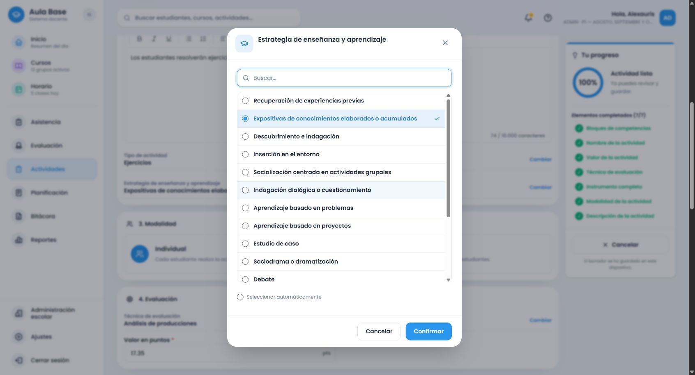
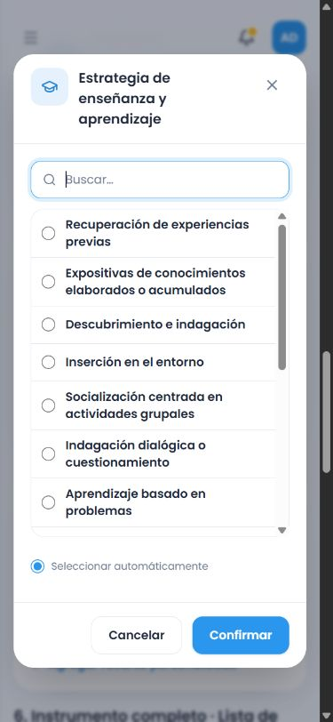
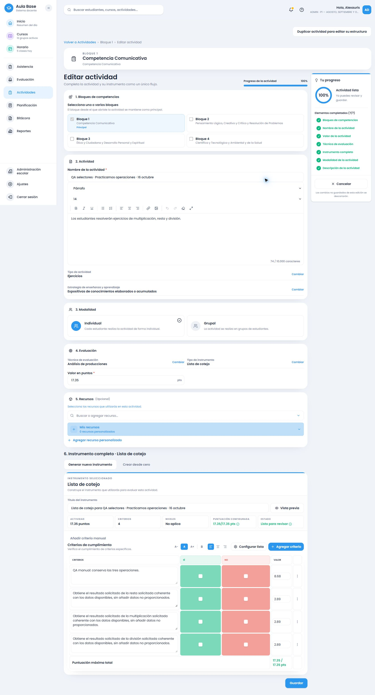

# Selectores del creador y pertinencia matemática

## Alcance

Rama `amplia-instrumentos-secundaria`, base `87c6224654cc56019f06821c9dc886ecadb5c1dd`. Se trabaja exclusivamente con AulaBase Development (`eolgunypmtgrsyrjzcld`). Sin despliegue, merge, ampliación de asignaturas, migraciones, cambios de esquema ni operaciones en producción.

## Interfaz

La referencia se inspeccionó en la aplicación real: Cursos → 1.º de secundaria → Agregar asignatura. Componente: `apps/frontend/src/modules/courses/components/SubjectAssignmentForm.tsx`. Se reutilizan `Modal`, `Input`, `Button`, el listado con selección azul, búsqueda, desplazamiento y el pie de acciones. No se modifica el modal de asignaturas.

`ActivitySelectionField.tsx` presenta etiqueta, valor completo y Cambiar/Seleccionar en una fila compacta. Se sustituyen los cuatro controles existentes, sin duplicar estrategia: tipo/estrategia después de descripción; técnica/instrumento en Evaluación con puntos. Permanecen presentes desde el formulario vacío. El instrumento ofrece los cuatro formatos; los demás catálogos conservan sus filtros académicos. La opción automática queda dentro del diálogo, sin anuncios de preparación.

La elección provisional se inicializa al abrir y no se sincroniza con recomendaciones que lleguen después. Solo Confirmar invoca el controlador vigente. Cancelar, Escape y Cerrar descartan elección y búsqueda y devuelven el foco al control. Se usan radios nativos para navegación por teclado, búsqueda inicial y listado desplazable. Las protecciones de conservar/adaptar/cancelar y los modelos persistidos se mantienen.

Se corrigió un fallo adicional demostrado mediante prueba roja/verde: confirmar manualmente el formato que ya estaba sugerido retornaba antes de registrar el origen manual. Ahora cambia solo el origen, sin regenerar el instrumento; actividad y técnica también registran esa prioridad cuando el valor coincide.

La revisión real en móvil encontró que el `fieldset` con desplazamiento podía dibujar filas encima de las acciones. El desplazamiento se trasladó a su contenedor para que recorte correctamente. La comprobación del retorno automático con “Conservar instrumento” también encontró un tipo vacío: se resuelve ahora el tipo de la descripción vigente antes de conservar el instrumento y su fingerprint. Técnica tenía el mismo caso al regresar a automático con un instrumento preparado y ahora se resuelve con la consigna vigente. Las pruebas nuevas fallan antes de los cambios y pasan después; no se regenera ni se pierde contenido.

## Diagnóstico matemático confirmado

No está disponible la consigna original del incidente de diez criterios. El caso mínimo **no reprodujo esa rúbrica exacta**: produjo una lista ponderada con dos criterios. Las causas siguientes se comprobaron por separado:

1. El proveedor común reconocía conjuntos numéricos concretos, pero no las operaciones sin ese conjunto. El caso mínimo caía en `actionContentCriteria`, cuyo fallback solo recogía suma/resta: omitía multiplicación y división y perdía explicación/justificación.
2. Si la descripción no activaba un tema, `resolveCommonMathTask` heredaba el tema del título. Con título antiguo de temperatura y la misma consigna aritmética se generaban criterios de temperatura. Se demostró la contaminación desde el título; no se atribuye sin evidencia a un borrador personal concreto.
3. Las rutas genéricas no utilizaban el propósito matemático para recomendar: explicar seguía dando ponderada y justificar métodos podía dar cotejo.
4. La revisión de instrumentos completos mostró que el tema temperatura imponía la relación con un termómetro incluso al resolver un problema sin pedir su lectura. Ahora solo exige ese recurso cuando aparece explícitamente. La variante explícita de termómetro conserva su contenido.

El proveedor elige una sola rama de criterios contextualizados; no se comprobó una mezcla de proveedores ni relleno genérico añadido a esa rama. La recuperación curricular HTTP en catálogo84 confirmó los resultados del caso mínimo; sus instrumentos completos están preservados.

## Corrección y recomendación

Las operaciones explícitas de la descripción se resuelven como evidencia aritmética suficiente, sin inferir un conjunto numérico, contexto, unidades ni datos. Si existe un tema explícito compatible, se conserva. Los criterios representan las acciones solicitadas; explicar o justificar no obliga a ejecutar cálculos adicionales. La justificación de métodos y la autonomía observada tienen descriptores correspondientes a ese propósito.

| Propósito comprobado | Recomendación |
| --- | --- |
| Resolver operaciones y comprobar procedimiento/resultados | Lista de cotejo |
| Resolver y explicar, o justificar métodos | Rúbrica |
| Puntos/pesos o crédito parcial explícitos | Lista ponderada |
| Grado/frecuencia observados con fundamento | Escala estimativa |

La elección explícita del docente prevalece. No se impone variedad artificial ni un límite de cinco criterios. El cotejo puede separar resultados de operaciones independientes; los formatos progresivos conservan sus descriptores. Los totales y pesos siguen el cálculo en centésimas existente.

## Instrumentos íntegros antes/después

- [Servicio puro y alternativa local antes](2026-10-16-operaciones-before.json): nueve variantes, cuatro formatos, criterios, progresiones, descriptores y puntuaciones completos.
- [Servicio puro y alternativa local después](2026-10-16-operaciones-after.json): mismas variantes y formatos, con la corrección compartida.
- [HTTP anterior, catálogo84](2026-10-16-operaciones-http-before.json): ocho variantes completas con el contexto curricular real QA de Development. La novena quedó interrumpida por HTTP503 y terminación del servidor local con `ECONNRESET`; no se mezcla con evidencia posterior.
- [HTTP posterior, catálogo85](2026-10-16-operaciones-http-after.json): nueve variantes y sus cuatro formatos, con comparación íntegra contra la alternativa local y selección por propósito. Todas las respuestas coinciden.

Variantes: consigna mínima, explicación, métodos, pesos, problema explícito de temperatura, título neutral, título incompatible, título antiguo de temperatura y autonomía observada. Los JSON incluyen el contenido completo para revisar pertinencia, no solo conteos o sumas.

## Catálogo y conservación

Catálogo84 congelado desde el backend compilado antes de cambiar contenido. Nueva versión `evaluation-2026.85`; instalación exclusiva en Development con resultado `CREATED`, después `UNCHANGED`. Se comprobaron iguales los hashes de los **17 catálogos y 72 snapshots** anteriores. No se modifica una migración, cuenta o tabla remota.

## Verificación final

Evidencia consolidada sin credenciales: [verificación del entorno, builds y reapertura](2026-10-16-selectores-verificacion.json).

| Comprobación | Resultado |
| --- | --- |
| `pnpm --filter backend test` | 100 archivos, 40.589 pruebas aprobadas |
| `pnpm --filter backend build` | Salida0 |
| `pnpm --filter frontend test` | 129 archivos, 41.046 pruebas aprobadas |
| Regresión adicional de transición temperatura→operaciones | 14 pruebas del ciclo de preparación aprobadas; incluye cambio de descripción con título antiguo |
| `pnpm --filter frontend build` | Salida0, repetido con ajustes finales |
| `pnpm cloudflare:build` | Salida0, repetido con ajustes finales; dry-run, sin desplegar |
| HTTP de recomendaciones en Development | Nueve variantes × cuatro formatos; paridad íntegra local/servidor |
| Catálogo85, repetición final | `UNCHANGED` / `UNCHANGED`; 18 releases y73 snapshots conservados |

La revisión incluyó criterios, niveles y descriptores completos de los cuatro formatos: procedimiento y resultados de las operaciones, explicación solo cuando se solicita, justificación de métodos, crédito parcial, temperatura sin termómetro supuesto y autonomía con apoyos graduados. No hay valores ni productos inventados. Las pruebas mantienen las comprobaciones de 20/17.35, capacidad20, completar huecos, añadir sin duplicar, agotamiento/manual, respuestas obsoletas y regresiones de Lengua Española, Inglés y Francés. La prueba adicional con estado del creador prepara primero temperatura y luego cambia solo la descripción a operaciones; la segunda preparación elimina temperatura aunque se conserve el título anterior. Typecheck final aprobado después de añadir esta prueba.

### Runtime efectivo

`localhost:8787` usa exclusivamente `eolgunypmtgrsyrjzcld`: PostgreSQL con `app_backend_local`, sin BYPASSRLS; Auth200, Storage200 y claves públicas Development. Entrada final `/assets/index-DcKmj8JH.js`; entrada, módulos de actividad y `sw.js` coinciden por SHA256 con `dist`. El verificador HTTP no inspecciona las registraciones ni toda la caché privada del navegador; no se borraron datos ni se desregistró un service worker. El comportamiento nuevo se verificó en una pestaña real nueva.

### Navegador y persistencia

Se probó con la sesión personal Development, además del contexto QA HTTP. Los cuatro campos están visibles sin título/descripción y con puntos vacíos. Después de introducir la consigna mínima se muestran Ejercicios, Análisis de producciones, ninguna estrategia sin evidencia y cotejo completo de4criterios.

Se probaron los cuatro modales, búsquedas, selección provisional, cancelación/cierre/Escape, selección manual y retorno automático. Una selección provisional Análisis se mantuvo mientras la recomendación externa cambió a Ejercicios. Cambiar estrategia conservó idéntica la tabla completa. Cancelar el cambio de formato tras editar manualmente conservó idénticos textos/puntos y el selector; confirmar el reemplazo generó una rúbrica de2criterios con17.35. Regresar a automático recuperó cotejo. Actividad manual→automática con Conservar conserva instrumento y muestra Ejercicios; técnica automática muestra Análisis de producciones.

Móvil390×844: búsqueda inicial enfocada, navegación por Tab/flechas, selección por teclado, foco devuelto, lista interna383px frente a780px de contenido, sin filas sobre el pie. El valor largo se lee completo en varias líneas. El control corto medido ocupa52.67px frente a64px del antiguo campo con etiqueta; no se añadieron cuatro tarjetas. Se restableció el viewport al terminar.

La actividad identificable `QA selectores · Practicamos operaciones · 16 octubre` se guardó una única vez desde resumen/Confirmar y guardar: ID `caf5d55f-0ff2-4f61-b272-1bdc9f46a8f6`, snapshot `e736c5db-788f-4a38-84ef-457f04388149`, 17.35 puntos, cotejo de4criterios, estrategia `EXPOSITORY` manual y criterio manual conservado. Se abrió desde Actividades y su visor de solo lectura muestra la estrategia y las cuatro filas completas. Consulta DB de solo lectura: exactamente una coincidencia, catálogo85 y contenido manual correcto. Se reabrió también el editor: comparación campo por campo de todas las filas y puntuaciones **idéntica**, estrategia conservada y valor17.35.

La recuperación normal mediante Borradores→Continuar conservó el borrador QA y los personales visibles. No se modificó el borrador personal de Francés. Durante las recompilaciones una pestaña anterior falló al navegar por assets reemplazados; se abrió una pestaña nueva y se recuperó el mismo borrador, sin limpieza de almacenamiento.

## Archivos y revisión

Interfaz: `ActivitySelectionField.tsx`, `TeachingStrategyField.tsx`, `ActivityDataSections.tsx`, `ActivityCreationView.tsx`. Matemática: `secondary-math-common.ts`, traza en `recommendation-engine.ts`, versión en `catalog-current.ts` y congelado `catalog-v84.ts`. Se actualizan pruebas de los consumidores reales (Actividades, Evaluación, Planificación), se añaden contratos de operaciones y los scripts/artefactos de comparación reproducible. Plan, informe y continuación registran la intervención.

Revisión realizada en línea, sin subagentes: callbacks vigentes, selección provisional, manual/automático, cancelación estructural, scoring, paridad compartida y persistencia. Sin dependencias nuevas ni migraciones. Revisión UTF8 y caracteres de control aprobada; los PNG se inspeccionaron visualmente. Escaneo sin coincidencias con secretos o credenciales QA; `.dev.vars.local`, cuentas/contextosQA, logs, respaldos y `.wrangler` permanecen excluidos.

## Límites y cierre de Git

La consigna original del incidente no está disponible: se informa la reproducción mínima y las causas demostradas, no una reproducción exacta. No se realizó auditoría general de cachés privadas ni ampliación curricular. Los snapshots anteriores se conservaron; se añadió únicamente el snapshot de la actividad QA de esta intervención.

Rama `amplia-instrumentos-secundaria`. Mensaje del commit de esta intervención: «Mejora selectores y corrige pertinencia de instrumentos matemáticos». El hash final, resultado del push normal y comprobación del árbol se entregan en el mensaje de cierre, después de ejecutar esas operaciones. No hay merge ni despliegue. No queda trabajo curricular autorizado que continuar en esta intervención.
